# Canvas items

A shader of `shader_type canvas_item` draws a 2D item. Godot links it into its canvas template, `canvas.glsl`, in the variant of the item's draw: a rect, a nine-patch, a primitive or a mesh with attributes, and the primitive and the mesh again as points. `transpileCanvasItem(text)` links the shader once, and `draw(variant)` gives the material of each variant, with its own uniforms and textures. Godot's default canvas shader, `DEFAULT_CANVAS_SHADER`, is the text with empty slots that draws an item with no material.

Each draw reads the item's transform, its final modulate and the render target's colour mode as a `CanvasItemDraw`. `writeCanvasBindings(draw, frame)` writes the template's `CanvasData` block from the render target's size, the canvas transform, the CanvasModulate colour, the time, the pixel snap and the colour mode. `CANVAS_BINDINGS` names the line of Godot's C++ behind each one. `CanvasTextureBinding` binds the item's texture with the item's filter and repeat, or Godot's white default texture, and returns the texel size it writes. Each draw is one pass with Godot's mix blend, no cull and no depth.

A rect and a nine-patch draw as Godot's quad batch does. `textureRectRegion(rect, source, modulate, { transpose, clipUv })` is the rect command of `draw_texture_rect_region`: a negative size flips that axis. `rectInstanceData(command, item, texelSize)` and `ninePatchInstanceData(command, item, texelSize)` write Godot's 128-byte `InstanceData` record. `quadBatchGeometry(records)` gives the instanced quad that reads each record as the attributes `attrib_A` to `attrib_H`.

A primitive of `draw_primitive` draws as Godot's primitive batch does. `primitiveCommand(points, colors, uvs)` repeats the first colour for a point with none. `primitiveInstanceData(command, item)` writes one record for a point, a line or a triangle, and two for a quad, with each colour in half floats. `primitiveDraw(pointCount)` names the variant and the primitive, and `primitiveBatchGeometry(records, pointCount)` gives the geometry. `primitiveObject(primitive, geometry, material)` gives the three.js object that draws it: points, lines, a line strip, triangles or a triangle strip.

A polygon and a mesh surface draw through the attributes variant, one draw each. `polygonCommand(points, colors, uvs)` cuts an outline into triangles, as `draw_polygon` does, and `triangleArrayCommand(indices, points, colors, uvs)` takes the triangles of a Polygon2D. `attributesGeometry(arrays)` writes the vertex arrays, with Godot's default white colour and zero UV for a missing array. `polygonConstants(item)` and `meshConstants(item, { transform, modulate })` give the push constants, and `attributesObject(draw, geometry, primitive, constants)` writes them before each draw of the object.

A viewport with `use_hdr_2d` keeps colours linear. Set `usesLinearColors` on the frame, the item and the texture state: the template then turns the vertex colours linear, Godot's C++ turns the modulate colours linear, and the texture reads through its sRGB view. Without it, the texels and the colours reach the frame as they are stored. A user's `canvas_item` shader and 2D lights do not draw yet, and their rows stay open with their issues.

Godot 4.6.3-stable (official), probed on llvmpipe (LLVM 20.1.2). Each table shows at most 8 of a probe's rows, picked to show as many mixes of zero, subnormal, normal, infinite and NaN values as fit. The real-GL test (`pnpm test:shaders:gpu`) checks every row, bit for bit, NaN lanes compared as NaN. Generated by `pnpm godot:shader-language`: do not edit by hand.

## Showcase `canvas-rect-texture`

Godot draws the scene's rects on a Node2D of a 2D view, with no material, so Godot's default canvas shader draws it (`tests/e2e/canvasScenes.mjs`). A plain three.js page draws the same commands through the transpiled canvas template with the same values. `pnpm test:shaders:e2e` draws both again and fails on any pixel over 2/255 apart.

```glsl
shader_type canvas_item;
```

| Godot | Transpilation on three.js |
| --- | --- |
|  |  |

## Showcase `canvas-rect-region`

Godot draws the scene's rects on a Node2D of a 2D view, with no material, so Godot's default canvas shader draws it (`tests/e2e/canvasScenes.mjs`). A plain three.js page draws the same commands through the transpiled canvas template with the same values. `pnpm test:shaders:e2e` draws both again and fails on any pixel over 2/255 apart.

```glsl
shader_type canvas_item;
```

| Godot | Transpilation on three.js |
| --- | --- |
|  |  |

## Showcase `canvas-rect-flip-h`

Godot draws the scene's rects on a Node2D of a 2D view, with no material, so Godot's default canvas shader draws it (`tests/e2e/canvasScenes.mjs`). A plain three.js page draws the same commands through the transpiled canvas template with the same values. `pnpm test:shaders:e2e` draws both again and fails on any pixel over 2/255 apart.

```glsl
shader_type canvas_item;
```

| Godot | Transpilation on three.js |
| --- | --- |
|  |  |

## Showcase `canvas-rect-flip-v`

Godot draws the scene's rects on a Node2D of a 2D view, with no material, so Godot's default canvas shader draws it (`tests/e2e/canvasScenes.mjs`). A plain three.js page draws the same commands through the transpiled canvas template with the same values. `pnpm test:shaders:e2e` draws both again and fails on any pixel over 2/255 apart.

```glsl
shader_type canvas_item;
```

| Godot | Transpilation on three.js |
| --- | --- |
|  |  |

## Showcase `canvas-rect-flip-source`

Godot draws the scene's rects on a Node2D of a 2D view, with no material, so Godot's default canvas shader draws it (`tests/e2e/canvasScenes.mjs`). A plain three.js page draws the same commands through the transpiled canvas template with the same values. `pnpm test:shaders:e2e` draws both again and fails on any pixel over 2/255 apart.

```glsl
shader_type canvas_item;
```

| Godot | Transpilation on three.js |
| --- | --- |
|  |  |

## Showcase `canvas-rect-transposed`

Godot draws the scene's rects on a Node2D of a 2D view, with no material, so Godot's default canvas shader draws it (`tests/e2e/canvasScenes.mjs`). A plain three.js page draws the same commands through the transpiled canvas template with the same values. `pnpm test:shaders:e2e` draws both again and fails on any pixel over 2/255 apart.

```glsl
shader_type canvas_item;
```

| Godot | Transpilation on three.js |
| --- | --- |
| 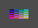 |  |

## Showcase `canvas-rect-modulate`

Godot draws the scene's rects on a Node2D of a 2D view, with no material, so Godot's default canvas shader draws it (`tests/e2e/canvasScenes.mjs`). A plain three.js page draws the same commands through the transpiled canvas template with the same values. `pnpm test:shaders:e2e` draws both again and fails on any pixel over 2/255 apart.

```glsl
shader_type canvas_item;
```

| Godot | Transpilation on three.js |
| --- | --- |
| 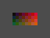 |  |

## Showcase `canvas-rect-modulate-over-1`

Godot draws the scene's rects on a Node2D of a 2D view, with no material, so Godot's default canvas shader draws it (`tests/e2e/canvasScenes.mjs`). A plain three.js page draws the same commands through the transpiled canvas template with the same values. `pnpm test:shaders:e2e` draws both again and fails on any pixel over 2/255 apart.

```glsl
shader_type canvas_item;
```

| Godot | Transpilation on three.js |
| --- | --- |
|  | 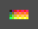 |

## Showcase `canvas-rect-modulate-alpha-0`

Godot draws the scene's rects on a Node2D of a 2D view, with no material, so Godot's default canvas shader draws it (`tests/e2e/canvasScenes.mjs`). A plain three.js page draws the same commands through the transpiled canvas template with the same values. `pnpm test:shaders:e2e` draws both again and fails on any pixel over 2/255 apart.

```glsl
shader_type canvas_item;
```

| Godot | Transpilation on three.js |
| --- | --- |
|  |  |

## Showcase `canvas-rect-self-modulate-alpha`

Godot draws the scene's rects on a Node2D of a 2D view, with no material, so Godot's default canvas shader draws it (`tests/e2e/canvasScenes.mjs`). A plain three.js page draws the same commands through the transpiled canvas template with the same values. `pnpm test:shaders:e2e` draws both again and fails on any pixel over 2/255 apart.

```glsl
shader_type canvas_item;
```

| Godot | Transpilation on three.js |
| --- | --- |
|  |  |

## Showcase `canvas-rect-blend-alpha`

Godot draws the scene's rects on a Node2D of a 2D view, with no material, so Godot's default canvas shader draws it (`tests/e2e/canvasScenes.mjs`). A plain three.js page draws the same commands through the transpiled canvas template with the same values. `pnpm test:shaders:e2e` draws both again and fails on any pixel over 2/255 apart.

```glsl
shader_type canvas_item;
```

| Godot | Transpilation on three.js |
| --- | --- |
|  |  |

## Showcase `canvas-rect-linear`

Godot draws the scene's rects on a Node2D of a 2D view, with no material, so Godot's default canvas shader draws it (`tests/e2e/canvasScenes.mjs`). A plain three.js page draws the same commands through the transpiled canvas template with the same values. `pnpm test:shaders:e2e` draws both again and fails on any pixel over 2/255 apart.

```glsl
shader_type canvas_item;
```

| Godot | Transpilation on three.js |
| --- | --- |
| 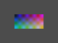 |  |

## Showcase `canvas-rect-linear-clip-uv`

Godot draws the scene's rects on a Node2D of a 2D view, with no material, so Godot's default canvas shader draws it (`tests/e2e/canvasScenes.mjs`). A plain three.js page draws the same commands through the transpiled canvas template with the same values. `pnpm test:shaders:e2e` draws both again and fails on any pixel over 2/255 apart.

```glsl
shader_type canvas_item;
```

| Godot | Transpilation on three.js |
| --- | --- |
|  |  |

## Showcase `canvas-rect-linear-no-clip`

Godot draws the scene's rects on a Node2D of a 2D view, with no material, so Godot's default canvas shader draws it (`tests/e2e/canvasScenes.mjs`). A plain three.js page draws the same commands through the transpiled canvas template with the same values. `pnpm test:shaders:e2e` draws both again and fails on any pixel over 2/255 apart.

```glsl
shader_type canvas_item;
```

| Godot | Transpilation on three.js |
| --- | --- |
|  |  |

## Showcase `canvas-rect-repeat`

Godot draws the scene's rects on a Node2D of a 2D view, with no material, so Godot's default canvas shader draws it (`tests/e2e/canvasScenes.mjs`). A plain three.js page draws the same commands through the transpiled canvas template with the same values. `pnpm test:shaders:e2e` draws both again and fails on any pixel over 2/255 apart.

```glsl
shader_type canvas_item;
```

| Godot | Transpilation on three.js |
| --- | --- |
|  |  |

## Showcase `canvas-rect-mirror`

Godot draws the scene's rects on a Node2D of a 2D view, with no material, so Godot's default canvas shader draws it (`tests/e2e/canvasScenes.mjs`). A plain three.js page draws the same commands through the transpiled canvas template with the same values. `pnpm test:shaders:e2e` draws both again and fails on any pixel over 2/255 apart.

```glsl
shader_type canvas_item;
```

| Godot | Transpilation on three.js |
| --- | --- |
|  | 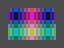 |

## Showcase `canvas-rect-clamp`

Godot draws the scene's rects on a Node2D of a 2D view, with no material, so Godot's default canvas shader draws it (`tests/e2e/canvasScenes.mjs`). A plain three.js page draws the same commands through the transpiled canvas template with the same values. `pnpm test:shaders:e2e` draws both again and fails on any pixel over 2/255 apart.

```glsl
shader_type canvas_item;
```

| Godot | Transpilation on three.js |
| --- | --- |
|  |  |

## Showcase `canvas-rect-rotated`

Godot draws the scene's rects on a Node2D of a 2D view, with no material, so Godot's default canvas shader draws it (`tests/e2e/canvasScenes.mjs`). A plain three.js page draws the same commands through the transpiled canvas template with the same values. `pnpm test:shaders:e2e` draws both again and fails on any pixel over 2/255 apart.

```glsl
shader_type canvas_item;
```

| Godot | Transpilation on three.js |
| --- | --- |
|  |  |

## Showcase `canvas-rect-rotated-linear`

Godot draws the scene's rects on a Node2D of a 2D view, with no material, so Godot's default canvas shader draws it (`tests/e2e/canvasScenes.mjs`). A plain three.js page draws the same commands through the transpiled canvas template with the same values. `pnpm test:shaders:e2e` draws both again and fails on any pixel over 2/255 apart.

```glsl
shader_type canvas_item;
```

| Godot | Transpilation on three.js |
| --- | --- |
|  |  |

## Showcase `canvas-rect-subpixel`

Godot draws the scene's rects on a Node2D of a 2D view, with no material, so Godot's default canvas shader draws it (`tests/e2e/canvasScenes.mjs`). A plain three.js page draws the same commands through the transpiled canvas template with the same values. `pnpm test:shaders:e2e` draws both again and fails on any pixel over 2/255 apart.

```glsl
shader_type canvas_item;
```

| Godot | Transpilation on three.js |
| --- | --- |
|  |  |

## Showcase `canvas-rect-subpixel-snapped`

Godot draws the scene's rects on a Node2D of a 2D view, with no material, so Godot's default canvas shader draws it (`tests/e2e/canvasScenes.mjs`). A plain three.js page draws the same commands through the transpiled canvas template with the same values. `pnpm test:shaders:e2e` draws both again and fails on any pixel over 2/255 apart.

```glsl
shader_type canvas_item;
```

| Godot | Transpilation on three.js |
| --- | --- |
|  |  |

## Showcase `canvas-rect-canvas-transform`

Godot draws the scene's rects on a Node2D of a 2D view, with no material, so Godot's default canvas shader draws it (`tests/e2e/canvasScenes.mjs`). A plain three.js page draws the same commands through the transpiled canvas template with the same values. `pnpm test:shaders:e2e` draws both again and fails on any pixel over 2/255 apart.

```glsl
shader_type canvas_item;
```

| Godot | Transpilation on three.js |
| --- | --- |
| 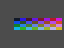 |  |

## Showcase `canvas-rect-canvas-modulate`

Godot draws the scene's rects on a Node2D of a 2D view, with no material, so Godot's default canvas shader draws it (`tests/e2e/canvasScenes.mjs`). A plain three.js page draws the same commands through the transpiled canvas template with the same values. `pnpm test:shaders:e2e` draws both again and fails on any pixel over 2/255 apart.

```glsl
shader_type canvas_item;
```

| Godot | Transpilation on three.js |
| --- | --- |
|  |  |

## Showcase `canvas-rect-batch`

Godot draws the scene's rects on a Node2D of a 2D view, with no material, so Godot's default canvas shader draws it (`tests/e2e/canvasScenes.mjs`). A plain three.js page draws the same commands through the transpiled canvas template with the same values. `pnpm test:shaders:e2e` draws both again and fails on any pixel over 2/255 apart.

```glsl
shader_type canvas_item;
```

| Godot | Transpilation on three.js |
| --- | --- |
|  |  |

## Showcase `canvas-primitive-points`

Godot draws the scene's `draw_primitive` calls on a Node2D of a 2D view, with no material, so Godot's default canvas shader draws it (`tests/e2e/canvasScenes.mjs`). A plain three.js page draws the same commands through the transpiled canvas template with the same values. `pnpm test:shaders:e2e` draws both again and fails on any pixel over 2/255 apart.

```glsl
shader_type canvas_item;
```

| Godot | Transpilation on three.js |
| --- | --- |
|  |  |

## Showcase `canvas-primitive-lines`

Godot draws the scene's `draw_primitive` calls on a Node2D of a 2D view, with no material, so Godot's default canvas shader draws it (`tests/e2e/canvasScenes.mjs`). A plain three.js page draws the same commands through the transpiled canvas template with the same values. `pnpm test:shaders:e2e` draws both again and fails on any pixel over 2/255 apart.

```glsl
shader_type canvas_item;
```

| Godot | Transpilation on three.js |
| --- | --- |
|  |  |

## Showcase `canvas-primitive-triangle`

Godot draws the scene's `draw_primitive` calls on a Node2D of a 2D view, with no material, so Godot's default canvas shader draws it (`tests/e2e/canvasScenes.mjs`). A plain three.js page draws the same commands through the transpiled canvas template with the same values. `pnpm test:shaders:e2e` draws both again and fails on any pixel over 2/255 apart.

```glsl
shader_type canvas_item;
```

| Godot | Transpilation on three.js |
| --- | --- |
|  | 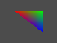 |

## Showcase `canvas-primitive-quad`

Godot draws the scene's `draw_primitive` calls on a Node2D of a 2D view, with no material, so Godot's default canvas shader draws it (`tests/e2e/canvasScenes.mjs`). A plain three.js page draws the same commands through the transpiled canvas template with the same values. `pnpm test:shaders:e2e` draws both again and fails on any pixel over 2/255 apart.

```glsl
shader_type canvas_item;
```

| Godot | Transpilation on three.js |
| --- | --- |
|  | 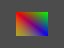 |

## Showcase `canvas-primitive-quad-textured`

Godot draws the scene's `draw_primitive` calls on a Node2D of a 2D view, with no material, so Godot's default canvas shader draws it (`tests/e2e/canvasScenes.mjs`). A plain three.js page draws the same commands through the transpiled canvas template with the same values. `pnpm test:shaders:e2e` draws both again and fails on any pixel over 2/255 apart.

```glsl
shader_type canvas_item;
```

| Godot | Transpilation on three.js |
| --- | --- |
|  |  |

## Showcase `canvas-primitive-modulate`

Godot draws the scene's `draw_primitive` calls on a Node2D of a 2D view, with no material, so Godot's default canvas shader draws it (`tests/e2e/canvasScenes.mjs`). A plain three.js page draws the same commands through the transpiled canvas template with the same values. `pnpm test:shaders:e2e` draws both again and fails on any pixel over 2/255 apart.

```glsl
shader_type canvas_item;
```

| Godot | Transpilation on three.js |
| --- | --- |
| 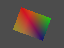 |  |

## Showcase `canvas-primitive-linear-canvas`

Godot draws the scene's `draw_primitive` calls on a Node2D of a 2D view with `use_hdr_2d`, whose image holds linear colours, with no material, so Godot's default canvas shader draws it (`tests/e2e/canvasScenes.mjs`). A plain three.js page draws the same commands through the transpiled canvas template with the same values. `pnpm test:shaders:e2e` draws both again and fails on any pixel over 2/255 apart.

```glsl
shader_type canvas_item;
```

| Godot | Transpilation on three.js |
| --- | --- |
|  | 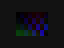 |

## Showcase `canvas-polygon-vertex-colors`

Godot draws a Polygon2D of a 2D view, with no material, so Godot's default canvas shader draws it (`tests/e2e/canvasScenes.mjs`). A plain three.js page draws the same commands through the transpiled canvas template with the same values. `pnpm test:shaders:e2e` draws both again and fails on any pixel over 2/255 apart.

```glsl
shader_type canvas_item;
```

| Godot | Transpilation on three.js |
| --- | --- |
|  | 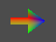 |

## Showcase `canvas-polygon-color`

Godot draws a Polygon2D of a 2D view, with no material, so Godot's default canvas shader draws it (`tests/e2e/canvasScenes.mjs`). A plain three.js page draws the same commands through the transpiled canvas template with the same values. `pnpm test:shaders:e2e` draws both again and fails on any pixel over 2/255 apart.

```glsl
shader_type canvas_item;
```

| Godot | Transpilation on three.js |
| --- | --- |
|  |  |

## Showcase `canvas-polygon-textured`

Godot draws a Polygon2D of a 2D view, with no material, so Godot's default canvas shader draws it (`tests/e2e/canvasScenes.mjs`). A plain three.js page draws the same commands through the transpiled canvas template with the same values. `pnpm test:shaders:e2e` draws both again and fails on any pixel over 2/255 apart.

```glsl
shader_type canvas_item;
```

| Godot | Transpilation on three.js |
| --- | --- |
|  |  |

## Showcase `canvas-polygon-textured-linear-filter`

Godot draws a Polygon2D of a 2D view, with no material, so Godot's default canvas shader draws it (`tests/e2e/canvasScenes.mjs`). A plain three.js page draws the same commands through the transpiled canvas template with the same values. `pnpm test:shaders:e2e` draws both again and fails on any pixel over 2/255 apart.

```glsl
shader_type canvas_item;
```

| Godot | Transpilation on three.js |
| --- | --- |
|  |  |

## Showcase `canvas-polygon-modulate`

Godot draws a Polygon2D of a 2D view, with no material, so Godot's default canvas shader draws it (`tests/e2e/canvasScenes.mjs`). A plain three.js page draws the same commands through the transpiled canvas template with the same values. `pnpm test:shaders:e2e` draws both again and fails on any pixel over 2/255 apart.

```glsl
shader_type canvas_item;
```

| Godot | Transpilation on three.js |
| --- | --- |
|  |  |

## Showcase `canvas-polygon-linear-canvas`

Godot draws a Polygon2D of a 2D view with `use_hdr_2d`, whose image holds linear colours, with no material, so Godot's default canvas shader draws it (`tests/e2e/canvasScenes.mjs`). A plain three.js page draws the same commands through the transpiled canvas template with the same values. `pnpm test:shaders:e2e` draws both again and fails on any pixel over 2/255 apart.

```glsl
shader_type canvas_item;
```

| Godot | Transpilation on three.js |
| --- | --- |
|  | 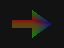 |

## Showcase `canvas-draw-polygon-one-color`

Godot draws the scene's `draw_polygon` call on a Node2D of a 2D view, with no material, so Godot's default canvas shader draws it (`tests/e2e/canvasScenes.mjs`). A plain three.js page draws the same commands through the transpiled canvas template with the same values. `pnpm test:shaders:e2e` draws both again and fails on any pixel over 2/255 apart.

```glsl
shader_type canvas_item;
```

| Godot | Transpilation on three.js |
| --- | --- |
|  |  |

## Showcase `canvas-draw-polygon-textured`

Godot draws the scene's `draw_polygon` call on a Node2D of a 2D view, with no material, so Godot's default canvas shader draws it (`tests/e2e/canvasScenes.mjs`). A plain three.js page draws the same commands through the transpiled canvas template with the same values. `pnpm test:shaders:e2e` draws both again and fails on any pixel over 2/255 apart.

```glsl
shader_type canvas_item;
```

| Godot | Transpilation on three.js |
| --- | --- |
|  |  |

## Showcase `canvas-mesh-triangles`

Godot draws an ArrayMesh of 2D vertices on a MeshInstance2D of a 2D view, with no material, so Godot's default canvas shader draws it (`tests/e2e/canvasScenes.mjs`). A plain three.js page draws the same commands through the transpiled canvas template with the same values. `pnpm test:shaders:e2e` draws both again and fails on any pixel over 2/255 apart.

```glsl
shader_type canvas_item;
```

| Godot | Transpilation on three.js |
| --- | --- |
|  |  |

## Showcase `canvas-mesh-textured`

Godot draws an ArrayMesh of 2D vertices on a MeshInstance2D of a 2D view, with no material, so Godot's default canvas shader draws it (`tests/e2e/canvasScenes.mjs`). A plain three.js page draws the same commands through the transpiled canvas template with the same values. `pnpm test:shaders:e2e` draws both again and fails on any pixel over 2/255 apart.

```glsl
shader_type canvas_item;
```

| Godot | Transpilation on three.js |
| --- | --- |
|  |  |

## Showcase `canvas-mesh-no-colors`

Godot draws an ArrayMesh of 2D vertices on a MeshInstance2D of a 2D view, with no material, so Godot's default canvas shader draws it (`tests/e2e/canvasScenes.mjs`). A plain three.js page draws the same commands through the transpiled canvas template with the same values. `pnpm test:shaders:e2e` draws both again and fails on any pixel over 2/255 apart.

```glsl
shader_type canvas_item;
```

| Godot | Transpilation on three.js |
| --- | --- |
| 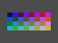 |  |

## Showcase `canvas-mesh-strip`

Godot draws an ArrayMesh of 2D vertices on a MeshInstance2D of a 2D view, with no material, so Godot's default canvas shader draws it (`tests/e2e/canvasScenes.mjs`). A plain three.js page draws the same commands through the transpiled canvas template with the same values. `pnpm test:shaders:e2e` draws both again and fails on any pixel over 2/255 apart.

```glsl
shader_type canvas_item;
```

| Godot | Transpilation on three.js |
| --- | --- |
|  |  |

## Showcase `canvas-mesh-lines`

Godot draws an ArrayMesh of 2D vertices on a MeshInstance2D of a 2D view, with no material, so Godot's default canvas shader draws it (`tests/e2e/canvasScenes.mjs`). A plain three.js page draws the same commands through the transpiled canvas template with the same values. `pnpm test:shaders:e2e` draws both again and fails on any pixel over 2/255 apart.

```glsl
shader_type canvas_item;
```

| Godot | Transpilation on three.js |
| --- | --- |
|  |  |

## Showcase `canvas-mesh-points`

Godot draws an ArrayMesh of 2D vertices on a MeshInstance2D of a 2D view, with no material, so Godot's default canvas shader draws it (`tests/e2e/canvasScenes.mjs`). A plain three.js page draws the same commands through the transpiled canvas template with the same values. `pnpm test:shaders:e2e` draws both again and fails on any pixel over 2/255 apart.

```glsl
shader_type canvas_item;
```

| Godot | Transpilation on three.js |
| --- | --- |
| 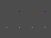 |  |

## Showcase `canvas-mesh-modulate`

Godot draws an ArrayMesh of 2D vertices on a MeshInstance2D of a 2D view, with no material, so Godot's default canvas shader draws it (`tests/e2e/canvasScenes.mjs`). A plain three.js page draws the same commands through the transpiled canvas template with the same values. `pnpm test:shaders:e2e` draws both again and fails on any pixel over 2/255 apart.

```glsl
shader_type canvas_item;
```

| Godot | Transpilation on three.js |
| --- | --- |
|  | 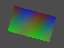 |

## Showcase `canvas-mesh-linear-canvas`

Godot draws an ArrayMesh of 2D vertices on a MeshInstance2D of a 2D view with `use_hdr_2d`, whose image holds linear colours, with no material, so Godot's default canvas shader draws it (`tests/e2e/canvasScenes.mjs`). A plain three.js page draws the same commands through the transpiled canvas template with the same values. `pnpm test:shaders:e2e` draws both again and fails on any pixel over 2/255 apart.

```glsl
shader_type canvas_item;
```

| Godot | Transpilation on three.js |
| --- | --- |
|  | 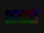 |

## Showcase `canvas-ninepatch-stretch`

Godot draws a `canvas_item_add_nine_patch` on a Node2D of a 2D view, with no material, so Godot's default canvas shader draws it (`tests/e2e/canvasScenes.mjs`). A plain three.js page draws the same commands through the transpiled canvas template with the same values. `pnpm test:shaders:e2e` draws both again and fails on any pixel over 2/255 apart.

```glsl
shader_type canvas_item;
```

| Godot | Transpilation on three.js |
| --- | --- |
| 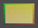 |  |

## Showcase `canvas-ninepatch-tile`

Godot draws a `canvas_item_add_nine_patch` on a Node2D of a 2D view, with no material, so Godot's default canvas shader draws it (`tests/e2e/canvasScenes.mjs`). A plain three.js page draws the same commands through the transpiled canvas template with the same values. `pnpm test:shaders:e2e` draws both again and fails on any pixel over 2/255 apart.

```glsl
shader_type canvas_item;
```

| Godot | Transpilation on three.js |
| --- | --- |
|  |  |

## Showcase `canvas-ninepatch-tile-fit`

Godot draws a `canvas_item_add_nine_patch` on a Node2D of a 2D view, with no material, so Godot's default canvas shader draws it (`tests/e2e/canvasScenes.mjs`). A plain three.js page draws the same commands through the transpiled canvas template with the same values. `pnpm test:shaders:e2e` draws both again and fails on any pixel over 2/255 apart.

```glsl
shader_type canvas_item;
```

| Godot | Transpilation on three.js |
| --- | --- |
|  |  |

## Showcase `canvas-ninepatch-no-centre`

Godot draws a `canvas_item_add_nine_patch` on a Node2D of a 2D view, with no material, so Godot's default canvas shader draws it (`tests/e2e/canvasScenes.mjs`). A plain three.js page draws the same commands through the transpiled canvas template with the same values. `pnpm test:shaders:e2e` draws both again and fails on any pixel over 2/255 apart.

```glsl
shader_type canvas_item;
```

| Godot | Transpilation on three.js |
| --- | --- |
|  |  |

## Showcase `canvas-ninepatch-region`

Godot draws a `canvas_item_add_nine_patch` on a Node2D of a 2D view, with no material, so Godot's default canvas shader draws it (`tests/e2e/canvasScenes.mjs`). A plain three.js page draws the same commands through the transpiled canvas template with the same values. `pnpm test:shaders:e2e` draws both again and fails on any pixel over 2/255 apart.

```glsl
shader_type canvas_item;
```

| Godot | Transpilation on three.js |
| --- | --- |
|  | 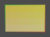 |

## Showcase `canvas-ninepatch-linear`

Godot draws a `canvas_item_add_nine_patch` on a Node2D of a 2D view, with no material, so Godot's default canvas shader draws it (`tests/e2e/canvasScenes.mjs`). A plain three.js page draws the same commands through the transpiled canvas template with the same values. `pnpm test:shaders:e2e` draws both again and fails on any pixel over 2/255 apart.

```glsl
shader_type canvas_item;
```

| Godot | Transpilation on three.js |
| --- | --- |
| 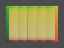 |  |

## Showcase `canvas-ninepatch-no-texture`

Godot draws a `canvas_item_add_nine_patch` on a Node2D of a 2D view, with no material, so Godot's default canvas shader draws it (`tests/e2e/canvasScenes.mjs`). A plain three.js page draws the same commands through the transpiled canvas template with the same values. `pnpm test:shaders:e2e` draws both again and fails on any pixel over 2/255 apart.

```glsl
shader_type canvas_item;
```

| Godot | Transpilation on three.js |
| --- | --- |
|  |  |

## Showcase `canvas-rect-linear-canvas`

Godot draws the scene's rects on a Node2D of a 2D view with `use_hdr_2d`, whose image holds linear colours, with no material, so Godot's default canvas shader draws it (`tests/e2e/canvasScenes.mjs`). A plain three.js page draws the same commands through the transpiled canvas template with the same values. `pnpm test:shaders:e2e` draws both again and fails on any pixel over 2/255 apart.

```glsl
shader_type canvas_item;
```

| Godot | Transpilation on three.js |
| --- | --- |
| 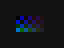 |  |

## Showcase `canvas-rect-linear-canvas-modulate`

Godot draws the scene's rects on a Node2D of a 2D view with `use_hdr_2d`, whose image holds linear colours, with no material, so Godot's default canvas shader draws it (`tests/e2e/canvasScenes.mjs`). A plain three.js page draws the same commands through the transpiled canvas template with the same values. `pnpm test:shaders:e2e` draws both again and fails on any pixel over 2/255 apart.

```glsl
shader_type canvas_item;
```

| Godot | Transpilation on three.js |
| --- | --- |
|  |  |

