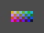
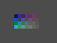
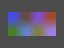
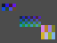

# Canvas items

A shader of `shader_type canvas_item` draws a 2D item. Godot links it into its canvas template, `canvas.glsl`, in the variant of the item's draw: a rect, a nine-patch, a primitive or a mesh with attributes. `transpileCanvasItem(text)` links the shader once, and `draw(variant)` gives the material of each variant, with its own uniforms and textures. Godot's default canvas shader, `DEFAULT_CANVAS_SHADER`, is the text with empty slots that draws an item with no material.

A rect draws as Godot's rect batch does. `textureRectRegion(rect, source, modulate, { transpose, clipUv })` is the rect command of `draw_texture_rect_region`: a negative size flips that axis. `rectInstanceData(command, item, texelSize)` writes Godot's 128-byte `InstanceData` record of the rect from the item's transform and final modulate. `rectBatchGeometry(records)` gives the instanced quad that reads each record as the attributes `attrib_A` to `attrib_H`. `writeCanvasBindings(draw, frame)` writes the template's `CanvasData` block from the render target's size, the canvas transform, the CanvasModulate colour, the time and the pixel snap. `CANVAS_BINDINGS` names the line of Godot's C++ behind each one. `CanvasTextureBinding` binds the item's texture with the item's filter and repeat, or Godot's white default texture, and writes the texture's texel size. The draw is one pass with Godot's mix blend, no cull and no depth.

The draws use an sRGB 2D render target, as a viewport without HDR 2D does: the texture's texels and the modulate colours reach the frame as they are stored. Only a rect draws now. A user's `canvas_item` shader, 2D lights, nine-patches, primitives and meshes do not draw yet, and their rows stay open with their issues.

Godot 4.6.3-stable (official), probed on llvmpipe (LLVM 20.1.2). Each table shows at most 8 of a probe's rows, picked to show as many mixes of zero, subnormal, normal, infinite and NaN values as fit. The real-GL test (`pnpm test:shaders:gpu`) checks every row, bit for bit, NaN lanes compared as NaN. Generated by `pnpm godot:shader-language`: do not edit by hand.

## Showcase `canvas-rect-texture`

Godot draws the scene's rects on a Node2D of a 2D view, with no material, so Godot's default canvas shader draws them (`tests/e2e/canvasScenes.mjs`). A plain three.js page draws the same rects through the transpiled canvas template with the same values. `pnpm test:shaders:e2e` draws both again and fails on any pixel over 2/255 apart.

```glsl
shader_type canvas_item;
```

| Godot | Transpilation on three.js |
| --- | --- |
|  |  |

## Showcase `canvas-rect-region`

Godot draws the scene's rects on a Node2D of a 2D view, with no material, so Godot's default canvas shader draws them (`tests/e2e/canvasScenes.mjs`). A plain three.js page draws the same rects through the transpiled canvas template with the same values. `pnpm test:shaders:e2e` draws both again and fails on any pixel over 2/255 apart.

```glsl
shader_type canvas_item;
```

| Godot | Transpilation on three.js |
| --- | --- |
|  |  |

## Showcase `canvas-rect-flip-h`

Godot draws the scene's rects on a Node2D of a 2D view, with no material, so Godot's default canvas shader draws them (`tests/e2e/canvasScenes.mjs`). A plain three.js page draws the same rects through the transpiled canvas template with the same values. `pnpm test:shaders:e2e` draws both again and fails on any pixel over 2/255 apart.

```glsl
shader_type canvas_item;
```

| Godot | Transpilation on three.js |
| --- | --- |
|  |  |

## Showcase `canvas-rect-flip-v`

Godot draws the scene's rects on a Node2D of a 2D view, with no material, so Godot's default canvas shader draws them (`tests/e2e/canvasScenes.mjs`). A plain three.js page draws the same rects through the transpiled canvas template with the same values. `pnpm test:shaders:e2e` draws both again and fails on any pixel over 2/255 apart.

```glsl
shader_type canvas_item;
```

| Godot | Transpilation on three.js |
| --- | --- |
|  |  |

## Showcase `canvas-rect-flip-source`

Godot draws the scene's rects on a Node2D of a 2D view, with no material, so Godot's default canvas shader draws them (`tests/e2e/canvasScenes.mjs`). A plain three.js page draws the same rects through the transpiled canvas template with the same values. `pnpm test:shaders:e2e` draws both again and fails on any pixel over 2/255 apart.

```glsl
shader_type canvas_item;
```

| Godot | Transpilation on three.js |
| --- | --- |
|  |  |

## Showcase `canvas-rect-transposed`

Godot draws the scene's rects on a Node2D of a 2D view, with no material, so Godot's default canvas shader draws them (`tests/e2e/canvasScenes.mjs`). A plain three.js page draws the same rects through the transpiled canvas template with the same values. `pnpm test:shaders:e2e` draws both again and fails on any pixel over 2/255 apart.

```glsl
shader_type canvas_item;
```

| Godot | Transpilation on three.js |
| --- | --- |
|  |  |

## Showcase `canvas-rect-modulate`

Godot draws the scene's rects on a Node2D of a 2D view, with no material, so Godot's default canvas shader draws them (`tests/e2e/canvasScenes.mjs`). A plain three.js page draws the same rects through the transpiled canvas template with the same values. `pnpm test:shaders:e2e` draws both again and fails on any pixel over 2/255 apart.

```glsl
shader_type canvas_item;
```

| Godot | Transpilation on three.js |
| --- | --- |
|  |  |

## Showcase `canvas-rect-modulate-over-1`

Godot draws the scene's rects on a Node2D of a 2D view, with no material, so Godot's default canvas shader draws them (`tests/e2e/canvasScenes.mjs`). A plain three.js page draws the same rects through the transpiled canvas template with the same values. `pnpm test:shaders:e2e` draws both again and fails on any pixel over 2/255 apart.

```glsl
shader_type canvas_item;
```

| Godot | Transpilation on three.js |
| --- | --- |
|  |  |

## Showcase `canvas-rect-modulate-alpha-0`

Godot draws the scene's rects on a Node2D of a 2D view, with no material, so Godot's default canvas shader draws them (`tests/e2e/canvasScenes.mjs`). A plain three.js page draws the same rects through the transpiled canvas template with the same values. `pnpm test:shaders:e2e` draws both again and fails on any pixel over 2/255 apart.

```glsl
shader_type canvas_item;
```

| Godot | Transpilation on three.js |
| --- | --- |
|  |  |

## Showcase `canvas-rect-self-modulate-alpha`

Godot draws the scene's rects on a Node2D of a 2D view, with no material, so Godot's default canvas shader draws them (`tests/e2e/canvasScenes.mjs`). A plain three.js page draws the same rects through the transpiled canvas template with the same values. `pnpm test:shaders:e2e` draws both again and fails on any pixel over 2/255 apart.

```glsl
shader_type canvas_item;
```

| Godot | Transpilation on three.js |
| --- | --- |
|  |  |

## Showcase `canvas-rect-blend-alpha`

Godot draws the scene's rects on a Node2D of a 2D view, with no material, so Godot's default canvas shader draws them (`tests/e2e/canvasScenes.mjs`). A plain three.js page draws the same rects through the transpiled canvas template with the same values. `pnpm test:shaders:e2e` draws both again and fails on any pixel over 2/255 apart.

```glsl
shader_type canvas_item;
```

| Godot | Transpilation on three.js |
| --- | --- |
|  |  |

## Showcase `canvas-rect-linear`

Godot draws the scene's rects on a Node2D of a 2D view, with no material, so Godot's default canvas shader draws them (`tests/e2e/canvasScenes.mjs`). A plain three.js page draws the same rects through the transpiled canvas template with the same values. `pnpm test:shaders:e2e` draws both again and fails on any pixel over 2/255 apart.

```glsl
shader_type canvas_item;
```

| Godot | Transpilation on three.js |
| --- | --- |
|  |  |

## Showcase `canvas-rect-linear-clip-uv`

Godot draws the scene's rects on a Node2D of a 2D view, with no material, so Godot's default canvas shader draws them (`tests/e2e/canvasScenes.mjs`). A plain three.js page draws the same rects through the transpiled canvas template with the same values. `pnpm test:shaders:e2e` draws both again and fails on any pixel over 2/255 apart.

```glsl
shader_type canvas_item;
```

| Godot | Transpilation on three.js |
| --- | --- |
|  |  |

## Showcase `canvas-rect-linear-no-clip`

Godot draws the scene's rects on a Node2D of a 2D view, with no material, so Godot's default canvas shader draws them (`tests/e2e/canvasScenes.mjs`). A plain three.js page draws the same rects through the transpiled canvas template with the same values. `pnpm test:shaders:e2e` draws both again and fails on any pixel over 2/255 apart.

```glsl
shader_type canvas_item;
```

| Godot | Transpilation on three.js |
| --- | --- |
|  |  |

## Showcase `canvas-rect-repeat`

Godot draws the scene's rects on a Node2D of a 2D view, with no material, so Godot's default canvas shader draws them (`tests/e2e/canvasScenes.mjs`). A plain three.js page draws the same rects through the transpiled canvas template with the same values. `pnpm test:shaders:e2e` draws both again and fails on any pixel over 2/255 apart.

```glsl
shader_type canvas_item;
```

| Godot | Transpilation on three.js |
| --- | --- |
|  |  |

## Showcase `canvas-rect-mirror`

Godot draws the scene's rects on a Node2D of a 2D view, with no material, so Godot's default canvas shader draws them (`tests/e2e/canvasScenes.mjs`). A plain three.js page draws the same rects through the transpiled canvas template with the same values. `pnpm test:shaders:e2e` draws both again and fails on any pixel over 2/255 apart.

```glsl
shader_type canvas_item;
```

| Godot | Transpilation on three.js |
| --- | --- |
|  |  |

## Showcase `canvas-rect-clamp`

Godot draws the scene's rects on a Node2D of a 2D view, with no material, so Godot's default canvas shader draws them (`tests/e2e/canvasScenes.mjs`). A plain three.js page draws the same rects through the transpiled canvas template with the same values. `pnpm test:shaders:e2e` draws both again and fails on any pixel over 2/255 apart.

```glsl
shader_type canvas_item;
```

| Godot | Transpilation on three.js |
| --- | --- |
|  |  |

## Showcase `canvas-rect-rotated`

Godot draws the scene's rects on a Node2D of a 2D view, with no material, so Godot's default canvas shader draws them (`tests/e2e/canvasScenes.mjs`). A plain three.js page draws the same rects through the transpiled canvas template with the same values. `pnpm test:shaders:e2e` draws both again and fails on any pixel over 2/255 apart.

```glsl
shader_type canvas_item;
```

| Godot | Transpilation on three.js |
| --- | --- |
|  |  |

## Showcase `canvas-rect-rotated-linear`

Godot draws the scene's rects on a Node2D of a 2D view, with no material, so Godot's default canvas shader draws them (`tests/e2e/canvasScenes.mjs`). A plain three.js page draws the same rects through the transpiled canvas template with the same values. `pnpm test:shaders:e2e` draws both again and fails on any pixel over 2/255 apart.

```glsl
shader_type canvas_item;
```

| Godot | Transpilation on three.js |
| --- | --- |
|  |  |

## Showcase `canvas-rect-subpixel`

Godot draws the scene's rects on a Node2D of a 2D view, with no material, so Godot's default canvas shader draws them (`tests/e2e/canvasScenes.mjs`). A plain three.js page draws the same rects through the transpiled canvas template with the same values. `pnpm test:shaders:e2e` draws both again and fails on any pixel over 2/255 apart.

```glsl
shader_type canvas_item;
```

| Godot | Transpilation on three.js |
| --- | --- |
|  |  |

## Showcase `canvas-rect-subpixel-snapped`

Godot draws the scene's rects on a Node2D of a 2D view, with no material, so Godot's default canvas shader draws them (`tests/e2e/canvasScenes.mjs`). A plain three.js page draws the same rects through the transpiled canvas template with the same values. `pnpm test:shaders:e2e` draws both again and fails on any pixel over 2/255 apart.

```glsl
shader_type canvas_item;
```

| Godot | Transpilation on three.js |
| --- | --- |
|  |  |

## Showcase `canvas-rect-canvas-transform`

Godot draws the scene's rects on a Node2D of a 2D view, with no material, so Godot's default canvas shader draws them (`tests/e2e/canvasScenes.mjs`). A plain three.js page draws the same rects through the transpiled canvas template with the same values. `pnpm test:shaders:e2e` draws both again and fails on any pixel over 2/255 apart.

```glsl
shader_type canvas_item;
```

| Godot | Transpilation on three.js |
| --- | --- |
|  |  |

## Showcase `canvas-rect-canvas-modulate`

Godot draws the scene's rects on a Node2D of a 2D view, with no material, so Godot's default canvas shader draws them (`tests/e2e/canvasScenes.mjs`). A plain three.js page draws the same rects through the transpiled canvas template with the same values. `pnpm test:shaders:e2e` draws both again and fails on any pixel over 2/255 apart.

```glsl
shader_type canvas_item;
```

| Godot | Transpilation on three.js |
| --- | --- |
|  |  |

## Showcase `canvas-rect-batch`

Godot draws the scene's rects on a Node2D of a 2D view, with no material, so Godot's default canvas shader draws them (`tests/e2e/canvasScenes.mjs`). A plain three.js page draws the same rects through the transpiled canvas template with the same values. `pnpm test:shaders:e2e` draws both again and fails on any pixel over 2/255 apart.

```glsl
shader_type canvas_item;
```

| Godot | Transpilation on three.js |
| --- | --- |
|  |  |

