# Canvas items

A shader of `shader_type canvas_item` draws a 2D item. Godot links it into its canvas template, `canvas.glsl`, in the variant of the item's draw: a rect, a nine-patch, a primitive or a mesh with attributes, and the primitive and the mesh again as points. `transpileCanvasItem(text)` links the shader once, and `draw(variant)` gives the material of each variant, with its own uniforms and textures. Godot's default canvas shader, `DEFAULT_CANVAS_SHADER`, is the text with empty slots that draws an item with no material.

Each draw reads the item's transform, its final modulate and the render target's colour mode as a `CanvasItemDraw`. `writeCanvasBindings(draw, frame)` writes the template's `CanvasData` block from the render target's size, the canvas transform, the CanvasModulate colour, the time, the pixel snap and the colour mode. When the target shows Godot's viewport inside a larger area, `frame.viewport`, a `TargetViewport`, gives the viewport's origin and size in target pixels and target pixels per viewport pixel. `SCREEN_UV`, `SCREEN_PIXEL_SIZE`, `FRAGCOORD` and `POINT_SIZE` then count the viewport. Without it they count the whole target. `CANVAS_BINDINGS` names the line of Godot's C++ behind each one. `CanvasTextureBinding` binds the item's texture with the item's filter and repeat, or Godot's white default texture, and returns the texel size it writes. Each draw is one pass with Godot's mix blend, no cull and no depth.

A rect and a nine-patch draw as Godot's quad batch does. `textureRectRegion(rect, source, modulate, { transpose, clipUv })` is the rect command of `draw_texture_rect_region`: a negative size flips that axis. `rectInstanceData(command, item, texelSize)` and `ninePatchInstanceData(command, item, texelSize)` write Godot's 128-byte `InstanceData` record. `quadBatchGeometry(records)` gives the instanced quad that reads each record as the attributes `attrib_A` to `attrib_H`.

A primitive of `draw_primitive` draws as Godot's primitive batch does. `primitiveCommand(points, colors, uvs)` repeats the first colour for a point with none. `primitiveInstanceData(command, item)` writes one record for a point, a line or a triangle, and two for a quad, with each colour in half floats. `primitiveDraw(pointCount)` names the variant and the primitive, and `primitiveBatchGeometry(records, pointCount)` gives the geometry. `primitiveObject(primitive, geometry, material)` gives the three.js object that draws it: points, lines, a line strip, triangles or a triangle strip. `primitiveBatchObject(draw, records, pointCount)` gives the object of the draw's variant in one call.

A polygon and a mesh surface draw through the attributes variant, one draw each. `polygonCommand(points, colors, uvs)` cuts an outline into triangles, as `draw_polygon` does, and `triangleArrayCommand(indices, points, colors, uvs)` takes the triangles of a Polygon2D. `attributesGeometry(arrays, draw)` writes the vertex arrays, with Godot's default white colour and zero UV for a missing array. `polygonConstants(item)` and `meshConstants(item, { transform, modulate })` give the push constants, and `attributesObject(draw, geometry, primitive, constants)` writes them before each draw of the object.

A viewport with `use_hdr_2d` keeps colours linear. Set `usesLinearColors` on the frame, the item and the texture state: the template then turns the vertex colours linear, Godot's C++ turns the modulate colours linear, and the texture reads through its sRGB view. Without it, the texels and the colours reach the frame as they are stored. 2D lights do not draw yet, and their rows stay open with their issues.

A user's `canvas_item` shader links into the same template: `vertex()` fills the slot after the template reads the command's vertex, UV and colour, and `fragment()` fills the slot after the template samples the texture. Each built-in reads as the template's local for it. A shader's `render_mode` blend word sets the material's blend state, and `blend_disabled` blends nothing. Give `transpileCanvasItem` the option `rows: 'godot'` for a render target whose GL row 0 is Godot's top row, as the previewer's 2D frame is: the clip y and `FRAGCOORD` then keep Godot's direction.

Godot 4.6.3-stable (official), probed on llvmpipe (LLVM 20.1.2). Each table shows at most 8 of a probe's rows, picked to show as many mixes of zero, subnormal, normal, infinite and NaN values as fit. The real-GL test (`pnpm test:shaders:gpu`) checks every row, bit for bit, NaN lanes compared as NaN. Generated by `pnpm godot:shader-language`: do not edit by hand.

## Showcase `canvas-rect-texture`

Godot draws the scene's rects on a Node2D of a 2D view, with no material, so Godot's default canvas shader draws it (`tests/e2e/canvasScenes.mjs`). A plain three.js page draws the same commands through the transpiled canvas template with the same values. `pnpm test:shaders:e2e` draws both again and fails on any pixel over 2/255 apart.

```glsl
shader_type canvas_item;
```

| Godot | Transpilation on three.js |
| --- | --- |
|  |  |

## Showcase `canvas-rect-region`

Godot draws the scene's rects on a Node2D of a 2D view, with no material, so Godot's default canvas shader draws it (`tests/e2e/canvasScenes.mjs`). A plain three.js page draws the same commands through the transpiled canvas template with the same values. `pnpm test:shaders:e2e` draws both again and fails on any pixel over 2/255 apart.

```glsl
shader_type canvas_item;
```

| Godot | Transpilation on three.js |
| --- | --- |
| 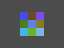 |  |

## Showcase `canvas-rect-flip-h`

Godot draws the scene's rects on a Node2D of a 2D view, with no material, so Godot's default canvas shader draws it (`tests/e2e/canvasScenes.mjs`). A plain three.js page draws the same commands through the transpiled canvas template with the same values. `pnpm test:shaders:e2e` draws both again and fails on any pixel over 2/255 apart.

```glsl
shader_type canvas_item;
```

| Godot | Transpilation on three.js |
| --- | --- |
|  | 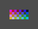 |

## Showcase `canvas-rect-flip-v`

Godot draws the scene's rects on a Node2D of a 2D view, with no material, so Godot's default canvas shader draws it (`tests/e2e/canvasScenes.mjs`). A plain three.js page draws the same commands through the transpiled canvas template with the same values. `pnpm test:shaders:e2e` draws both again and fails on any pixel over 2/255 apart.

```glsl
shader_type canvas_item;
```

| Godot | Transpilation on three.js |
| --- | --- |
|  | 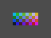 |

## Showcase `canvas-rect-flip-source`

Godot draws the scene's rects on a Node2D of a 2D view, with no material, so Godot's default canvas shader draws it (`tests/e2e/canvasScenes.mjs`). A plain three.js page draws the same commands through the transpiled canvas template with the same values. `pnpm test:shaders:e2e` draws both again and fails on any pixel over 2/255 apart.

```glsl
shader_type canvas_item;
```

| Godot | Transpilation on three.js |
| --- | --- |
|  |  |

## Showcase `canvas-rect-transposed`

Godot draws the scene's rects on a Node2D of a 2D view, with no material, so Godot's default canvas shader draws it (`tests/e2e/canvasScenes.mjs`). A plain three.js page draws the same commands through the transpiled canvas template with the same values. `pnpm test:shaders:e2e` draws both again and fails on any pixel over 2/255 apart.

```glsl
shader_type canvas_item;
```

| Godot | Transpilation on three.js |
| --- | --- |
|  |  |

## Showcase `canvas-rect-modulate`

Godot draws the scene's rects on a Node2D of a 2D view, with no material, so Godot's default canvas shader draws it (`tests/e2e/canvasScenes.mjs`). A plain three.js page draws the same commands through the transpiled canvas template with the same values. `pnpm test:shaders:e2e` draws both again and fails on any pixel over 2/255 apart.

```glsl
shader_type canvas_item;
```

| Godot | Transpilation on three.js |
| --- | --- |
|  |  |

## Showcase `canvas-rect-modulate-over-1`

Godot draws the scene's rects on a Node2D of a 2D view, with no material, so Godot's default canvas shader draws it (`tests/e2e/canvasScenes.mjs`). A plain three.js page draws the same commands through the transpiled canvas template with the same values. `pnpm test:shaders:e2e` draws both again and fails on any pixel over 2/255 apart.

```glsl
shader_type canvas_item;
```

| Godot | Transpilation on three.js |
| --- | --- |
|  |  |

## Showcase `canvas-rect-modulate-alpha-0`

Godot draws the scene's rects on a Node2D of a 2D view, with no material, so Godot's default canvas shader draws it (`tests/e2e/canvasScenes.mjs`). A plain three.js page draws the same commands through the transpiled canvas template with the same values. `pnpm test:shaders:e2e` draws both again and fails on any pixel over 2/255 apart.

```glsl
shader_type canvas_item;
```

| Godot | Transpilation on three.js |
| --- | --- |
|  |  |

## Showcase `canvas-rect-self-modulate-alpha`

Godot draws the scene's rects on a Node2D of a 2D view, with no material, so Godot's default canvas shader draws it (`tests/e2e/canvasScenes.mjs`). A plain three.js page draws the same commands through the transpiled canvas template with the same values. `pnpm test:shaders:e2e` draws both again and fails on any pixel over 2/255 apart.

```glsl
shader_type canvas_item;
```

| Godot | Transpilation on three.js |
| --- | --- |
|  | 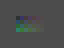 |

## Showcase `canvas-rect-blend-alpha`

Godot draws the scene's rects on a Node2D of a 2D view, with no material, so Godot's default canvas shader draws it (`tests/e2e/canvasScenes.mjs`). A plain three.js page draws the same commands through the transpiled canvas template with the same values. `pnpm test:shaders:e2e` draws both again and fails on any pixel over 2/255 apart.

```glsl
shader_type canvas_item;
```

| Godot | Transpilation on three.js |
| --- | --- |
|  |  |

## Showcase `canvas-rect-linear`

Godot draws the scene's rects on a Node2D of a 2D view, with no material, so Godot's default canvas shader draws it (`tests/e2e/canvasScenes.mjs`). A plain three.js page draws the same commands through the transpiled canvas template with the same values. `pnpm test:shaders:e2e` draws both again and fails on any pixel over 2/255 apart.

```glsl
shader_type canvas_item;
```

| Godot | Transpilation on three.js |
| --- | --- |
|  |  |

## Showcase `canvas-rect-linear-clip-uv`

Godot draws the scene's rects on a Node2D of a 2D view, with no material, so Godot's default canvas shader draws it (`tests/e2e/canvasScenes.mjs`). A plain three.js page draws the same commands through the transpiled canvas template with the same values. `pnpm test:shaders:e2e` draws both again and fails on any pixel over 2/255 apart.

```glsl
shader_type canvas_item;
```

| Godot | Transpilation on three.js |
| --- | --- |
|  |  |

## Showcase `canvas-rect-linear-no-clip`

Godot draws the scene's rects on a Node2D of a 2D view, with no material, so Godot's default canvas shader draws it (`tests/e2e/canvasScenes.mjs`). A plain three.js page draws the same commands through the transpiled canvas template with the same values. `pnpm test:shaders:e2e` draws both again and fails on any pixel over 2/255 apart.

```glsl
shader_type canvas_item;
```

| Godot | Transpilation on three.js |
| --- | --- |
|  | 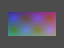 |

## Showcase `canvas-rect-repeat`

Godot draws the scene's rects on a Node2D of a 2D view, with no material, so Godot's default canvas shader draws it (`tests/e2e/canvasScenes.mjs`). A plain three.js page draws the same commands through the transpiled canvas template with the same values. `pnpm test:shaders:e2e` draws both again and fails on any pixel over 2/255 apart.

```glsl
shader_type canvas_item;
```

| Godot | Transpilation on three.js |
| --- | --- |
| 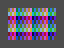 |  |

## Showcase `canvas-rect-mirror`

Godot draws the scene's rects on a Node2D of a 2D view, with no material, so Godot's default canvas shader draws it (`tests/e2e/canvasScenes.mjs`). A plain three.js page draws the same commands through the transpiled canvas template with the same values. `pnpm test:shaders:e2e` draws both again and fails on any pixel over 2/255 apart.

```glsl
shader_type canvas_item;
```

| Godot | Transpilation on three.js |
| --- | --- |
|  |  |

## Showcase `canvas-rect-clamp`

Godot draws the scene's rects on a Node2D of a 2D view, with no material, so Godot's default canvas shader draws it (`tests/e2e/canvasScenes.mjs`). A plain three.js page draws the same commands through the transpiled canvas template with the same values. `pnpm test:shaders:e2e` draws both again and fails on any pixel over 2/255 apart.

```glsl
shader_type canvas_item;
```

| Godot | Transpilation on three.js |
| --- | --- |
|  |  |

## Showcase `canvas-rect-rotated`

Godot draws the scene's rects on a Node2D of a 2D view, with no material, so Godot's default canvas shader draws it (`tests/e2e/canvasScenes.mjs`). A plain three.js page draws the same commands through the transpiled canvas template with the same values. `pnpm test:shaders:e2e` draws both again and fails on any pixel over 2/255 apart.

```glsl
shader_type canvas_item;
```

| Godot | Transpilation on three.js |
| --- | --- |
|  |  |

## Showcase `canvas-rect-rotated-linear`

Godot draws the scene's rects on a Node2D of a 2D view, with no material, so Godot's default canvas shader draws it (`tests/e2e/canvasScenes.mjs`). A plain three.js page draws the same commands through the transpiled canvas template with the same values. `pnpm test:shaders:e2e` draws both again and fails on any pixel over 2/255 apart.

```glsl
shader_type canvas_item;
```

| Godot | Transpilation on three.js |
| --- | --- |
| 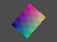 |  |

## Showcase `canvas-rect-subpixel`

Godot draws the scene's rects on a Node2D of a 2D view, with no material, so Godot's default canvas shader draws it (`tests/e2e/canvasScenes.mjs`). A plain three.js page draws the same commands through the transpiled canvas template with the same values. `pnpm test:shaders:e2e` draws both again and fails on any pixel over 2/255 apart.

```glsl
shader_type canvas_item;
```

| Godot | Transpilation on three.js |
| --- | --- |
|  | 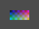 |

## Showcase `canvas-rect-subpixel-snapped`

Godot draws the scene's rects on a Node2D of a 2D view, with no material, so Godot's default canvas shader draws it (`tests/e2e/canvasScenes.mjs`). A plain three.js page draws the same commands through the transpiled canvas template with the same values. `pnpm test:shaders:e2e` draws both again and fails on any pixel over 2/255 apart.

```glsl
shader_type canvas_item;
```

| Godot | Transpilation on three.js |
| --- | --- |
| 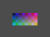 |  |

## Showcase `canvas-rect-canvas-transform`

Godot draws the scene's rects on a Node2D of a 2D view, with no material, so Godot's default canvas shader draws it (`tests/e2e/canvasScenes.mjs`). A plain three.js page draws the same commands through the transpiled canvas template with the same values. `pnpm test:shaders:e2e` draws both again and fails on any pixel over 2/255 apart.

```glsl
shader_type canvas_item;
```

| Godot | Transpilation on three.js |
| --- | --- |
|  |  |

## Showcase `canvas-rect-canvas-modulate`

Godot draws the scene's rects on a Node2D of a 2D view, with no material, so Godot's default canvas shader draws it (`tests/e2e/canvasScenes.mjs`). A plain three.js page draws the same commands through the transpiled canvas template with the same values. `pnpm test:shaders:e2e` draws both again and fails on any pixel over 2/255 apart.

```glsl
shader_type canvas_item;
```

| Godot | Transpilation on three.js |
| --- | --- |
| 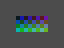 |  |

## Showcase `canvas-rect-batch`

Godot draws the scene's rects on a Node2D of a 2D view, with no material, so Godot's default canvas shader draws it (`tests/e2e/canvasScenes.mjs`). A plain three.js page draws the same commands through the transpiled canvas template with the same values. `pnpm test:shaders:e2e` draws both again and fails on any pixel over 2/255 apart.

```glsl
shader_type canvas_item;
```

| Godot | Transpilation on three.js |
| --- | --- |
|  |  |

## Showcase `canvas-primitive-points`

Godot draws the scene's `draw_primitive` calls on a Node2D of a 2D view, with no material, so Godot's default canvas shader draws it (`tests/e2e/canvasScenes.mjs`). A plain three.js page draws the same commands through the transpiled canvas template with the same values. `pnpm test:shaders:e2e` draws both again and fails on any pixel over 2/255 apart.

```glsl
shader_type canvas_item;
```

| Godot | Transpilation on three.js |
| --- | --- |
|  | 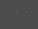 |

## Showcase `canvas-primitive-lines`

Godot draws the scene's `draw_primitive` calls on a Node2D of a 2D view, with no material, so Godot's default canvas shader draws it (`tests/e2e/canvasScenes.mjs`). A plain three.js page draws the same commands through the transpiled canvas template with the same values. `pnpm test:shaders:e2e` draws both again and fails on any pixel over 2/255 apart.

```glsl
shader_type canvas_item;
```

| Godot | Transpilation on three.js |
| --- | --- |
| 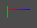 |  |

## Showcase `canvas-primitive-triangle`

Godot draws the scene's `draw_primitive` calls on a Node2D of a 2D view, with no material, so Godot's default canvas shader draws it (`tests/e2e/canvasScenes.mjs`). A plain three.js page draws the same commands through the transpiled canvas template with the same values. `pnpm test:shaders:e2e` draws both again and fails on any pixel over 2/255 apart.

```glsl
shader_type canvas_item;
```

| Godot | Transpilation on three.js |
| --- | --- |
|  |  |

## Showcase `canvas-primitive-quad`

Godot draws the scene's `draw_primitive` calls on a Node2D of a 2D view, with no material, so Godot's default canvas shader draws it (`tests/e2e/canvasScenes.mjs`). A plain three.js page draws the same commands through the transpiled canvas template with the same values. `pnpm test:shaders:e2e` draws both again and fails on any pixel over 2/255 apart.

```glsl
shader_type canvas_item;
```

| Godot | Transpilation on three.js |
| --- | --- |
|  |  |

## Showcase `canvas-primitive-quad-textured`

Godot draws the scene's `draw_primitive` calls on a Node2D of a 2D view, with no material, so Godot's default canvas shader draws it (`tests/e2e/canvasScenes.mjs`). A plain three.js page draws the same commands through the transpiled canvas template with the same values. `pnpm test:shaders:e2e` draws both again and fails on any pixel over 2/255 apart.

```glsl
shader_type canvas_item;
```

| Godot | Transpilation on three.js |
| --- | --- |
| 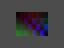 |  |

## Showcase `canvas-primitive-modulate`

Godot draws the scene's `draw_primitive` calls on a Node2D of a 2D view, with no material, so Godot's default canvas shader draws it (`tests/e2e/canvasScenes.mjs`). A plain three.js page draws the same commands through the transpiled canvas template with the same values. `pnpm test:shaders:e2e` draws both again and fails on any pixel over 2/255 apart.

```glsl
shader_type canvas_item;
```

| Godot | Transpilation on three.js |
| --- | --- |
|  |  |

## Showcase `canvas-primitive-linear-canvas`

Godot draws the scene's `draw_primitive` calls on a Node2D of a 2D view with `use_hdr_2d`, whose image holds linear colours, with no material, so Godot's default canvas shader draws it (`tests/e2e/canvasScenes.mjs`). A plain three.js page draws the same commands through the transpiled canvas template with the same values. `pnpm test:shaders:e2e` draws both again and fails on any pixel over 2/255 apart.

```glsl
shader_type canvas_item;
```

| Godot | Transpilation on three.js |
| --- | --- |
|  |  |

## Showcase `canvas-polygon-vertex-colors`

Godot draws a Polygon2D of a 2D view, with no material, so Godot's default canvas shader draws it (`tests/e2e/canvasScenes.mjs`). A plain three.js page draws the same commands through the transpiled canvas template with the same values. `pnpm test:shaders:e2e` draws both again and fails on any pixel over 2/255 apart.

```glsl
shader_type canvas_item;
```

| Godot | Transpilation on three.js |
| --- | --- |
|  |  |

## Showcase `canvas-polygon-color`

Godot draws a Polygon2D of a 2D view, with no material, so Godot's default canvas shader draws it (`tests/e2e/canvasScenes.mjs`). A plain three.js page draws the same commands through the transpiled canvas template with the same values. `pnpm test:shaders:e2e` draws both again and fails on any pixel over 2/255 apart.

```glsl
shader_type canvas_item;
```

| Godot | Transpilation on three.js |
| --- | --- |
|  |  |

## Showcase `canvas-polygon-textured`

Godot draws a Polygon2D of a 2D view, with no material, so Godot's default canvas shader draws it (`tests/e2e/canvasScenes.mjs`). A plain three.js page draws the same commands through the transpiled canvas template with the same values. `pnpm test:shaders:e2e` draws both again and fails on any pixel over 2/255 apart.

```glsl
shader_type canvas_item;
```

| Godot | Transpilation on three.js |
| --- | --- |
|  |  |

## Showcase `canvas-polygon-textured-linear-filter`

Godot draws a Polygon2D of a 2D view, with no material, so Godot's default canvas shader draws it (`tests/e2e/canvasScenes.mjs`). A plain three.js page draws the same commands through the transpiled canvas template with the same values. `pnpm test:shaders:e2e` draws both again and fails on any pixel over 2/255 apart.

```glsl
shader_type canvas_item;
```

| Godot | Transpilation on three.js |
| --- | --- |
|  |  |

## Showcase `canvas-polygon-modulate`

Godot draws a Polygon2D of a 2D view, with no material, so Godot's default canvas shader draws it (`tests/e2e/canvasScenes.mjs`). A plain three.js page draws the same commands through the transpiled canvas template with the same values. `pnpm test:shaders:e2e` draws both again and fails on any pixel over 2/255 apart.

```glsl
shader_type canvas_item;
```

| Godot | Transpilation on three.js |
| --- | --- |
|  |  |

## Showcase `canvas-polygon-linear-canvas`

Godot draws a Polygon2D of a 2D view with `use_hdr_2d`, whose image holds linear colours, with no material, so Godot's default canvas shader draws it (`tests/e2e/canvasScenes.mjs`). A plain three.js page draws the same commands through the transpiled canvas template with the same values. `pnpm test:shaders:e2e` draws both again and fails on any pixel over 2/255 apart.

```glsl
shader_type canvas_item;
```

| Godot | Transpilation on three.js |
| --- | --- |
|  |  |

## Showcase `canvas-draw-polygon-one-color`

Godot draws the scene's `draw_polygon` call on a Node2D of a 2D view, with no material, so Godot's default canvas shader draws it (`tests/e2e/canvasScenes.mjs`). A plain three.js page draws the same commands through the transpiled canvas template with the same values. `pnpm test:shaders:e2e` draws both again and fails on any pixel over 2/255 apart.

```glsl
shader_type canvas_item;
```

| Godot | Transpilation on three.js |
| --- | --- |
|  |  |

## Showcase `canvas-draw-polygon-textured`

Godot draws the scene's `draw_polygon` call on a Node2D of a 2D view, with no material, so Godot's default canvas shader draws it (`tests/e2e/canvasScenes.mjs`). A plain three.js page draws the same commands through the transpiled canvas template with the same values. `pnpm test:shaders:e2e` draws both again and fails on any pixel over 2/255 apart.

```glsl
shader_type canvas_item;
```

| Godot | Transpilation on three.js |
| --- | --- |
|  |  |

## Showcase `canvas-mesh-triangles`

Godot draws an ArrayMesh of 2D vertices on a MeshInstance2D of a 2D view, with no material, so Godot's default canvas shader draws it (`tests/e2e/canvasScenes.mjs`). A plain three.js page draws the same commands through the transpiled canvas template with the same values. `pnpm test:shaders:e2e` draws both again and fails on any pixel over 2/255 apart.

```glsl
shader_type canvas_item;
```

| Godot | Transpilation on three.js |
| --- | --- |
|  |  |

## Showcase `canvas-mesh-textured`

Godot draws an ArrayMesh of 2D vertices on a MeshInstance2D of a 2D view, with no material, so Godot's default canvas shader draws it (`tests/e2e/canvasScenes.mjs`). A plain three.js page draws the same commands through the transpiled canvas template with the same values. `pnpm test:shaders:e2e` draws both again and fails on any pixel over 2/255 apart.

```glsl
shader_type canvas_item;
```

| Godot | Transpilation on three.js |
| --- | --- |
|  | 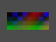 |

## Showcase `canvas-mesh-no-colors`

Godot draws an ArrayMesh of 2D vertices on a MeshInstance2D of a 2D view, with no material, so Godot's default canvas shader draws it (`tests/e2e/canvasScenes.mjs`). A plain three.js page draws the same commands through the transpiled canvas template with the same values. `pnpm test:shaders:e2e` draws both again and fails on any pixel over 2/255 apart.

```glsl
shader_type canvas_item;
```

| Godot | Transpilation on three.js |
| --- | --- |
|  |  |

## Showcase `canvas-mesh-strip`

Godot draws an ArrayMesh of 2D vertices on a MeshInstance2D of a 2D view, with no material, so Godot's default canvas shader draws it (`tests/e2e/canvasScenes.mjs`). A plain three.js page draws the same commands through the transpiled canvas template with the same values. `pnpm test:shaders:e2e` draws both again and fails on any pixel over 2/255 apart.

```glsl
shader_type canvas_item;
```

| Godot | Transpilation on three.js |
| --- | --- |
| 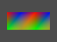 |  |

## Showcase `canvas-mesh-lines`

Godot draws an ArrayMesh of 2D vertices on a MeshInstance2D of a 2D view, with no material, so Godot's default canvas shader draws it (`tests/e2e/canvasScenes.mjs`). A plain three.js page draws the same commands through the transpiled canvas template with the same values. `pnpm test:shaders:e2e` draws both again and fails on any pixel over 2/255 apart.

```glsl
shader_type canvas_item;
```

| Godot | Transpilation on three.js |
| --- | --- |
| 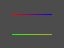 | 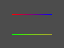 |

## Showcase `canvas-mesh-points`

Godot draws an ArrayMesh of 2D vertices on a MeshInstance2D of a 2D view, with no material, so Godot's default canvas shader draws it (`tests/e2e/canvasScenes.mjs`). A plain three.js page draws the same commands through the transpiled canvas template with the same values. `pnpm test:shaders:e2e` draws both again and fails on any pixel over 2/255 apart.

```glsl
shader_type canvas_item;
```

| Godot | Transpilation on three.js |
| --- | --- |
|  |  |

## Showcase `canvas-mesh-modulate`

Godot draws an ArrayMesh of 2D vertices on a MeshInstance2D of a 2D view, with no material, so Godot's default canvas shader draws it (`tests/e2e/canvasScenes.mjs`). A plain three.js page draws the same commands through the transpiled canvas template with the same values. `pnpm test:shaders:e2e` draws both again and fails on any pixel over 2/255 apart.

```glsl
shader_type canvas_item;
```

| Godot | Transpilation on three.js |
| --- | --- |
|  |  |

## Showcase `canvas-mesh-linear-canvas`

Godot draws an ArrayMesh of 2D vertices on a MeshInstance2D of a 2D view with `use_hdr_2d`, whose image holds linear colours, with no material, so Godot's default canvas shader draws it (`tests/e2e/canvasScenes.mjs`). A plain three.js page draws the same commands through the transpiled canvas template with the same values. `pnpm test:shaders:e2e` draws both again and fails on any pixel over 2/255 apart.

```glsl
shader_type canvas_item;
```

| Godot | Transpilation on three.js |
| --- | --- |
|  |  |

## Showcase `canvas-ninepatch-stretch`

Godot draws a `canvas_item_add_nine_patch` on a Node2D of a 2D view, with no material, so Godot's default canvas shader draws it (`tests/e2e/canvasScenes.mjs`). A plain three.js page draws the same commands through the transpiled canvas template with the same values. `pnpm test:shaders:e2e` draws both again and fails on any pixel over 2/255 apart.

```glsl
shader_type canvas_item;
```

| Godot | Transpilation on three.js |
| --- | --- |
|  |  |

## Showcase `canvas-ninepatch-tile`

Godot draws a `canvas_item_add_nine_patch` on a Node2D of a 2D view, with no material, so Godot's default canvas shader draws it (`tests/e2e/canvasScenes.mjs`). A plain three.js page draws the same commands through the transpiled canvas template with the same values. `pnpm test:shaders:e2e` draws both again and fails on any pixel over 2/255 apart.

```glsl
shader_type canvas_item;
```

| Godot | Transpilation on three.js |
| --- | --- |
|  |  |

## Showcase `canvas-ninepatch-tile-fit`

Godot draws a `canvas_item_add_nine_patch` on a Node2D of a 2D view, with no material, so Godot's default canvas shader draws it (`tests/e2e/canvasScenes.mjs`). A plain three.js page draws the same commands through the transpiled canvas template with the same values. `pnpm test:shaders:e2e` draws both again and fails on any pixel over 2/255 apart.

```glsl
shader_type canvas_item;
```

| Godot | Transpilation on three.js |
| --- | --- |
|  | 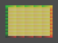 |

## Showcase `canvas-ninepatch-no-centre`

Godot draws a `canvas_item_add_nine_patch` on a Node2D of a 2D view, with no material, so Godot's default canvas shader draws it (`tests/e2e/canvasScenes.mjs`). A plain three.js page draws the same commands through the transpiled canvas template with the same values. `pnpm test:shaders:e2e` draws both again and fails on any pixel over 2/255 apart.

```glsl
shader_type canvas_item;
```

| Godot | Transpilation on three.js |
| --- | --- |
| 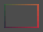 |  |

## Showcase `canvas-ninepatch-region`

Godot draws a `canvas_item_add_nine_patch` on a Node2D of a 2D view, with no material, so Godot's default canvas shader draws it (`tests/e2e/canvasScenes.mjs`). A plain three.js page draws the same commands through the transpiled canvas template with the same values. `pnpm test:shaders:e2e` draws both again and fails on any pixel over 2/255 apart.

```glsl
shader_type canvas_item;
```

| Godot | Transpilation on three.js |
| --- | --- |
| 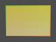 |  |

## Showcase `canvas-ninepatch-linear`

Godot draws a `canvas_item_add_nine_patch` on a Node2D of a 2D view, with no material, so Godot's default canvas shader draws it (`tests/e2e/canvasScenes.mjs`). A plain three.js page draws the same commands through the transpiled canvas template with the same values. `pnpm test:shaders:e2e` draws both again and fails on any pixel over 2/255 apart.

```glsl
shader_type canvas_item;
```

| Godot | Transpilation on three.js |
| --- | --- |
|  |  |

## Showcase `canvas-ninepatch-whole-texture`

Godot draws a `canvas_item_add_nine_patch` on a Node2D of a 2D view, with no material, so Godot's default canvas shader draws it (`tests/e2e/canvasScenes.mjs`). A plain three.js page draws the same commands through the transpiled canvas template with the same values. `pnpm test:shaders:e2e` draws both again and fails on any pixel over 2/255 apart.

```glsl
shader_type canvas_item;
```

| Godot | Transpilation on three.js |
| --- | --- |
| 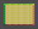 |  |

## Showcase `canvas-ninepatch-no-texture`

Godot draws a `canvas_item_add_nine_patch` on a Node2D of a 2D view, with no material, so Godot's default canvas shader draws it (`tests/e2e/canvasScenes.mjs`). A plain three.js page draws the same commands through the transpiled canvas template with the same values. `pnpm test:shaders:e2e` draws both again and fails on any pixel over 2/255 apart.

```glsl
shader_type canvas_item;
```

| Godot | Transpilation on three.js |
| --- | --- |
|  |  |

## Showcase `canvas-rect-linear-canvas`

Godot draws the scene's rects on a Node2D of a 2D view with `use_hdr_2d`, whose image holds linear colours, with no material, so Godot's default canvas shader draws it (`tests/e2e/canvasScenes.mjs`). A plain three.js page draws the same commands through the transpiled canvas template with the same values. `pnpm test:shaders:e2e` draws both again and fails on any pixel over 2/255 apart.

```glsl
shader_type canvas_item;
```

| Godot | Transpilation on three.js |
| --- | --- |
|  |  |

## Showcase `canvas-rect-linear-canvas-modulate`

Godot draws the scene's rects on a Node2D of a 2D view with `use_hdr_2d`, whose image holds linear colours, with no material, so Godot's default canvas shader draws it (`tests/e2e/canvasScenes.mjs`). A plain three.js page draws the same commands through the transpiled canvas template with the same values. `pnpm test:shaders:e2e` draws both again and fails on any pixel over 2/255 apart.

```glsl
shader_type canvas_item;
```

| Godot | Transpilation on three.js |
| --- | --- |
| 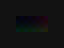 |  |

## Showcase `canvas-shader-fragment-uv`

Godot draws the scene's rects on a Node2D of a 2D view, with a ShaderMaterial of this shader (`tests/e2e/canvasScenes.mjs`). A plain three.js page draws the same commands through the transpiled canvas template with the same values. `pnpm test:shaders:e2e` draws both again and fails on any pixel over 2/255 apart.

```glsl
shader_type canvas_item;

void fragment() {
	COLOR = vec4(UV, 0.5, 1.0);
}
```

| Godot | Transpilation on three.js |
| --- | --- |
| 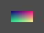 |  |

## Showcase `canvas-shader-fragment-texture`

Godot draws the scene's rects on a Node2D of a 2D view, with a ShaderMaterial of this shader (`tests/e2e/canvasScenes.mjs`). A plain three.js page draws the same commands through the transpiled canvas template with the same values. `pnpm test:shaders:e2e` draws both again and fails on any pixel over 2/255 apart.

```glsl
shader_type canvas_item;

void fragment() {
	COLOR = vec4(texture(TEXTURE, UV + vec2(TEXTURE_PIXEL_SIZE.x, 0.0)).bgr, 1.0);
}
```

| Godot | Transpilation on three.js |
| --- | --- |
|  | 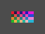 |

## Showcase `canvas-shader-fragment-vertex`

Godot draws the scene's rects on a Node2D of a 2D view, with a ShaderMaterial of this shader (`tests/e2e/canvasScenes.mjs`). A plain three.js page draws the same commands through the transpiled canvas template with the same values. `pnpm test:shaders:e2e` draws both again and fails on any pixel over 2/255 apart.

```glsl
shader_type canvas_item;

void fragment() {
	COLOR = vec4(fract(VERTEX / 8.0), 0.0, 1.0);
}
```

| Godot | Transpilation on three.js |
| --- | --- |
| 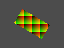 |  |

## Showcase `canvas-shader-fragcoord`

Godot draws the scene's rects on a Node2D of a 2D view, with a ShaderMaterial of this shader (`tests/e2e/canvasScenes.mjs`). A plain three.js page draws the same commands through the transpiled canvas template with the same values. `pnpm test:shaders:e2e` draws both again and fails on any pixel over 2/255 apart.

```glsl
shader_type canvas_item;

void fragment() {
	COLOR = vec4(FRAGCOORD.xy / vec2(64.0, 48.0), FRAGCOORD.z, 1.0);
}
```

| Godot | Transpilation on three.js |
| --- | --- |
| 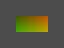 |  |

## Showcase `canvas-shader-screen-uv`

Godot draws the scene's rects on a Node2D of a 2D view, with a ShaderMaterial of this shader (`tests/e2e/canvasScenes.mjs`). A plain three.js page draws the same commands through the transpiled canvas template with the same values. `pnpm test:shaders:e2e` draws both again and fails on any pixel over 2/255 apart.

```glsl
shader_type canvas_item;

void fragment() {
	COLOR = vec4(SCREEN_UV, SCREEN_PIXEL_SIZE.x * 32.0, 1.0);
}
```

| Godot | Transpilation on three.js |
| --- | --- |
| 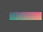 |  |

## Showcase `canvas-shader-region-rect`

Godot draws the scene's rects on a Node2D of a 2D view, with a ShaderMaterial of this shader (`tests/e2e/canvasScenes.mjs`). A plain three.js page draws the same commands through the transpiled canvas template with the same values. `pnpm test:shaders:e2e` draws both again and fails on any pixel over 2/255 apart.

```glsl
shader_type canvas_item;

void fragment() {
	COLOR = vec4(REGION_RECT.xy * 2.0, REGION_RECT.zw);
}
```

| Godot | Transpilation on three.js |
| --- | --- |
|  |  |

## Showcase `canvas-shader-normal-map`

Godot draws the scene's rects on a Node2D of a 2D view, with a ShaderMaterial of this shader (`tests/e2e/canvasScenes.mjs`). A plain three.js page draws the same commands through the transpiled canvas template with the same values. `pnpm test:shaders:e2e` draws both again and fails on any pixel over 2/255 apart.

```glsl
shader_type canvas_item;

void fragment() {
	NORMAL_MAP = vec3(UV, 1.0);
	NORMAL_MAP_DEPTH = 0.5;
	COLOR = vec4(NORMAL * 0.5 + 0.5, 1.0);
}
```

| Godot | Transpilation on three.js |
| --- | --- |
|  |  |

## Showcase `canvas-shader-normal-specular-textures`

Godot draws the scene's rects on a Node2D of a 2D view, with a ShaderMaterial of this shader (`tests/e2e/canvasScenes.mjs`). A plain three.js page draws the same commands through the transpiled canvas template with the same values. `pnpm test:shaders:e2e` draws both again and fails on any pixel over 2/255 apart.

```glsl
shader_type canvas_item;

void fragment() {
	COLOR = vec4(texture(NORMAL_TEXTURE, UV).rg, texture(SPECULAR_SHININESS_TEXTURE, UV).b * SPECULAR_SHININESS.a, 1.0);
}
```

| Godot | Transpilation on three.js |
| --- | --- |
|  |  |

## Showcase `canvas-shader-canvas-texture-maps`

Godot draws the scene's rects on a Node2D of a 2D view, with a ShaderMaterial of this shader (`tests/e2e/canvasScenes.mjs`). A plain three.js page draws the same commands through the transpiled canvas template with the same values. `pnpm test:shaders:e2e` draws both again and fails on any pixel over 2/255 apart.

```glsl
shader_type canvas_item;

void fragment() {
	COLOR = vec4(texture(NORMAL_TEXTURE, UV).rg, texture(SPECULAR_SHININESS_TEXTURE, UV).b * SPECULAR_SHININESS.a, 1.0);
}
```

| Godot | Transpilation on three.js |
| --- | --- |
|  | 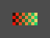 |

## Showcase `canvas-shader-light-vertex`

Godot draws the scene's rects on a Node2D of a 2D view, with a ShaderMaterial of this shader (`tests/e2e/canvasScenes.mjs`). A plain three.js page draws the same commands through the transpiled canvas template with the same values. `pnpm test:shaders:e2e` draws both again and fails on any pixel over 2/255 apart.

```glsl
shader_type canvas_item;

void fragment() {
	LIGHT_VERTEX.z = 0.5;
	SHADOW_VERTEX += vec2(1.0);
	COLOR = vec4(fract(LIGHT_VERTEX.xy / 8.0), LIGHT_VERTEX.z + fract(SHADOW_VERTEX.x / 16.0) * 0.25, 1.0);
}
```

| Godot | Transpilation on three.js |
| --- | --- |
| 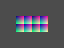 |  |

## Showcase `canvas-shader-at-light-pass`

Godot draws the scene's rects on a Node2D of a 2D view, with a ShaderMaterial of this shader (`tests/e2e/canvasScenes.mjs`). A plain three.js page draws the same commands through the transpiled canvas template with the same values. `pnpm test:shaders:e2e` draws both again and fails on any pixel over 2/255 apart.

```glsl
shader_type canvas_item;

varying float vertex_pass;

void vertex() {
	vertex_pass = AT_LIGHT_PASS ? 1.0 : 0.25;
}

void fragment() {
	COLOR = vec4(AT_LIGHT_PASS ? 1.0 : 0.5, vertex_pass, 0.0, 1.0);
}
```

| Godot | Transpilation on three.js |
| --- | --- |
|  |  |

## Showcase `canvas-shader-vertex-moved`

Godot draws the scene's rects on a Node2D of a 2D view, with a ShaderMaterial of this shader (`tests/e2e/canvasScenes.mjs`). A plain three.js page draws the same commands through the transpiled canvas template with the same values. `pnpm test:shaders:e2e` draws both again and fails on any pixel over 2/255 apart.

```glsl
shader_type canvas_item;

void vertex() {
	VERTEX += vec2(4.0, -2.0);
	UV = UV.yx;
	COLOR = vec4(1.0, 0.5, 0.25, 1.0);
}
```

| Godot | Transpilation on three.js |
| --- | --- |
| 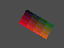 |  |

## Showcase `canvas-shader-vertex-matrices`

Godot draws the scene's rects on a Node2D of a 2D view, with a ShaderMaterial of this shader (`tests/e2e/canvasScenes.mjs`). A plain three.js page draws the same commands through the transpiled canvas template with the same values. `pnpm test:shaders:e2e` draws both again and fails on any pixel over 2/255 apart.

```glsl
shader_type canvas_item;

void vertex() {
	COLOR = vec4(MODEL_MATRIX[0].y + 0.5, CANVAS_MATRIX[3].x / -20.0, SCREEN_MATRIX[0].x * 16.0, 1.0);
}
```

| Godot | Transpilation on three.js |
| --- | --- |
|  | 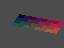 |

## Showcase `canvas-shader-vertex-ids`

Godot draws the scene's rects on a Node2D of a 2D view, with a ShaderMaterial of this shader (`tests/e2e/canvasScenes.mjs`). A plain three.js page draws the same commands through the transpiled canvas template with the same values. `pnpm test:shaders:e2e` draws both again and fails on any pixel over 2/255 apart.

```glsl
shader_type canvas_item;

void vertex() {
	COLOR = vec4(float(VERTEX_ID) / 4.0, float(INSTANCE_ID) / 3.0 + 0.25, INSTANCE_CUSTOM.x + CUSTOM0.x + CUSTOM1.x + 0.5, TEXTURE_PIXEL_SIZE.x * 8.0);
}
```

| Godot | Transpilation on three.js |
| --- | --- |
| 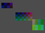 |  |

## Showcase `canvas-shader-constants`

Godot draws the scene's rects on a Node2D of a 2D view, with a ShaderMaterial of this shader (`tests/e2e/canvasScenes.mjs`). A plain three.js page draws the same commands through the transpiled canvas template with the same values. `pnpm test:shaders:e2e` draws both again and fails on any pixel over 2/255 apart.

```glsl
shader_type canvas_item;

void fragment() {
	COLOR = vec4(PI / 4.0, TAU / 8.0, E / 4.0, 1.0);
}
```

| Godot | Transpilation on three.js |
| --- | --- |
|  |  |

## Showcase `canvas-shader-time`

Godot draws the scene's rects on a Node2D of a 2D view, with a ShaderMaterial of this shader (`tests/e2e/canvasScenes.mjs`). A plain three.js page draws the same commands through the transpiled canvas template with the same values. `pnpm test:shaders:e2e` draws both again and fails on any pixel over 2/255 apart.

```glsl
shader_type canvas_item;

void fragment() {
	COLOR = vec4(fract(TIME), fract(TIME * 0.5), 0.5, 1.0);
}
```

| Godot | Transpilation on three.js |
| --- | --- |
|  |  |

## Showcase `canvas-shader-skip-vertex-transform`

Godot draws the scene's rects on a Node2D of a 2D view, with a ShaderMaterial of this shader (`tests/e2e/canvasScenes.mjs`). A plain three.js page draws the same commands through the transpiled canvas template with the same values. `pnpm test:shaders:e2e` draws both again and fails on any pixel over 2/255 apart.

```glsl
shader_type canvas_item;

render_mode skip_vertex_transform;

void vertex() {
	VERTEX = (MODEL_MATRIX * vec4(VERTEX, 0.0, 1.0)).xy + vec2(6.0, 0.0);
}
```

| Godot | Transpilation on three.js |
| --- | --- |
| 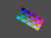 |  |

## Showcase `canvas-shader-world-vertex-coords`

Godot draws the scene's rects on a Node2D of a 2D view, with a ShaderMaterial of this shader (`tests/e2e/canvasScenes.mjs`). A plain three.js page draws the same commands through the transpiled canvas template with the same values. `pnpm test:shaders:e2e` draws both again and fails on any pixel over 2/255 apart.

```glsl
shader_type canvas_item;

render_mode world_vertex_coords;

void vertex() {
	VERTEX.x += 6.0;
}
```

| Godot | Transpilation on three.js |
| --- | --- |
|  |  |

## Showcase `canvas-shader-unshaded`

Godot draws the scene's rects on a Node2D of a 2D view, with a ShaderMaterial of this shader (`tests/e2e/canvasScenes.mjs`). A plain three.js page draws the same commands through the transpiled canvas template with the same values. `pnpm test:shaders:e2e` draws both again and fails on any pixel over 2/255 apart.

```glsl
shader_type canvas_item;

render_mode unshaded;
```

| Godot | Transpilation on three.js |
| --- | --- |
|  | 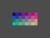 |

## Showcase `canvas-shader-light-only`

Godot draws the scene's rects on a Node2D of a 2D view, with a ShaderMaterial of this shader (`tests/e2e/canvasScenes.mjs`). A plain three.js page draws the same commands through the transpiled canvas template with the same values. `pnpm test:shaders:e2e` draws both again and fails on any pixel over 2/255 apart.

```glsl
shader_type canvas_item;

render_mode light_only;
```

| Godot | Transpilation on three.js |
| --- | --- |
|  |  |

## Showcase `canvas-shader-mesh-customs`

Godot draws an ArrayMesh of 2D vertices on a MeshInstance2D of a 2D view, with a ShaderMaterial of this shader (`tests/e2e/canvasScenes.mjs`). A plain three.js page draws the same commands through the transpiled canvas template with the same values. `pnpm test:shaders:e2e` draws both again and fails on any pixel over 2/255 apart.

```glsl
shader_type canvas_item;

void vertex() {
	COLOR = vec4(CUSTOM0.xy, CUSTOM1.z, CUSTOM0.w + CUSTOM1.w * 0.5);
}
```

| Godot | Transpilation on three.js |
| --- | --- |
| 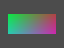 |  |

## Showcase `canvas-shader-point-size-mesh`

Godot draws an ArrayMesh of 2D vertices on a MeshInstance2D of a 2D view, with a ShaderMaterial of this shader (`tests/e2e/canvasScenes.mjs`). A plain three.js page draws the same commands through the transpiled canvas template with the same values. `pnpm test:shaders:e2e` draws both again and fails on any pixel over 2/255 apart.

```glsl
shader_type canvas_item;

void vertex() {
	POINT_SIZE = 2.0 + float(VERTEX_ID) * 1.5;
}

void fragment() {
	COLOR = vec4(POINT_COORD, COLOR.b, 1.0);
}
```

| Godot | Transpilation on three.js |
| --- | --- |
| 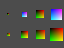 | 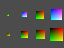 |

## Showcase `canvas-shader-point-size-primitive`

Godot draws the scene's `draw_primitive` calls on a Node2D of a 2D view, with a ShaderMaterial of this shader (`tests/e2e/canvasScenes.mjs`). A plain three.js page draws the same commands through the transpiled canvas template with the same values. `pnpm test:shaders:e2e` draws both again and fails on any pixel over 2/255 apart.

```glsl
shader_type canvas_item;

void vertex() {
	POINT_SIZE = 3.0 + float(INSTANCE_ID) * 2.0;
}

void fragment() {
	COLOR = vec4(POINT_COORD.x, COLOR.g, POINT_COORD.y, 1.0);
}
```

| Godot | Transpilation on three.js |
| --- | --- |
| 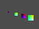 |  |

## Showcase `canvas-shader-blend-mix`

Godot draws the scene's rects on a Node2D of a 2D view, with a ShaderMaterial of this shader (`tests/e2e/canvasScenes.mjs`). A plain three.js page draws the same commands through the transpiled canvas template with the same values. `pnpm test:shaders:e2e` draws both again and fails on any pixel over 2/255 apart.

```glsl
shader_type canvas_item;

render_mode blend_mix;

void fragment() {
	COLOR.rgb *= 0.75;
}
```

| Godot | Transpilation on three.js |
| --- | --- |
|  | 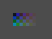 |

## Showcase `canvas-shader-blend-add`

Godot draws the scene's rects on a Node2D of a 2D view, with a ShaderMaterial of this shader (`tests/e2e/canvasScenes.mjs`). A plain three.js page draws the same commands through the transpiled canvas template with the same values. `pnpm test:shaders:e2e` draws both again and fails on any pixel over 2/255 apart.

```glsl
shader_type canvas_item;

render_mode blend_add;

void fragment() {
	COLOR.rgb *= 0.75;
}
```

| Godot | Transpilation on three.js |
| --- | --- |
|  | 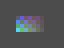 |

## Showcase `canvas-shader-blend-sub`

Godot draws the scene's rects on a Node2D of a 2D view, with a ShaderMaterial of this shader (`tests/e2e/canvasScenes.mjs`). A plain three.js page draws the same commands through the transpiled canvas template with the same values. `pnpm test:shaders:e2e` draws both again and fails on any pixel over 2/255 apart.

```glsl
shader_type canvas_item;

render_mode blend_sub;

void fragment() {
	COLOR.rgb *= 0.75;
}
```

| Godot | Transpilation on three.js |
| --- | --- |
| 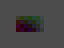 |  |

## Showcase `canvas-shader-blend-mul`

Godot draws the scene's rects on a Node2D of a 2D view, with a ShaderMaterial of this shader (`tests/e2e/canvasScenes.mjs`). A plain three.js page draws the same commands through the transpiled canvas template with the same values. `pnpm test:shaders:e2e` draws both again and fails on any pixel over 2/255 apart.

```glsl
shader_type canvas_item;

render_mode blend_mul;

void fragment() {
	COLOR.rgb *= 0.75;
}
```

| Godot | Transpilation on three.js |
| --- | --- |
| 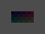 |  |

## Showcase `canvas-shader-blend-premul-alpha`

Godot draws the scene's rects on a Node2D of a 2D view, with a ShaderMaterial of this shader (`tests/e2e/canvasScenes.mjs`). A plain three.js page draws the same commands through the transpiled canvas template with the same values. `pnpm test:shaders:e2e` draws both again and fails on any pixel over 2/255 apart.

```glsl
shader_type canvas_item;

render_mode blend_premul_alpha;

void fragment() {
	COLOR.rgb *= 0.75;
}
```

| Godot | Transpilation on three.js |
| --- | --- |
| 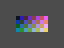 |  |

## Showcase `canvas-shader-blend-disabled`

Godot draws the scene's rects on a Node2D of a 2D view, with a ShaderMaterial of this shader (`tests/e2e/canvasScenes.mjs`). A plain three.js page draws the same commands through the transpiled canvas template with the same values. `pnpm test:shaders:e2e` draws both again and fails on any pixel over 2/255 apart.

```glsl
shader_type canvas_item;

render_mode blend_disabled;

void fragment() {
	COLOR.rgb *= 0.75;
}
```

| Godot | Transpilation on three.js |
| --- | --- |
| 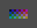 |  |

## Showcase `canvas-shader-source-color`

Godot draws the scene's rects on a Node2D of a 2D view, with no material, so Godot's default canvas shader draws it (`tests/e2e/canvasScenes.mjs`). A plain three.js page draws the same commands through the transpiled canvas template with the same values. `pnpm test:shaders:e2e` draws both again and fails on any pixel over 2/255 apart.

```glsl
shader_type canvas_item;

uniform vec4 tint : source_color = vec4(0.5, 0.25, 0.75, 1.0);

void fragment() {
	COLOR = tint;
}
```

| Godot | Transpilation on three.js |
| --- | --- |
|  |  |

## Showcase `canvas-shader-source-color-linear`

Godot draws the scene's rects on a Node2D of a 2D view with `use_hdr_2d`, whose image holds linear colours, with no material, so Godot's default canvas shader draws it (`tests/e2e/canvasScenes.mjs`). A plain three.js page draws the same commands through the transpiled canvas template with the same values. `pnpm test:shaders:e2e` draws both again and fails on any pixel over 2/255 apart.

```glsl
shader_type canvas_item;

uniform vec4 tint : source_color = vec4(0.5, 0.25, 0.75, 1.0);

void fragment() {
	COLOR = tint;
}
```

| Godot | Transpilation on three.js |
| --- | --- |
|  |  |

## `COLOR` and `UV` in `fragment()`

`COLOR` starts as the vertex colour times the texture's texel at `UV`, and `fragment()` writes the colour the item blends. `UV` is the texture coordinate, read only: the rect's source in 0 to 1, clamped half a texel inside a region with `clipUv` (`canvas.glsl:292-297`).

The transpiler emits the template's locals `color` and `uv`. Rows: `canvas_item.fragment.UV`, `canvas_item.fragment.COLOR`. Godot source: `servers/rendering/shader_types.cpp:294`.

Every row is native on WebGL 2. WebGPURenderer runs the same nodes and is untested (#1788).


## `TEXTURE` and `TEXTURE_PIXEL_SIZE` in `fragment()`

`TEXTURE` is the item's texture with the item's filter and repeat, or Godot's white default texture. `TEXTURE_PIXEL_SIZE` is one over the texture's size in texels (`renderer_canvas_render_rd.cpp:1791-1792`).

The transpiler emits the template's texture `color_texture` and the record's texel size. Rows: `canvas_item.fragment.TEXTURE`, `canvas_item.fragment.TEXTURE_PIXEL_SIZE`. Godot source: `servers/rendering/shader_types.cpp:296`.

Every row is native on WebGL 2. WebGPURenderer runs the same nodes and is untested (#1788).


## `VERTEX` in `fragment()`

`VERTEX` in `fragment()` is the pixel's place after the item's transform and the canvas transform, in the render target's pixels (`canvas.glsl:290-296`, `canvas.glsl:572`).

The transpiler emits the template's local `vertex`, from the varying `uv_vertex_interp.zw`. Rows: `canvas_item.fragment.VERTEX`. Godot source: `servers/rendering/shader_types.cpp:287`.

Every row is native on WebGL 2. WebGPURenderer runs the same nodes and is untested (#1788).


## `FRAGCOORD`

`FRAGCOORD` is the pixel's window coordinate, with y down from the render target's top row, as Godot's Vulkan frame counts it (`renderer_canvas_render_rd.cpp:1799`).

The transpiler emits `screenCoordinate`, counted from the top row for a target of Godot's rows. It subtracts the viewport's top-left in the target and divides by the viewport's pixel scale, since a previewer draws Godot's viewport inside a larger target. Rows: `canvas_item.fragment.FRAGCOORD`. Godot source: `servers/rendering/shader_types.cpp:290`.

Every row is native on WebGL 2. WebGPURenderer runs the same nodes and is untested (#1788).


## `SCREEN_UV` and `SCREEN_PIXEL_SIZE`

`SCREEN_PIXEL_SIZE` is one over the render target's size in pixels. `SCREEN_UV` is `FRAGCOORD.xy` times it, from 0 to 1 across the target (`canvas.glsl:684-688`).

The transpiler emits the template's local `screen_uv` and the block member `canvas_data.screen_pixel_size`, which holds one over the viewport's size, not the WebGL target's. Rows: `canvas_item.fragment.SCREEN_UV`, `canvas_item.fragment.SCREEN_PIXEL_SIZE`. Godot source: `servers/rendering/shader_types.cpp:301`.

Every row is native on WebGL 2. WebGPURenderer runs the same nodes and is untested (#1788).


## `REGION_RECT`

`REGION_RECT` is the rect's source region in uv: its corner, then its size. A primitive, a polygon and a mesh read the whole texture, `(0, 0, 1, 1)` (`canvas.glsl:575-579`).

The transpiler emits the template's local `region_rect`. Rows: `canvas_item.fragment.REGION_RECT`. Godot source: `servers/rendering/shader_types.cpp:302`.

Every row is native on WebGL 2. WebGPURenderer runs the same nodes and is untested (#1788).


## `NORMAL`, `NORMAL_MAP` and `NORMAL_MAP_DEPTH`

`NORMAL` starts as the item's normal texture at `UV`, or `(0, 0, 1)` with none. After `fragment()`, a written `NORMAL_MAP` replaces it, mixed from `(0, 0, 1)` by `NORMAL_MAP_DEPTH` (`canvas.glsl:654-705`). Only a 2D light reads the normal.

The transpiler emits the template's locals `normal`, `normal_map` and `normal_map_depth`. Rows: `canvas_item.fragment.NORMAL`, `canvas_item.fragment.NORMAL_MAP`, `canvas_item.fragment.NORMAL_MAP_DEPTH`. Godot source: `servers/rendering/shader_types.cpp:291`.

Every row is native on WebGL 2. WebGPURenderer runs the same nodes and is untested (#1788).


## `NORMAL_TEXTURE`, `SPECULAR_SHININESS_TEXTURE` and `SPECULAR_SHININESS`

`NORMAL_TEXTURE` and `SPECULAR_SHININESS_TEXTURE` are the item's CanvasTexture maps, or Godot's default normal and white textures. `SPECULAR_SHININESS` is the specular texture at `UV` times the item's specular colour and shininess (`canvas.glsl:667-682`).

The transpiler emits the template's textures `normal_texture` and `specular_texture`, and its local `specular_shininess`. Rows: `canvas_item.fragment.NORMAL_TEXTURE`, `canvas_item.fragment.SPECULAR_SHININESS_TEXTURE`, `canvas_item.fragment.SPECULAR_SHININESS`. Godot source: `servers/rendering/shader_types.cpp:298`.

Every row is native on WebGL 2. WebGPURenderer runs the same nodes and is untested (#1788).


## `LIGHT_VERTEX` and `SHADOW_VERTEX`

`LIGHT_VERTEX` starts as `vec3(VERTEX, 0.0)` and `SHADOW_VERTEX` as `VERTEX`. A 2D light reads the first for its direction and the second for its shadow (`canvas.glsl:690-691`).

The transpiler emits the template's locals `light_vertex` and `shadow_vertex`. Rows: `canvas_item.fragment.SHADOW_VERTEX`, `canvas_item.fragment.LIGHT_VERTEX`. Godot source: `servers/rendering/shader_types.cpp:288`.

Every row is native on WebGL 2. WebGPURenderer runs the same nodes and is untested (#1788).


## `AT_LIGHT_PASS`

`AT_LIGHT_PASS` is always false: Godot draws an item's lights in the item's one pass (`renderer_canvas_render_rd.cpp:1784`).

The transpiler emits `false`. Rows: `canvas_item.vertex.AT_LIGHT_PASS`, `canvas_item.fragment.AT_LIGHT_PASS`. Godot source: `servers/rendering/shader_types.cpp:280`.

Every row is native on WebGL 2. WebGPURenderer runs the same nodes and is untested (#1788).


## `VERTEX`, `UV` and `COLOR` in `vertex()`

`VERTEX` is the vertex in the item's local pixels, `UV` its texture coordinate and `COLOR` its colour times the final modulate. After `vertex()`, the template moves `VERTEX` by the item's transform and the canvas transform (`canvas.glsl:268-300`).

The transpiler emits the template's locals `vertex`, `uv` and `color`. Rows: `canvas_item.vertex.VERTEX`, `canvas_item.vertex.UV`, `canvas_item.vertex.COLOR`. Godot source: `servers/rendering/shader_types.cpp:269`.

Every row is native on WebGL 2. WebGPURenderer runs the same nodes and is untested (#1788).


## `MODEL_MATRIX`, `CANVAS_MATRIX` and `SCREEN_MATRIX`

`MODEL_MATRIX` is the item's transform to the canvas, `CANVAS_MATRIX` the canvas transform to the render target's pixels, and `SCREEN_MATRIX` the pixels to clip space (`renderer_canvas_render_rd.cpp:1777-1779`).

The transpiler emits the template's local `model_matrix` and the block members `canvas_data.canvas_transform` and `canvas_data.screen_transform`. Rows: `canvas_item.vertex.MODEL_MATRIX`, `canvas_item.vertex.CANVAS_MATRIX`, `canvas_item.vertex.SCREEN_MATRIX`. Godot source: `servers/rendering/shader_types.cpp:274`.

Every row is native on WebGL 2. WebGPURenderer runs the same nodes and is untested (#1788).


## `VERTEX_ID`, `INSTANCE_ID`, `INSTANCE_CUSTOM`, `CUSTOM0`, `CUSTOM1` and `TEXTURE_PIXEL_SIZE` in `vertex()`

`VERTEX_ID` and `INSTANCE_ID` are the draw's vertex and instance index: a quad batch draws one instance for each rect. `INSTANCE_CUSTOM` is a MultiMesh instance's custom data, and `CUSTOM0` and `CUSTOM1` a mesh's custom arrays, each zero with none (`canvas.glsl:139-188`). `attributesGeometry` takes them as `customs`, four lanes a vertex. It binds only those in the draw's `customsRead`, as `canvas.glsl:12-18` declares no other.

The transpiler emits `vertexIndex`, `instanceIndex` and the template's locals `instance_custom`, `custom0` and `custom1`. Rows: `canvas_item.vertex.INSTANCE_CUSTOM`, `canvas_item.vertex.INSTANCE_ID`, `canvas_item.vertex.VERTEX_ID`, `canvas_item.vertex.TEXTURE_PIXEL_SIZE`, `canvas_item.vertex.CUSTOM0`, `canvas_item.vertex.CUSTOM1`. Godot source: `servers/rendering/shader_types.cpp:277`.

Every row is native on WebGL 2. WebGPURenderer runs the same nodes and is untested (#1788).


## `POINT_SIZE` and `POINT_COORD`

A point of a one-point primitive or of a mesh of `PRIMITIVE_POINTS` draws in a points variant, which writes `POINT_SIZE` as the point's size in pixels, 1 when `vertex()` leaves it (`canvas.glsl:268, 300-302`). `POINT_COORD` runs from 0 to 1 across the point, with y down (`renderer_canvas_render_rd.cpp:1800`). three's node shaders write a size of 1 to every point, so a shader that names `POINT_SIZE` draws each point as an instance of six vertices, at the corners of a square of `POINT_SIZE` pixels: `CanvasDraw.emulatesPoints` is then true. `attributesObject` and `primitiveBatchObject` build that draw. A size below 1, 0 or a negative size draws as 1 pixel, as Vulkan draws it.

The transpiler emits `devicePoints`: the square's corner of `vertexIndex` and a varying of it for `gl_PointCoord`, or three's `pointUV` turned for a point of 1 pixel. Rows: `canvas_item.vertex.POINT_SIZE`, `canvas_item.fragment.POINT_COORD`. Godot source: `servers/rendering/shader_types.cpp:272`.

Every row is native on WebGL 2. WebGPURenderer runs the same nodes and is untested (#1788).


## `PI`, `TAU` and `E`

Each constant is the number that Godot writes in the text of the shader (`renderer_canvas_render_rd.cpp:1781-1783`).

The transpiler emits `a float literal`. Rows: `canvas_item.constants.PI`, `canvas_item.constants.TAU`, `canvas_item.constants.E`. Godot source: `servers/rendering/shader_types.cpp:265`.

Every row is native on WebGL 2. WebGPURenderer runs the same nodes and is untested (#1788).


## `TIME`

`TIME` is the shader time in seconds, with the same sum and wrap as a sky's `TIME`. `writeCanvasBindings(draw, { time })` writes it (`renderer_canvas_render_rd.cpp:1780`).

The transpiler emits the block member `canvas_data.time`. Rows: `canvas_item.global.TIME`. Godot source: `servers/rendering/shader_types.cpp:264`.

Every row is native on WebGL 2. WebGPURenderer runs the same nodes and is untested (#1788).


## `skip_vertex_transform` and `world_vertex_coords`

`skip_vertex_transform` leaves the item's transform to `vertex()`. `world_vertex_coords` moves `VERTEX` by the item's transform before `vertex()` instead of after (`canvas.glsl:270-283`).

The transpiler emits the template's defines `SKIP_TRANSFORM_USED` and `USE_WORLD_VERTEX_COORDS`. Rows: `canvas_item render_mode skip_vertex_transform`, `canvas_item render_mode world_vertex_coords`. Godot source: `servers/rendering/shader_types.cpp:354`.

Every row is native on WebGL 2. WebGPURenderer runs the same nodes and is untested (#1788).


## `unshaded` and `light_only`

`unshaded` leaves out the CanvasModulate colour and the 2D lights. `light_only` draws the item only where a 2D light reaches it, so with no light it draws nothing (`canvas.glsl:717-721`, `canvas.glsl:861-863`).

The transpiler emits the template's defines `MODE_UNSHADED` and `MODE_LIGHT_ONLY`. Rows: `canvas_item render_mode unshaded`, `canvas_item render_mode light_only`. Godot source: `servers/rendering/shader_types.cpp:356`.

Every row is native on WebGL 2. WebGPURenderer runs the same nodes and is untested (#1788).


## Blend modes

A blend word sets the blend of the item's pass, as on a spatial material. `blend_disabled` writes the colour and its alpha as they are (`renderer_canvas_render_rd.cpp:1502-1516`, `renderer_canvas_render_rd.cpp:1566-1571`).

The transpiler emits the material's blend state from `canvasBlendState(tree)`. Rows: `canvas_item render_mode blend_mix`, `canvas_item render_mode blend_add`, `canvas_item render_mode blend_sub`, `canvas_item render_mode blend_mul`, `canvas_item render_mode blend_premul_alpha`, `canvas_item render_mode blend_disabled`. Godot source: `servers/rendering/shader_types.cpp:355`.

Every row is native on WebGL 2. WebGPURenderer runs the same nodes and is untested (#1788).

