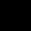

# Sky shaders

A shader of `shader_type sky` draws a 3D view's background. Godot links it into its sky template, `environment/sky.glsl`: the shader's `sky()` fills the template's code slot, each built-in reads as the template's GLSL for it, and each name of the shader takes Godot's `m_` id. The transpiler links the shader the same way, then transpiles both stages of the template to TSL on a triangle that covers the view. `writeSkyBindings` writes the template's uniforms from the camera, the fog and the directional lights, and `SKY_BINDINGS` names the line of Godot's C++ behind each one.

Godot 4.6.3-stable (official), probed on llvmpipe (LLVM 20.1.2). Each table shows at most 8 of a probe's rows, picked to show as many mixes of zero, subnormal, normal, infinite and NaN values as fit. The real-GL test (`pnpm test:shaders:gpu`) checks every row, bit for bit, NaN lanes compared as NaN. Generated by `pnpm godot:shader-language`: do not edit by hand.

## Showcase `sky-default`

Godot draws this sky shader as a 3D view's background, with the scene's camera, fog and directional lights (`tests/e2e/skyScenes.mjs`). A plain three.js page draws the transpiled sky with the same values. `pnpm test:shaders:e2e` draws both again and fails on any pixel over 2/255 apart.

```glsl
shader_type sky;

void sky() {
	COLOR = vec3(0.0);
}
```

| Godot | Transpilation on three.js |
| --- | --- |
|  |  |

## Showcase `sky-fog`

Godot draws this sky shader as a 3D view's background, with the scene's camera, fog and directional lights (`tests/e2e/skyScenes.mjs`). A plain three.js page draws the transpiled sky with the same values. `pnpm test:shaders:e2e` draws both again and fails on any pixel over 2/255 apart.

```glsl
shader_type sky;

void sky() {
	COLOR = vec3(0.0);
}
```

| Godot | Transpilation on three.js |
| --- | --- |
|  |  |

## Showcase `sky-fog-sun`

Godot draws this sky shader as a 3D view's background, with the scene's camera, fog and directional lights (`tests/e2e/skyScenes.mjs`). A plain three.js page draws the transpiled sky with the same values. `pnpm test:shaders:e2e` draws both again and fails on any pixel over 2/255 apart.

```glsl
shader_type sky;

void sky() {
	COLOR = vec3(0.0);
}
```

| Godot | Transpilation on three.js |
| --- | --- |
|  |  |

## The shader head

`shader_type sky;` opens the shader and names its type. Godot refuses a type it does not have, with the valid ones, and a head with no `;`, at the line of the type. The shader node holds the type, the structs and the functions.

The transpiler emits `the sky template, both stages, with the shader linked into its slots`. Rows: `shader_type`, `NODE_TYPE_SHADER`, `shader_type sky`. Godot source: `servers/rendering/shader_language.cpp:340`.

Every row is native on WebGL 2 and on WebGPURenderer.


## `COLOR`

`COLOR` is the colour `sky()` writes, linear. Godot's sky template holds it in its local `color`, and writes it to the frame after the environment's brightness and fog.

The transpiler emits `the template's local `color``. Rows: `sky.sky.COLOR`. Godot source: `servers/rendering/shader_types.cpp:486`.

Every row is native on WebGL 2 and on WebGPURenderer.

