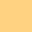
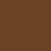
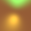
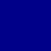
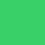
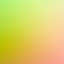
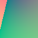
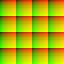
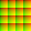
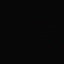

# Sky shaders

A shader of `shader_type sky` draws a 3D view's background. Godot links it into its sky template, `environment/sky.glsl`: the shader's `sky()` fills the template's code slot, each built-in reads as the template's GLSL for it, and each name of the shader takes Godot's `m_` id. The transpiler links the shader the same way, then transpiles both stages of the template to TSL on a triangle that covers the view. `writeSkyBindings` writes the template's uniforms from the camera, the fog and the directional lights, and `SKY_BINDINGS` names the line of Godot's C++ behind each one.

Godot 4.6.3-stable (official), probed on llvmpipe (LLVM 20.1.2). Each table shows at most 8 of a probe's rows, picked to show as many mixes of zero, subnormal, normal, infinite and NaN values as fit. The real-GL test (`pnpm test:shaders:gpu`) checks every row, bit for bit, NaN lanes compared as NaN. Generated by `pnpm godot:shader-language`: do not edit by hand.

## Showcase `sky-default`

Godot draws this sky shader as a 3D view's background, with the scene's camera, fog and directional lights (`tests/e2e/skyScenes.mjs`). A plain three.js page draws the transpiled sky with the same values. `pnpm test:shaders:e2e` draws both again and fails on any pixel over 2/255 apart.

```glsl
shader_type sky;

void sky() {
	COLOR = vec3(0.0);
}
```

| Godot | Transpilation on three.js |
| --- | --- |
|  |  |

## Showcase `sky-fog`

Godot draws this sky shader as a 3D view's background, with the scene's camera, fog and directional lights (`tests/e2e/skyScenes.mjs`). A plain three.js page draws the transpiled sky with the same values. `pnpm test:shaders:e2e` draws both again and fails on any pixel over 2/255 apart.

```glsl
shader_type sky;

void sky() {
	COLOR = vec3(0.0);
}
```

| Godot | Transpilation on three.js |
| --- | --- |
|  |  |

## Showcase `sky-fog-sun`

Godot draws this sky shader as a 3D view's background, with the scene's camera, fog and directional lights (`tests/e2e/skyScenes.mjs`). A plain three.js page draws the transpiled sky with the same values. `pnpm test:shaders:e2e` draws both again and fails on any pixel over 2/255 apart.

```glsl
shader_type sky;

void sky() {
	COLOR = vec3(0.0);
}
```

| Godot | Transpilation on three.js |
| --- | --- |
|  |  |

## Showcase `sky-fog-energy-0`

Godot draws this sky shader as a 3D view's background, with the scene's camera, fog and directional lights (`tests/e2e/skyScenes.mjs`). A plain three.js page draws the transpiled sky with the same values. `pnpm test:shaders:e2e` draws both again and fails on any pixel over 2/255 apart.

```glsl
shader_type sky;

void sky() {
	COLOR = vec3(0.0);
}
```

| Godot | Transpilation on three.js |
| --- | --- |
|  |  |

## Showcase `sky-fog-energy-3`

Godot draws this sky shader as a 3D view's background, with the scene's camera, fog and directional lights (`tests/e2e/skyScenes.mjs`). A plain three.js page draws the transpiled sky with the same values. `pnpm test:shaders:e2e` draws both again and fails on any pixel over 2/255 apart.

```glsl
shader_type sky;

void sky() {
	COLOR = vec3(0.0);
}
```

| Godot | Transpilation on three.js |
| --- | --- |
|  |  |

## Showcase `sky-fog-affect-0`

Godot draws this sky shader as a 3D view's background, with the scene's camera, fog and directional lights (`tests/e2e/skyScenes.mjs`). A plain three.js page draws the transpiled sky with the same values. `pnpm test:shaders:e2e` draws both again and fails on any pixel over 2/255 apart.

```glsl
shader_type sky;

void sky() {
	COLOR = vec3(0.0);
}
```

| Godot | Transpilation on three.js |
| --- | --- |
|  |  |

## Showcase `sky-fog-affect-half`

Godot draws this sky shader as a 3D view's background, with the scene's camera, fog and directional lights (`tests/e2e/skyScenes.mjs`). A plain three.js page draws the transpiled sky with the same values. `pnpm test:shaders:e2e` draws both again and fails on any pixel over 2/255 apart.

```glsl
shader_type sky;

void sky() {
	COLOR = vec3(0.0);
}
```

| Godot | Transpilation on three.js |
| --- | --- |
|  |  |

## Showcase `sky-sun-coloured`

Godot draws this sky shader as a 3D view's background, with the scene's camera, fog and directional lights (`tests/e2e/skyScenes.mjs`). A plain three.js page draws the transpiled sky with the same values. `pnpm test:shaders:e2e` draws both again and fails on any pixel over 2/255 apart.

```glsl
shader_type sky;

void sky() {
	COLOR = vec3(0.0);
}
```

| Godot | Transpilation on three.js |
| --- | --- |
|  |  |

## Showcase `sky-sun-below`

Godot draws this sky shader as a 3D view's background, with the scene's camera, fog and directional lights (`tests/e2e/skyScenes.mjs`). A plain three.js page draws the transpiled sky with the same values. `pnpm test:shaders:e2e` draws both again and fails on any pixel over 2/255 apart.

```glsl
shader_type sky;

void sky() {
	COLOR = vec3(0.0);
}
```

| Godot | Transpilation on three.js |
| --- | --- |
|  |  |

## Showcase `sky-sun-energy-0`

Godot draws this sky shader as a 3D view's background, with the scene's camera, fog and directional lights (`tests/e2e/skyScenes.mjs`). A plain three.js page draws the transpiled sky with the same values. `pnpm test:shaders:e2e` draws both again and fails on any pixel over 2/255 apart.

```glsl
shader_type sky;

void sky() {
	COLOR = vec3(0.0);
}
```

| Godot | Transpilation on three.js |
| --- | --- |
|  |  |

## Showcase `sky-camera-wide`

Godot draws this sky shader as a 3D view's background, with the scene's camera, fog and directional lights (`tests/e2e/skyScenes.mjs`). A plain three.js page draws the transpiled sky with the same values. `pnpm test:shaders:e2e` draws both again and fails on any pixel over 2/255 apart.

```glsl
shader_type sky;

void sky() {
	COLOR = vec3(0.0);
}
```

| Godot | Transpilation on three.js |
| --- | --- |
|  |  |

## Showcase `sky-time-zero`

Godot draws this sky shader as a 3D view's background, with the scene's camera, fog and directional lights (`tests/e2e/skyScenes.mjs`). A plain three.js page draws the transpiled sky with the same values. `pnpm test:shaders:e2e` draws both again and fails on any pixel over 2/255 apart.

```glsl
shader_type sky;

void sky() {
	COLOR = vec3(TIME * 0.5, fract(TIME * 4.0), 0.25);
}
```

| Godot | Transpilation on three.js |
| --- | --- |
|  |  |

## Showcase `sky-time-fraction`

Godot draws this sky shader as a 3D view's background, with the scene's camera, fog and directional lights (`tests/e2e/skyScenes.mjs`). A plain three.js page draws the transpiled sky with the same values. `pnpm test:shaders:e2e` draws both again and fails on any pixel over 2/255 apart.

```glsl
shader_type sky;

void sky() {
	COLOR = vec3(TIME * 0.5, fract(TIME * 4.0), 0.25);
}
```

| Godot | Transpilation on three.js |
| --- | --- |
|  |  |

## Showcase `sky-time-rolled-over`

Godot draws this sky shader as a 3D view's background, with the scene's camera, fog and directional lights (`tests/e2e/skyScenes.mjs`). A plain three.js page draws the transpiled sky with the same values. `pnpm test:shaders:e2e` draws both again and fails on any pixel over 2/255 apart.

```glsl
shader_type sky;

void sky() {
	COLOR = vec3(TIME * 0.5, fract(TIME * 4.0), 0.25);
}
```

| Godot | Transpilation on three.js |
| --- | --- |
|  |  |

## Showcase `sky-time-cycle`

Godot draws this sky shader as a 3D view's background, with the scene's camera, fog and directional lights (`tests/e2e/skyScenes.mjs`). A plain three.js page draws the transpiled sky with the same values. `pnpm test:shaders:e2e` draws both again and fails on any pixel over 2/255 apart.

```glsl
shader_type sky;

void sky() {
	vec3 phase = vec3(0.0, 2.0, 4.0);
	COLOR = 0.5 + 0.5 * cos(TIME * vec3(1.0, 1.3, 1.7) * 2.0 + phase);
	COLOR *= 0.75 + 0.25 * step(0.5, fract(TIME));
}
```

| Godot | Transpilation on three.js |
| --- | --- |
|  |  |

## Showcase `sky-eyedir`

Godot draws this sky shader as a 3D view's background, with the scene's camera, fog and directional lights (`tests/e2e/skyScenes.mjs`). A plain three.js page draws the transpiled sky with the same values. `pnpm test:shaders:e2e` draws both again and fails on any pixel over 2/255 apart.

```glsl
shader_type sky;

void sky() {
	COLOR = EYEDIR * 0.5 + 0.5;
}
```

| Godot | Transpilation on three.js |
| --- | --- |
|  |  |

## Showcase `sky-coords`

Godot draws this sky shader as a 3D view's background, with the scene's camera, fog and directional lights (`tests/e2e/skyScenes.mjs`). A plain three.js page draws the transpiled sky with the same values. `pnpm test:shaders:e2e` draws both again and fails on any pixel over 2/255 apart.

```glsl
shader_type sky;

void sky() {
	COLOR = vec3(SKY_COORDS, 0.25);
}
```

| Godot | Transpilation on three.js |
| --- | --- |
|  |  |

## Showcase `sky-screen-uv`

Godot draws this sky shader as a 3D view's background, with the scene's camera, fog and directional lights (`tests/e2e/skyScenes.mjs`). A plain three.js page draws the transpiled sky with the same values. `pnpm test:shaders:e2e` draws both again and fails on any pixel over 2/255 apart.

```glsl
shader_type sky;

void sky() {
	COLOR = vec3(SCREEN_UV, 0.25);
}
```

| Godot | Transpilation on three.js |
| --- | --- |
|  |  |

## Showcase `sky-fragcoord`

Godot draws this sky shader as a 3D view's background, with the scene's camera, fog and directional lights (`tests/e2e/skyScenes.mjs`). A plain three.js page draws the transpiled sky with the same values. `pnpm test:shaders:e2e` draws both again and fails on any pixel over 2/255 apart.

```glsl
shader_type sky;

void sky() {
	COLOR = vec3(fract(FRAGCOORD.xy / 16.0), FRAGCOORD.z);
}
```

| Godot | Transpilation on three.js |
| --- | --- |
|  |  |

## Showcase `sky-position`

Godot draws this sky shader as a 3D view's background, with the scene's camera, fog and directional lights (`tests/e2e/skyScenes.mjs`). A plain three.js page draws the transpiled sky with the same values. `pnpm test:shaders:e2e` draws both again and fails on any pixel over 2/255 apart.

```glsl
shader_type sky;

void sky() {
	COLOR = fract(POSITION * 0.37);
}
```

| Godot | Transpilation on three.js |
| --- | --- |
|  |  |

## Showcase `sky-constants`

Godot draws this sky shader as a 3D view's background, with the scene's camera, fog and directional lights (`tests/e2e/skyScenes.mjs`). A plain three.js page draws the transpiled sky with the same values. `pnpm test:shaders:e2e` draws both again and fails on any pixel over 2/255 apart.

```glsl
shader_type sky;

void sky() {
	COLOR = vec3(PI / 4.0, TAU / 8.0, E / 3.0) * (0.5 + 0.5 * EYEDIR.y);
}
```

| Godot | Transpilation on three.js |
| --- | --- |
|  |  |

## Showcase `sky-fog-write`

Godot draws this sky shader as a 3D view's background, with the scene's camera, fog and directional lights (`tests/e2e/skyScenes.mjs`). A plain three.js page draws the transpiled sky with the same values. `pnpm test:shaders:e2e` draws both again and fails on any pixel over 2/255 apart.

```glsl
shader_type sky;

void sky() {
	COLOR = vec3(0.1, 0.2, 0.8);
	FOG = vec4(1.0, 0.3, 0.1, 0.6 * max(EYEDIR.y, 0.0));
}
```

| Godot | Transpilation on three.js |
| --- | --- |
|  |  |

## Showcase `sky-disable-fog`

Godot draws this sky shader as a 3D view's background, with the scene's camera, fog and directional lights (`tests/e2e/skyScenes.mjs`). A plain three.js page draws the transpiled sky with the same values. `pnpm test:shaders:e2e` draws both again and fails on any pixel over 2/255 apart.

```glsl
shader_type sky;
render_mode disable_fog;

void sky() {
	COLOR = vec3(0.1, 0.2, 0.8);
}
```

| Godot | Transpilation on three.js |
| --- | --- |
|  |  |

## Showcase `sky-debanding`

Godot draws this sky shader as a 3D view's background, with the scene's camera, fog and directional lights (`tests/e2e/skyScenes.mjs`). A plain three.js page draws the transpiled sky with the same values. `pnpm test:shaders:e2e` draws both again and fails on any pixel over 2/255 apart.

```glsl
shader_type sky;
render_mode use_debanding;

void sky() {
	COLOR = vec3(0.002);
}
```

| Godot | Transpilation on three.js |
| --- | --- |
|  |  |

## `COLOR`

`COLOR` is the colour `sky()` writes, linear. Godot's sky template holds it in its local `color`, and writes it to the frame after the environment's brightness and fog.

The transpiler emits the template's local `color`. Rows: `sky.sky.COLOR`. Godot source: `servers/rendering/shader_types.cpp:486`.

Every row is native on WebGL 2. WebGPURenderer runs the same nodes and is untested (#1788).


## `TIME`

`TIME` is the shader time in seconds. Godot adds each frame's step to it before the frame draws, in a double, and wraps it at the project setting `rendering/limits/time/time_rollover_secs`, 3600 by default. `ShaderClock` keeps the same sum and wrap: `advance(step)` before each frame, then `writeSkyBindings({ time })`. In the previewer, `PlaybackShaderTime` moves it with the playback controls instead: play advances it, pause holds it, a seek sets it to the playhead, and stop sets it to 0. A seek counts in `Playback.seeks`, so a seek to the playhead it is at sets it too. A scene with no AnimationPlayer advances it every frame, as Godot does.

The transpiler emits the template's uniform `params.time`, which `writeSkyBindings` writes as a float. Rows: `sky.global.TIME`. Godot source: `servers/rendering/shader_types.cpp:456`.

Every row is native on WebGL 2. WebGPURenderer runs the same nodes and is untested (#1788).


## `EYEDIR`

`EYEDIR` is the unit direction from the camera through the pixel, in world space. Godot's template unprojects the pixel at the far plane with the camera's inverse projection, turns it by the camera's orientation and normalises it (`sky.glsl:211-223`).

The transpiler emits the template's local `cube_normal`. Rows: `sky.sky.EYEDIR`. Godot source: `servers/rendering/shader_types.cpp:488`.

Every row is native on WebGL 2. WebGPURenderer runs the same nodes and is untested (#1788).


## `SKY_COORDS`

`SKY_COORDS` is the panorama's uv of `EYEDIR`: x from the angle about Y, y from the angle down from +Y, each from 0 to 1. Godot computes the angles with its own approximations of `atan2` and `acos` (`sky.glsl:178-232`), and the transpiler runs the same approximations.

The transpiler emits the template's local `panorama_coords`. Rows: `sky.sky.SKY_COORDS`. Godot source: `servers/rendering/shader_types.cpp:491`.

Every row is native on WebGL 2. WebGPURenderer runs the same nodes and is untested (#1788).


## `SCREEN_UV` and `FRAGCOORD`

`SCREEN_UV` is the pixel's place in the view, from 0 to 1, and `FRAGCOORD` is the pixel's window coordinate. Godot's `SCREEN_UV` is the template's `uv`, which it derives from the triangle's `uv_interp` (`sky.glsl:204`).

The transpiler emits the template's local `uv`, and `screenCoordinate` for `gl_FragCoord`. Rows: `sky.sky.SCREEN_UV`, `sky.sky.FRAGCOORD`. Godot source: `servers/rendering/shader_types.cpp:489`.

Every row is native on WebGL 2. WebGPURenderer runs the same nodes and is untested (#1788).


## `POSITION`

`POSITION` is the camera's position in world space. `writeSkyBindings` writes it from the camera's world matrix, as `sky.cpp` writes `params.position` from the camera transform.

The transpiler emits the template's uniform `params.position`. Rows: `sky.global.POSITION`. Godot source: `servers/rendering/shader_types.cpp:460`.

Every row is native on WebGL 2. WebGPURenderer runs the same nodes and is untested (#1788).


## `PI`, `TAU` and `E`

Godot writes each constant into the shader as the text of `String::num` of its C++ value (`sky.cpp:755-757`): 3.14159265358979, 6.28318530717959 and 2.71828182845905. The transpiler reads the same text as a float.

The transpiler emits `a float constant`. Rows: `sky.constants.PI`, `sky.constants.TAU`, `sky.constants.E`. Godot source: `servers/rendering/shader_types.cpp:457`.

Every row is native on WebGL 2. WebGPURenderer runs the same nodes and is untested (#1788).


## `FOG`

`FOG` starts at `vec4(0.0)`. After the scene's fog, Godot mixes the sky's colour toward `FOG.rgb` by `FOG.a` when `FOG.a` is above 0 (`sky.glsl:238`, `:297-298`). `disable_fog` turns off both.

The transpiler emits the template's local `custom_fog`. Rows: `sky.sky.FOG`. Godot source: `servers/rendering/shader_types.cpp:494`.

Every row is native on WebGL 2. WebGPURenderer runs the same nodes and is untested (#1788).


## Render modes

`disable_fog` defines `DISABLE_FOG`, which skips the scene's fog and `FOG` (`sky.glsl:279-301`). `use_debanding` defines `USE_DEBANDING`, which adds Godot's interleaved gradient noise of the pixel's window coordinate to the colour (`sky.glsl:313-314`).

The transpiler emits `the defines of the template variant`. Rows: `sky render_mode disable_fog`, `sky render_mode use_debanding`. Godot source: `servers/rendering/shader_types.cpp:501`.

Every row is native on WebGL 2. WebGPURenderer runs the same nodes and is untested (#1788).

