# Sky shaders

A shader of `shader_type sky` draws a 3D view's background. Godot links it into its sky template, `environment/sky.glsl`: the shader's `sky()` fills the template's code slot, each built-in reads as the template's GLSL for it, and each name of the shader takes Godot's `m_` id. The transpiler links the shader the same way, then transpiles both stages of the template to TSL on a triangle that covers the view. `writeSkyBindings` writes the template's uniforms from the camera, the fog and the directional lights, and `SKY_BINDINGS` names the line of Godot's C++ behind each one.

Godot's three sky materials, ProceduralSkyMaterial, PanoramaSkyMaterial and PhysicalSkyMaterial, each write a sky shader from their properties (`scene/resources/3d/sky_material.cpp`). `skyMaterialShader(className, { properties, textures })` writes the same text, and the uniform values that Godot's setters write, so the material draws as that sky shader: `transpileSky(shader.code)`, then `set` each of `shader.parameters` on the sky's `parameters`. `properties` holds each property the material sets as a Variant, and `textures` names each texture property it sets. `shader.textureUniforms` names the uniform that samples each texture property. The previewer draws each of the three materials this way, so a sky material and a sky shader draw through one path.

Godot 4.6.3-stable (official), probed on llvmpipe (LLVM 20.1.2). Each table shows at most 8 of a probe's rows, picked to show as many mixes of zero, subnormal, normal, infinite and NaN values as fit. The real-GL test (`pnpm test:shaders:gpu`) checks every row, bit for bit, NaN lanes compared as NaN. Generated by `pnpm godot:shader-language`: do not edit by hand.

## Showcase `sky-default`

Godot draws this sky shader as a 3D view's background, with the scene's camera, fog and directional lights (`tests/e2e/skyScenes.mjs`). A plain three.js page draws the transpiled sky with the same values. `pnpm test:shaders:e2e` draws both again and fails on any pixel over 2/255 apart.

```glsl
shader_type sky;

void sky() {
	COLOR = vec3(0.0);
}
```

| Godot | Transpilation on three.js |
| --- | --- |
| 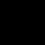 |  |

## Showcase `sky-fog`

Godot draws this sky shader as a 3D view's background, with the scene's camera, fog and directional lights (`tests/e2e/skyScenes.mjs`). A plain three.js page draws the transpiled sky with the same values. `pnpm test:shaders:e2e` draws both again and fails on any pixel over 2/255 apart.

```glsl
shader_type sky;

void sky() {
	COLOR = vec3(0.0);
}
```

| Godot | Transpilation on three.js |
| --- | --- |
|  |  |

## Showcase `sky-fog-sun`

Godot draws this sky shader as a 3D view's background, with the scene's camera, fog and directional lights (`tests/e2e/skyScenes.mjs`). A plain three.js page draws the transpiled sky with the same values. `pnpm test:shaders:e2e` draws both again and fails on any pixel over 2/255 apart.

```glsl
shader_type sky;

void sky() {
	COLOR = vec3(0.0);
}
```

| Godot | Transpilation on three.js |
| --- | --- |
|  |  |

## Showcase `sky-fog-energy-0`

Godot draws this sky shader as a 3D view's background, with the scene's camera, fog and directional lights (`tests/e2e/skyScenes.mjs`). A plain three.js page draws the transpiled sky with the same values. `pnpm test:shaders:e2e` draws both again and fails on any pixel over 2/255 apart.

```glsl
shader_type sky;

void sky() {
	COLOR = vec3(0.0);
}
```

| Godot | Transpilation on three.js |
| --- | --- |
|  |  |

## Showcase `sky-fog-energy-3`

Godot draws this sky shader as a 3D view's background, with the scene's camera, fog and directional lights (`tests/e2e/skyScenes.mjs`). A plain three.js page draws the transpiled sky with the same values. `pnpm test:shaders:e2e` draws both again and fails on any pixel over 2/255 apart.

```glsl
shader_type sky;

void sky() {
	COLOR = vec3(0.0);
}
```

| Godot | Transpilation on three.js |
| --- | --- |
|  |  |

## Showcase `sky-fog-affect-0`

Godot draws this sky shader as a 3D view's background, with the scene's camera, fog and directional lights (`tests/e2e/skyScenes.mjs`). A plain three.js page draws the transpiled sky with the same values. `pnpm test:shaders:e2e` draws both again and fails on any pixel over 2/255 apart.

```glsl
shader_type sky;

void sky() {
	COLOR = vec3(0.0);
}
```

| Godot | Transpilation on three.js |
| --- | --- |
|  |  |

## Showcase `sky-fog-affect-half`

Godot draws this sky shader as a 3D view's background, with the scene's camera, fog and directional lights (`tests/e2e/skyScenes.mjs`). A plain three.js page draws the transpiled sky with the same values. `pnpm test:shaders:e2e` draws both again and fails on any pixel over 2/255 apart.

```glsl
shader_type sky;

void sky() {
	COLOR = vec3(0.0);
}
```

| Godot | Transpilation on three.js |
| --- | --- |
|  |  |

## Showcase `sky-sun-coloured`

Godot draws this sky shader as a 3D view's background, with the scene's camera, fog and directional lights (`tests/e2e/skyScenes.mjs`). A plain three.js page draws the transpiled sky with the same values. `pnpm test:shaders:e2e` draws both again and fails on any pixel over 2/255 apart.

```glsl
shader_type sky;

void sky() {
	COLOR = vec3(0.0);
}
```

| Godot | Transpilation on three.js |
| --- | --- |
|  |  |

## Showcase `sky-sun-below`

Godot draws this sky shader as a 3D view's background, with the scene's camera, fog and directional lights (`tests/e2e/skyScenes.mjs`). A plain three.js page draws the transpiled sky with the same values. `pnpm test:shaders:e2e` draws both again and fails on any pixel over 2/255 apart.

```glsl
shader_type sky;

void sky() {
	COLOR = vec3(0.0);
}
```

| Godot | Transpilation on three.js |
| --- | --- |
|  | 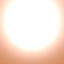 |

## Showcase `sky-sun-energy-0`

Godot draws this sky shader as a 3D view's background, with the scene's camera, fog and directional lights (`tests/e2e/skyScenes.mjs`). A plain three.js page draws the transpiled sky with the same values. `pnpm test:shaders:e2e` draws both again and fails on any pixel over 2/255 apart.

```glsl
shader_type sky;

void sky() {
	COLOR = vec3(0.0);
}
```

| Godot | Transpilation on three.js |
| --- | --- |
|  | 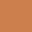 |

## Showcase `sky-camera-wide`

Godot draws this sky shader as a 3D view's background, with the scene's camera, fog and directional lights (`tests/e2e/skyScenes.mjs`). A plain three.js page draws the transpiled sky with the same values. `pnpm test:shaders:e2e` draws both again and fails on any pixel over 2/255 apart.

```glsl
shader_type sky;

void sky() {
	COLOR = vec3(0.0);
}
```

| Godot | Transpilation on three.js |
| --- | --- |
|  |  |

## Showcase `sky-time-zero`

Godot draws this sky shader as a 3D view's background, with the scene's camera, fog and directional lights (`tests/e2e/skyScenes.mjs`). A plain three.js page draws the transpiled sky with the same values. `pnpm test:shaders:e2e` draws both again and fails on any pixel over 2/255 apart.

```glsl
shader_type sky;

void sky() {
	COLOR = vec3(TIME * 0.5, fract(TIME * 4.0), 0.25);
}
```

| Godot | Transpilation on three.js |
| --- | --- |
|  |  |

## Showcase `sky-time-fraction`

Godot draws this sky shader as a 3D view's background, with the scene's camera, fog and directional lights (`tests/e2e/skyScenes.mjs`). A plain three.js page draws the transpiled sky with the same values. `pnpm test:shaders:e2e` draws both again and fails on any pixel over 2/255 apart.

```glsl
shader_type sky;

void sky() {
	COLOR = vec3(TIME * 0.5, fract(TIME * 4.0), 0.25);
}
```

| Godot | Transpilation on three.js |
| --- | --- |
|  | 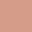 |

## Showcase `sky-time-rolled-over`

Godot draws this sky shader as a 3D view's background, with the scene's camera, fog and directional lights (`tests/e2e/skyScenes.mjs`). A plain three.js page draws the transpiled sky with the same values. `pnpm test:shaders:e2e` draws both again and fails on any pixel over 2/255 apart.

```glsl
shader_type sky;

void sky() {
	COLOR = vec3(TIME * 0.5, fract(TIME * 4.0), 0.25);
}
```

| Godot | Transpilation on three.js |
| --- | --- |
| 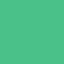 |  |

## Showcase `sky-time-cycle`

Godot draws this sky shader as a 3D view's background, with the scene's camera, fog and directional lights (`tests/e2e/skyScenes.mjs`). A plain three.js page draws the transpiled sky with the same values. `pnpm test:shaders:e2e` draws both again and fails on any pixel over 2/255 apart.

```glsl
shader_type sky;

void sky() {
	vec3 phase = vec3(0.0, 2.0, 4.0);
	COLOR = 0.5 + 0.5 * cos(TIME * vec3(1.0, 1.3, 1.7) * 2.0 + phase);
	COLOR *= 0.75 + 0.25 * step(0.5, fract(TIME));
}
```

| Godot | Transpilation on three.js |
| --- | --- |
|  |  |

## Showcase `sky-time-seek-half`

Godot draws this sky shader as a 3D view's background, with the scene's camera, fog and directional lights (`tests/e2e/skyScenes.mjs`). A plain three.js page draws the transpiled sky with the same values. `pnpm test:shaders:e2e` draws both again and fails on any pixel over 2/255 apart.

```glsl
shader_type sky;

void sky() {
	COLOR = vec3(fract(TIME * 0.37), fract(TIME * 4.0), TIME / 8.0);
}
```

| Godot | Transpilation on three.js |
| --- | --- |
|  |  |

## Showcase `sky-time-seek-third`

Godot draws this sky shader as a 3D view's background, with the scene's camera, fog and directional lights (`tests/e2e/skyScenes.mjs`). A plain three.js page draws the transpiled sky with the same values. `pnpm test:shaders:e2e` draws both again and fails on any pixel over 2/255 apart.

```glsl
shader_type sky;

void sky() {
	COLOR = vec3(fract(TIME * 0.37), fract(TIME * 4.0), TIME / 8.0);
}
```

| Godot | Transpilation on three.js |
| --- | --- |
|  |  |

## Showcase `sky-time-seek-four`

Godot draws this sky shader as a 3D view's background, with the scene's camera, fog and directional lights (`tests/e2e/skyScenes.mjs`). A plain three.js page draws the transpiled sky with the same values. `pnpm test:shaders:e2e` draws both again and fails on any pixel over 2/255 apart.

```glsl
shader_type sky;

void sky() {
	COLOR = vec3(fract(TIME * 0.37), fract(TIME * 4.0), TIME / 8.0);
}
```

| Godot | Transpilation on three.js |
| --- | --- |
| 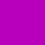 |  |

## Showcase `sky-time-seek-rolled-over`

Godot draws this sky shader as a 3D view's background, with the scene's camera, fog and directional lights (`tests/e2e/skyScenes.mjs`). A plain three.js page draws the transpiled sky with the same values. `pnpm test:shaders:e2e` draws both again and fails on any pixel over 2/255 apart.

```glsl
shader_type sky;

void sky() {
	COLOR = vec3(fract(TIME * 0.37), fract(TIME * 4.0), TIME / 8.0);
}
```

| Godot | Transpilation on three.js |
| --- | --- |
|  |  |

## Showcase `sky-time-seek-third-rolled-over`

Godot draws this sky shader as a 3D view's background, with the scene's camera, fog and directional lights (`tests/e2e/skyScenes.mjs`). A plain three.js page draws the transpiled sky with the same values. `pnpm test:shaders:e2e` draws both again and fails on any pixel over 2/255 apart.

```glsl
shader_type sky;

void sky() {
	COLOR = vec3(fract(TIME * 0.37), fract(TIME * 4.0), TIME / 8.0);
}
```

| Godot | Transpilation on three.js |
| --- | --- |
| 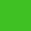 |  |

## Showcase `sky-eyedir`

Godot draws this sky shader as a 3D view's background, with the scene's camera, fog and directional lights (`tests/e2e/skyScenes.mjs`). A plain three.js page draws the transpiled sky with the same values. `pnpm test:shaders:e2e` draws both again and fails on any pixel over 2/255 apart.

```glsl
shader_type sky;

void sky() {
	COLOR = EYEDIR * 0.5 + 0.5;
}
```

| Godot | Transpilation on three.js |
| --- | --- |
| 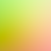 |  |

## Showcase `sky-coords`

Godot draws this sky shader as a 3D view's background, with the scene's camera, fog and directional lights (`tests/e2e/skyScenes.mjs`). A plain three.js page draws the transpiled sky with the same values. `pnpm test:shaders:e2e` draws both again and fails on any pixel over 2/255 apart.

```glsl
shader_type sky;

void sky() {
	COLOR = vec3(SKY_COORDS, 0.25);
}
```

| Godot | Transpilation on three.js |
| --- | --- |
|  |  |

## Showcase `sky-screen-uv`

Godot draws this sky shader as a 3D view's background, with the scene's camera, fog and directional lights (`tests/e2e/skyScenes.mjs`). A plain three.js page draws the transpiled sky with the same values. `pnpm test:shaders:e2e` draws both again and fails on any pixel over 2/255 apart.

```glsl
shader_type sky;

void sky() {
	COLOR = vec3(SCREEN_UV, 0.25);
}
```

| Godot | Transpilation on three.js |
| --- | --- |
| 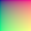 | 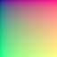 |

## Showcase `sky-fragcoord`

Godot draws this sky shader as a 3D view's background, with the scene's camera, fog and directional lights (`tests/e2e/skyScenes.mjs`). A plain three.js page draws the transpiled sky with the same values. `pnpm test:shaders:e2e` draws both again and fails on any pixel over 2/255 apart.

```glsl
shader_type sky;

void sky() {
	COLOR = vec3(fract(FRAGCOORD.xy / 16.0), FRAGCOORD.z);
}
```

| Godot | Transpilation on three.js |
| --- | --- |
|  |  |

## Showcase `sky-position`

Godot draws this sky shader as a 3D view's background, with the scene's camera, fog and directional lights (`tests/e2e/skyScenes.mjs`). A plain three.js page draws the transpiled sky with the same values. `pnpm test:shaders:e2e` draws both again and fails on any pixel over 2/255 apart.

```glsl
shader_type sky;

void sky() {
	COLOR = fract(POSITION * 0.37);
}
```

| Godot | Transpilation on three.js |
| --- | --- |
|  |  |

## Showcase `sky-constants`

Godot draws this sky shader as a 3D view's background, with the scene's camera, fog and directional lights (`tests/e2e/skyScenes.mjs`). A plain three.js page draws the transpiled sky with the same values. `pnpm test:shaders:e2e` draws both again and fails on any pixel over 2/255 apart.

```glsl
shader_type sky;

void sky() {
	COLOR = vec3(PI / 4.0, TAU / 8.0, E / 3.0) * (0.5 + 0.5 * EYEDIR.y);
}
```

| Godot | Transpilation on three.js |
| --- | --- |
|  |  |

## Showcase `sky-fog-write`

Godot draws this sky shader as a 3D view's background, with the scene's camera, fog and directional lights (`tests/e2e/skyScenes.mjs`). A plain three.js page draws the transpiled sky with the same values. `pnpm test:shaders:e2e` draws both again and fails on any pixel over 2/255 apart.

```glsl
shader_type sky;

void sky() {
	COLOR = vec3(0.1, 0.2, 0.8);
	FOG = vec4(1.0, 0.3, 0.1, 0.6 * max(EYEDIR.y, 0.0));
}
```

| Godot | Transpilation on three.js |
| --- | --- |
|  |  |

## Showcase `sky-disable-fog`

Godot draws this sky shader as a 3D view's background, with the scene's camera, fog and directional lights (`tests/e2e/skyScenes.mjs`). A plain three.js page draws the transpiled sky with the same values. `pnpm test:shaders:e2e` draws both again and fails on any pixel over 2/255 apart.

```glsl
shader_type sky;
render_mode disable_fog;

void sky() {
	COLOR = vec3(0.1, 0.2, 0.8);
}
```

| Godot | Transpilation on three.js |
| --- | --- |
|  |  |

## Showcase `sky-debanding`

Godot draws this sky shader as a 3D view's background, with the scene's camera, fog and directional lights (`tests/e2e/skyScenes.mjs`). A plain three.js page draws the transpiled sky with the same values. `pnpm test:shaders:e2e` draws both again and fails on any pixel over 2/255 apart.

```glsl
shader_type sky;
render_mode use_debanding;

void sky() {
	COLOR = vec3(0.002);
}
```

| Godot | Transpilation on three.js |
| --- | --- |
| 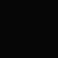 |  |

## Showcase `sky-twenty-uniforms`

Godot draws this sky shader as a 3D view's background, with the scene's camera, fog and directional lights (`tests/e2e/skyScenes.mjs`). A plain three.js page draws the transpiled sky with the same values. `pnpm test:shaders:e2e` draws both again and fails on any pixel over 2/255 apart.

```glsl
shader_type sky;

uniform float f0 = 0.05;
uniform vec3 v0 = vec3(0.1, 0.2, 0.3);
uniform float f1 = 0.15;
uniform mat3 m0 = mat3(vec3(0.9, 0.1, 0.0), vec3(0.2, 0.7, 0.1), vec3(0.0, 0.3, 0.8));
uniform vec2 w0 = vec2(0.25, -0.5);
uniform float f2 = 0.35;
uniform int i0 = -3;
uniform uint u0 = 3000000000u;
uniform bool b0 = true;
uniform vec4 c0 : source_color = vec4(0.8, 0.4, 0.1, 1.0);
uniform vec3 c1 : source_color = vec3(0.1, 0.5, 0.9);
uniform float a0[3];
uniform vec3 a1[2];
uniform mat2 m1 = mat2(vec2(1.0, 0.5), vec2(-0.25, 1.0));
uniform ivec2 i1 = ivec2(2, -1);
uniform bvec3 b1 = bvec3(false, true, false);
uniform float f3 = 0.45;
uniform mat4 m2 = mat4(vec4(1.0, 0.0, 0.0, 0.1), vec4(0.0, 1.0, 0.2, 0.0), vec4(0.3, 0.0, 1.0, 0.0), vec4(0.0, 0.0, 0.0, 1.0));
uniform uvec2 u1 = uvec2(1u, 2u);
uniform float f4 = 0.55;

void sky() {
	vec3 d = m0 * (EYEDIR * 0.5 + 0.5) + v0 * f0;
	d.xy = m1 * d.xy + w0 * f1 + float(i0 + i1.x - i1.y) * 0.01;
	d += (m2 * vec4(d, 1.0)).xyz * f2 + c0.rgb * f3 + c1 * f4;
	d += vec3(a0[0], a0[1], a0[2]) + a1[0] * (b0 ? 1.0 : -1.0) + (b1.y ? a1[1] : vec3(0.0));
	d *= float(u0 / 1000000000u + u1.x + u1.y) * 0.1;
	COLOR = fract(d);
}
```

| Godot | Transpilation on three.js |
| --- | --- |
|  |  |

## Showcase `sky-light-0`

Godot draws this sky shader as a 3D view's background, with the scene's camera, fog and directional lights (`tests/e2e/skyScenes.mjs`). A plain three.js page draws the transpiled sky with the same values. `pnpm test:shaders:e2e` draws both again and fails on any pixel over 2/255 apart.

```glsl
shader_type sky;

void sky() {
	float facing = max(dot(EYEDIR, LIGHT0_DIRECTION), 0.0);
	COLOR = LIGHT0_COLOR * LIGHT0_ENERGY * 0.4 * facing + vec3(LIGHT0_SIZE * 0.25);
	COLOR *= LIGHT0_ENABLED ? 1.0 : 0.25;
}
```

| Godot | Transpilation on three.js |
| --- | --- |
| 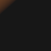 |  |

## Showcase `sky-light-1`

Godot draws this sky shader as a 3D view's background, with the scene's camera, fog and directional lights (`tests/e2e/skyScenes.mjs`). A plain three.js page draws the transpiled sky with the same values. `pnpm test:shaders:e2e` draws both again and fails on any pixel over 2/255 apart.

```glsl
shader_type sky;

void sky() {
	float facing = max(dot(EYEDIR, LIGHT1_DIRECTION), 0.0);
	COLOR = LIGHT1_COLOR * LIGHT1_ENERGY * 0.4 * facing + vec3(LIGHT1_SIZE * 0.25);
	COLOR *= LIGHT1_ENABLED ? 1.0 : 0.25;
}
```

| Godot | Transpilation on three.js |
| --- | --- |
|  |  |

## Showcase `sky-light-2`

Godot draws this sky shader as a 3D view's background, with the scene's camera, fog and directional lights (`tests/e2e/skyScenes.mjs`). A plain three.js page draws the transpiled sky with the same values. `pnpm test:shaders:e2e` draws both again and fails on any pixel over 2/255 apart.

```glsl
shader_type sky;

void sky() {
	float facing = max(dot(EYEDIR, LIGHT2_DIRECTION), 0.0);
	COLOR = LIGHT2_COLOR * LIGHT2_ENERGY * 0.4 * facing + vec3(LIGHT2_SIZE * 0.25);
	COLOR *= LIGHT2_ENABLED ? 1.0 : 0.25;
}
```

| Godot | Transpilation on three.js |
| --- | --- |
|  |  |

## Showcase `sky-light-3`

Godot draws this sky shader as a 3D view's background, with the scene's camera, fog and directional lights (`tests/e2e/skyScenes.mjs`). A plain three.js page draws the transpiled sky with the same values. `pnpm test:shaders:e2e` draws both again and fails on any pixel over 2/255 apart.

```glsl
shader_type sky;

void sky() {
	float facing = max(dot(EYEDIR, LIGHT3_DIRECTION), 0.0);
	COLOR = LIGHT3_COLOR * LIGHT3_ENERGY * 0.4 * facing + vec3(LIGHT3_SIZE * 0.25);
	COLOR *= LIGHT3_ENABLED ? 1.0 : 0.25;
}
```

| Godot | Transpilation on three.js |
| --- | --- |
|  |  |

## Showcase `sky-light-unset`

Godot draws this sky shader as a 3D view's background, with the scene's camera, fog and directional lights (`tests/e2e/skyScenes.mjs`). A plain three.js page draws the transpiled sky with the same values. `pnpm test:shaders:e2e` draws both again and fails on any pixel over 2/255 apart.

```glsl
shader_type sky;

void sky() {
	COLOR = LIGHT1_ENABLED ? vec3(0.1, 0.8, 0.2) : vec3(0.8, 0.1, 0.1);
}
```

| Godot | Transpilation on three.js |
| --- | --- |
|  |  |

## Showcase `sky-light-fifth`

Godot draws this sky shader as a 3D view's background, with the scene's camera, fog and directional lights (`tests/e2e/skyScenes.mjs`). A plain three.js page draws the transpiled sky with the same values. `pnpm test:shaders:e2e` draws both again and fails on any pixel over 2/255 apart.

```glsl
shader_type sky;

void sky() {
	float facing = max(dot(EYEDIR, LIGHT3_DIRECTION), 0.0);
	COLOR = LIGHT3_COLOR * LIGHT3_ENERGY * 0.4 * facing + vec3(LIGHT3_SIZE * 0.25);
	COLOR *= LIGHT3_ENABLED ? 1.0 : 0.25;
}
```

| Godot | Transpilation on three.js |
| --- | --- |
|  |  |

## Showcase `sky-half-res`

Godot draws this sky shader as a 3D view's background, with the scene's camera, fog and directional lights (`tests/e2e/skyScenes.mjs`). A plain three.js page draws the transpiled sky with the same values. `pnpm test:shaders:e2e` draws both again and fails on any pixel over 2/255 apart.

```glsl
shader_type sky;
render_mode use_half_res_pass;

void sky() {
	if (AT_HALF_RES_PASS) {
		COLOR = EYEDIR * 0.5 + 0.5;
	} else {
		COLOR = HALF_RES_COLOR.rgb * vec3(1.0, 0.8, 0.6) + vec3(0.0, 0.0, 0.2);
	}
}
```

| Godot | Transpilation on three.js |
| --- | --- |
| 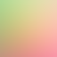 | 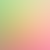 |

## Showcase `sky-quarter-res`

Godot draws this sky shader as a 3D view's background, with the scene's camera, fog and directional lights (`tests/e2e/skyScenes.mjs`). A plain three.js page draws the transpiled sky with the same values. `pnpm test:shaders:e2e` draws both again and fails on any pixel over 2/255 apart.

```glsl
shader_type sky;
render_mode use_half_res_pass, use_quarter_res_pass;

void sky() {
	if (AT_QUARTER_RES_PASS) {
		COLOR = vec3(fract(FRAGCOORD.xy / 4.0), SCREEN_UV.x);
	} else if (AT_HALF_RES_PASS) {
		COLOR = mix(QUARTER_RES_COLOR.rgb, EYEDIR * 0.5 + 0.5, 0.5);
	} else {
		COLOR = HALF_RES_COLOR.rgb;
	}
}
```

| Godot | Transpilation on three.js |
| --- | --- |
| 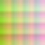 | 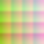 |

## Showcase `sky-quarter-res-alone`

Godot draws this sky shader as a 3D view's background, with the scene's camera, fog and directional lights (`tests/e2e/skyScenes.mjs`). A plain three.js page draws the transpiled sky with the same values. `pnpm test:shaders:e2e` draws both again and fails on any pixel over 2/255 apart.

```glsl
shader_type sky;
render_mode use_quarter_res_pass;

void sky() {
	COLOR = AT_QUARTER_RES_PASS ? EYEDIR * 0.5 + 0.5 : QUARTER_RES_COLOR.rgb * HALF_RES_COLOR.rgb;
}
```

| Godot | Transpilation on three.js |
| --- | --- |
| 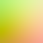 | 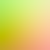 |

## Showcase `sky-half-res-unset`

Godot draws this sky shader as a 3D view's background, with the scene's camera, fog and directional lights (`tests/e2e/skyScenes.mjs`). A plain three.js page draws the transpiled sky with the same values. `pnpm test:shaders:e2e` draws both again and fails on any pixel over 2/255 apart.

```glsl
shader_type sky;

void sky() {
	COLOR = HALF_RES_COLOR.rgb * QUARTER_RES_COLOR.rgb * vec3(0.9, 0.6, 0.3);
}
```

| Godot | Transpilation on three.js |
| --- | --- |
|  |  |

## Showcase `sky-alpha-half-res`

Godot draws this sky shader as a 3D view's background, with the scene's camera, fog and directional lights (`tests/e2e/skyScenes.mjs`). A plain three.js page draws the transpiled sky with the same values. `pnpm test:shaders:e2e` draws both again and fails on any pixel over 2/255 apart.

```glsl
shader_type sky;
render_mode use_half_res_pass;

void sky() {
	if (AT_HALF_RES_PASS) {
		COLOR = EYEDIR * 0.5 + 0.5;
		ALPHA = SCREEN_UV.x;
	} else {
		COLOR = mix(vec3(0.1, 0.2, 0.8), HALF_RES_COLOR.rgb, HALF_RES_COLOR.a);
	}
}
```

| Godot | Transpilation on three.js |
| --- | --- |
| 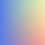 | 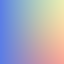 |

## Showcase `sky-alpha-quarter-res`

Godot draws this sky shader as a 3D view's background, with the scene's camera, fog and directional lights (`tests/e2e/skyScenes.mjs`). A plain three.js page draws the transpiled sky with the same values. `pnpm test:shaders:e2e` draws both again and fails on any pixel over 2/255 apart.

```glsl
shader_type sky;
render_mode use_half_res_pass, use_quarter_res_pass;

void sky() {
	if (AT_QUARTER_RES_PASS) {
		COLOR = vec3(0.9, 0.5, 0.1);
		ALPHA = SCREEN_UV.y * 2.0 - 0.5;
	} else if (AT_HALF_RES_PASS) {
		COLOR = EYEDIR * 0.5 + 0.5;
		ALPHA = QUARTER_RES_COLOR.a * 0.5 + 0.25;
	} else {
		COLOR = mix(QUARTER_RES_COLOR.rgb, HALF_RES_COLOR.rgb, HALF_RES_COLOR.a);
	}
}
```

| Godot | Transpilation on three.js |
| --- | --- |
| 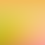 | 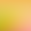 |

## Showcase `sky-alpha-background`

Godot draws this sky shader as a 3D view's background, with the scene's camera, fog and directional lights (`tests/e2e/skyScenes.mjs`). A plain three.js page draws the transpiled sky with the same values. `pnpm test:shaders:e2e` draws both again and fails on any pixel over 2/255 apart.

```glsl
shader_type sky;

void sky() {
	COLOR = vec3(0.2, 0.6, 0.4) * (0.5 + 0.5 * EYEDIR.y);
	ALPHA = 0.25;
}
```

| Godot | Transpilation on three.js |
| --- | --- |
|  |  |

## Showcase `sky-radiance`

Godot draws this sky shader as a 3D view's background, with the scene's camera, fog and directional lights (`tests/e2e/skyScenes.mjs`). A plain three.js page draws the transpiled sky with the same values. `pnpm test:shaders:e2e` draws both again and fails on any pixel over 2/255 apart.

```glsl
shader_type sky;

void sky() {
	if (AT_CUBEMAP_PASS) {
		COLOR = 0.5 + 0.5 * EYEDIR;
	} else {
		COLOR = texture(RADIANCE, EYEDIR).rgb;
	}
}
```

| Godot | Transpilation on three.js |
| --- | --- |
| 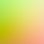 | 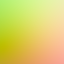 |

## Showcase `sky-cubemap-pass`

Godot draws this sky shader as a 3D view's background, with the scene's camera, fog and directional lights (`tests/e2e/skyScenes.mjs`). A plain three.js page draws the transpiled sky with the same values. `pnpm test:shaders:e2e` draws both again and fails on any pixel over 2/255 apart.

```glsl
shader_type sky;

void sky() {
	COLOR = AT_CUBEMAP_PASS ? vec3(1.0, 0.0, 0.0) : vec3(0.1, 0.7, 0.3);
}
```

| Godot | Transpilation on three.js |
| --- | --- |
| 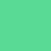 |  |

## Showcase `sky-passes-odd-size`

Godot draws this sky shader as a 3D view's background, with the scene's camera, fog and directional lights (`tests/e2e/skyScenes.mjs`). A plain three.js page draws the transpiled sky with the same values. `pnpm test:shaders:e2e` draws both again and fails on any pixel over 2/255 apart.

```glsl
shader_type sky;
render_mode use_half_res_pass, use_quarter_res_pass;

void sky() {
	if (AT_QUARTER_RES_PASS) {
		COLOR = vec3(fract(FRAGCOORD.xy / 4.0), SCREEN_UV.x);
	} else if (AT_HALF_RES_PASS) {
		COLOR = mix(QUARTER_RES_COLOR.rgb, EYEDIR * 0.5 + 0.5, 0.5);
	} else {
		COLOR = HALF_RES_COLOR.rgb;
	}
}
```

| Godot | Transpilation on three.js |
| --- | --- |
| 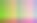 | 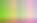 |

## Showcase `sky-passes-under-4-px`

Godot draws this sky shader as a 3D view's background, with the scene's camera, fog and directional lights (`tests/e2e/skyScenes.mjs`). A plain three.js page draws the transpiled sky with the same values. `pnpm test:shaders:e2e` draws both again and fails on any pixel over 2/255 apart.

```glsl
shader_type sky;
render_mode use_half_res_pass, use_quarter_res_pass;

void sky() {
	if (AT_QUARTER_RES_PASS) {
		COLOR = vec3(fract(FRAGCOORD.xy / 4.0), SCREEN_UV.x);
	} else if (AT_HALF_RES_PASS) {
		COLOR = mix(QUARTER_RES_COLOR.rgb, EYEDIR * 0.5 + 0.5, 0.5);
	} else {
		COLOR = HALF_RES_COLOR.rgb;
	}
}
```

| Godot | Transpilation on three.js |
| --- | --- |
| 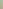 | 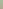 |

## Showcase `sky-procedural-default`

Godot draws this sky shader as a 3D view's background, with the scene's camera, fog and directional lights (`tests/e2e/skyScenes.mjs`). A plain three.js page draws the transpiled sky with the same values. `pnpm test:shaders:e2e` draws both again and fails on any pixel over 2/255 apart.

```glsl
// NOTE: Shader automatically converted from Godot Engine 4.6.3.stable's ProceduralSkyMaterial.

shader_type sky;
render_mode use_debanding;

uniform vec4 sky_top_color : source_color = vec4(0.385, 0.454, 0.55, 1.0);
uniform vec4 sky_horizon_color : source_color = vec4(0.646, 0.656, 0.67, 1.0);
uniform float inv_sky_curve : hint_range(1, 100) = 4.0;
uniform vec4 ground_bottom_color : source_color = vec4(0.2, 0.169, 0.133, 1.0);
uniform vec4 ground_horizon_color : source_color = vec4(0.646, 0.656, 0.67, 1.0);
uniform float inv_ground_curve : hint_range(1, 100) = 30.0;
uniform float sun_angle_max = 0.877;
uniform float inv_sun_curve : hint_range(1, 100) = 22.78;
uniform float exposure : hint_range(0, 128) = 1.0;

uniform sampler2D sky_cover : filter_linear, source_color, hint_default_black;
uniform vec4 sky_cover_modulate : source_color = vec4(1.0, 1.0, 1.0, 1.0);

void sky() {
	float v_angle = clamp(EYEDIR.y, -1.0, 1.0);
	vec3 sky = mix(sky_top_color.rgb, sky_horizon_color.rgb, clamp(pow(1.0 - v_angle, inv_sky_curve), 0.0, 1.0));

	if (LIGHT0_ENABLED) {
		float sun_angle = dot(LIGHT0_DIRECTION, EYEDIR);
		float sun_size = cos(LIGHT0_SIZE);
		if (sun_angle > sun_size) {
			sky = LIGHT0_COLOR * LIGHT0_ENERGY;
		} else if (sun_angle > sun_angle_max) {
			float c2 = (sun_size - sun_angle) / (sun_size - sun_angle_max);
			sky = mix(sky, LIGHT0_COLOR * LIGHT0_ENERGY, clamp(pow(1.0 - c2, inv_sun_curve), 0.0, 1.0));
		}
	}

	if (LIGHT1_ENABLED) {
		float sun_angle = dot(LIGHT1_DIRECTION, EYEDIR);
		float sun_size = cos(LIGHT1_SIZE);
		if (sun_angle > sun_size) {
			sky = LIGHT1_COLOR * LIGHT1_ENERGY;
		} else if (sun_angle > sun_angle_max) {
			float c2 = (sun_size - sun_angle) / (sun_size - sun_angle_max);
			sky = mix(sky, LIGHT1_COLOR * LIGHT1_ENERGY, clamp(pow(1.0 - c2, inv_sun_curve), 0.0, 1.0));
		}
	}

	if (LIGHT2_ENABLED) {
		float sun_angle = dot(LIGHT2_DIRECTION, EYEDIR);
		float sun_size = cos(LIGHT2_SIZE);
		if (sun_angle > sun_size) {
			sky = LIGHT2_COLOR * LIGHT2_ENERGY;
		} else if (sun_angle > sun_angle_max) {
			float c2 = (sun_size - sun_angle) / (sun_size - sun_angle_max);
			sky = mix(sky, LIGHT2_COLOR * LIGHT2_ENERGY, clamp(pow(1.0 - c2, inv_sun_curve), 0.0, 1.0));
		}
	}

	if (LIGHT3_ENABLED) {
		float sun_angle = dot(LIGHT3_DIRECTION, EYEDIR);
		float sun_size = cos(LIGHT3_SIZE);
		if (sun_angle > sun_size) {
			sky = LIGHT3_COLOR * LIGHT3_ENERGY;
		} else if (sun_angle > sun_angle_max) {
			float c2 = (sun_size - sun_angle) / (sun_size - sun_angle_max);
			sky = mix(sky, LIGHT3_COLOR * LIGHT3_ENERGY, clamp(pow(1.0 - c2, inv_sun_curve), 0.0, 1.0));
		}
	}

	
	
	vec3 ground = mix(ground_bottom_color.rgb, ground_horizon_color.rgb, clamp(pow(1.0 + v_angle, inv_ground_curve), 0.0, 1.0));

	COLOR = mix(ground, sky, step(0.0, EYEDIR.y)) * exposure;
}
```

| Godot | Transpilation on three.js |
| --- | --- |
| 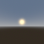 | 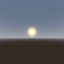 |

## Showcase `sky-procedural-values`

Godot draws this sky shader as a 3D view's background, with the scene's camera, fog and directional lights (`tests/e2e/skyScenes.mjs`). A plain three.js page draws the transpiled sky with the same values. `pnpm test:shaders:e2e` draws both again and fails on any pixel over 2/255 apart.

```glsl
// NOTE: Shader automatically converted from Godot Engine 4.6.3.stable's ProceduralSkyMaterial.

shader_type sky;


uniform vec4 sky_top_color : source_color = vec4(0.385, 0.454, 0.55, 1.0);
uniform vec4 sky_horizon_color : source_color = vec4(0.646, 0.656, 0.67, 1.0);
uniform float inv_sky_curve : hint_range(1, 100) = 4.0;
uniform vec4 ground_bottom_color : source_color = vec4(0.2, 0.169, 0.133, 1.0);
uniform vec4 ground_horizon_color : source_color = vec4(0.646, 0.656, 0.67, 1.0);
uniform float inv_ground_curve : hint_range(1, 100) = 30.0;
uniform float sun_angle_max = 0.877;
uniform float inv_sun_curve : hint_range(1, 100) = 22.78;
uniform float exposure : hint_range(0, 128) = 1.0;

uniform sampler2D sky_cover : filter_linear, source_color, hint_default_black;
uniform vec4 sky_cover_modulate : source_color = vec4(1.0, 1.0, 1.0, 1.0);

void sky() {
	float v_angle = clamp(EYEDIR.y, -1.0, 1.0);
	vec3 sky = mix(sky_top_color.rgb, sky_horizon_color.rgb, clamp(pow(1.0 - v_angle, inv_sky_curve), 0.0, 1.0));

	if (LIGHT0_ENABLED) {
		float sun_angle = dot(LIGHT0_DIRECTION, EYEDIR);
		float sun_size = cos(LIGHT0_SIZE);
		if (sun_angle > sun_size) {
			sky = LIGHT0_COLOR * LIGHT0_ENERGY;
		} else if (sun_angle > sun_angle_max) {
			float c2 = (sun_size - sun_angle) / (sun_size - sun_angle_max);
			sky = mix(sky, LIGHT0_COLOR * LIGHT0_ENERGY, clamp(pow(1.0 - c2, inv_sun_curve), 0.0, 1.0));
		}
	}

	if (LIGHT1_ENABLED) {
		float sun_angle = dot(LIGHT1_DIRECTION, EYEDIR);
		float sun_size = cos(LIGHT1_SIZE);
		if (sun_angle > sun_size) {
			sky = LIGHT1_COLOR * LIGHT1_ENERGY;
		} else if (sun_angle > sun_angle_max) {
			float c2 = (sun_size - sun_angle) / (sun_size - sun_angle_max);
			sky = mix(sky, LIGHT1_COLOR * LIGHT1_ENERGY, clamp(pow(1.0 - c2, inv_sun_curve), 0.0, 1.0));
		}
	}

	if (LIGHT2_ENABLED) {
		float sun_angle = dot(LIGHT2_DIRECTION, EYEDIR);
		float sun_size = cos(LIGHT2_SIZE);
		if (sun_angle > sun_size) {
			sky = LIGHT2_COLOR * LIGHT2_ENERGY;
		} else if (sun_angle > sun_angle_max) {
			float c2 = (sun_size - sun_angle) / (sun_size - sun_angle_max);
			sky = mix(sky, LIGHT2_COLOR * LIGHT2_ENERGY, clamp(pow(1.0 - c2, inv_sun_curve), 0.0, 1.0));
		}
	}

	if (LIGHT3_ENABLED) {
		float sun_angle = dot(LIGHT3_DIRECTION, EYEDIR);
		float sun_size = cos(LIGHT3_SIZE);
		if (sun_angle > sun_size) {
			sky = LIGHT3_COLOR * LIGHT3_ENERGY;
		} else if (sun_angle > sun_angle_max) {
			float c2 = (sun_size - sun_angle) / (sun_size - sun_angle_max);
			sky = mix(sky, LIGHT3_COLOR * LIGHT3_ENERGY, clamp(pow(1.0 - c2, inv_sun_curve), 0.0, 1.0));
		}
	}

	
	
	vec3 ground = mix(ground_bottom_color.rgb, ground_horizon_color.rgb, clamp(pow(1.0 + v_angle, inv_ground_curve), 0.0, 1.0));

	COLOR = mix(ground, sky, step(0.0, EYEDIR.y)) * exposure;
}
```

| Godot | Transpilation on three.js |
| --- | --- |
|  | 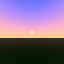 |

## Showcase `sky-procedural-energy-0`

Godot draws this sky shader as a 3D view's background, with the scene's camera, fog and directional lights (`tests/e2e/skyScenes.mjs`). A plain three.js page draws the transpiled sky with the same values. `pnpm test:shaders:e2e` draws both again and fails on any pixel over 2/255 apart.

```glsl
// NOTE: Shader automatically converted from Godot Engine 4.6.3.stable's ProceduralSkyMaterial.

shader_type sky;
render_mode use_debanding;

uniform vec4 sky_top_color : source_color = vec4(0.385, 0.454, 0.55, 1.0);
uniform vec4 sky_horizon_color : source_color = vec4(0.646, 0.656, 0.67, 1.0);
uniform float inv_sky_curve : hint_range(1, 100) = 4.0;
uniform vec4 ground_bottom_color : source_color = vec4(0.2, 0.169, 0.133, 1.0);
uniform vec4 ground_horizon_color : source_color = vec4(0.646, 0.656, 0.67, 1.0);
uniform float inv_ground_curve : hint_range(1, 100) = 30.0;
uniform float sun_angle_max = 0.877;
uniform float inv_sun_curve : hint_range(1, 100) = 22.78;
uniform float exposure : hint_range(0, 128) = 1.0;

uniform sampler2D sky_cover : filter_linear, source_color, hint_default_black;
uniform vec4 sky_cover_modulate : source_color = vec4(1.0, 1.0, 1.0, 1.0);

void sky() {
	float v_angle = clamp(EYEDIR.y, -1.0, 1.0);
	vec3 sky = mix(sky_top_color.rgb, sky_horizon_color.rgb, clamp(pow(1.0 - v_angle, inv_sky_curve), 0.0, 1.0));

	if (LIGHT0_ENABLED) {
		float sun_angle = dot(LIGHT0_DIRECTION, EYEDIR);
		float sun_size = cos(LIGHT0_SIZE);
		if (sun_angle > sun_size) {
			sky = LIGHT0_COLOR * LIGHT0_ENERGY;
		} else if (sun_angle > sun_angle_max) {
			float c2 = (sun_size - sun_angle) / (sun_size - sun_angle_max);
			sky = mix(sky, LIGHT0_COLOR * LIGHT0_ENERGY, clamp(pow(1.0 - c2, inv_sun_curve), 0.0, 1.0));
		}
	}

	if (LIGHT1_ENABLED) {
		float sun_angle = dot(LIGHT1_DIRECTION, EYEDIR);
		float sun_size = cos(LIGHT1_SIZE);
		if (sun_angle > sun_size) {
			sky = LIGHT1_COLOR * LIGHT1_ENERGY;
		} else if (sun_angle > sun_angle_max) {
			float c2 = (sun_size - sun_angle) / (sun_size - sun_angle_max);
			sky = mix(sky, LIGHT1_COLOR * LIGHT1_ENERGY, clamp(pow(1.0 - c2, inv_sun_curve), 0.0, 1.0));
		}
	}

	if (LIGHT2_ENABLED) {
		float sun_angle = dot(LIGHT2_DIRECTION, EYEDIR);
		float sun_size = cos(LIGHT2_SIZE);
		if (sun_angle > sun_size) {
			sky = LIGHT2_COLOR * LIGHT2_ENERGY;
		} else if (sun_angle > sun_angle_max) {
			float c2 = (sun_size - sun_angle) / (sun_size - sun_angle_max);
			sky = mix(sky, LIGHT2_COLOR * LIGHT2_ENERGY, clamp(pow(1.0 - c2, inv_sun_curve), 0.0, 1.0));
		}
	}

	if (LIGHT3_ENABLED) {
		float sun_angle = dot(LIGHT3_DIRECTION, EYEDIR);
		float sun_size = cos(LIGHT3_SIZE);
		if (sun_angle > sun_size) {
			sky = LIGHT3_COLOR * LIGHT3_ENERGY;
		} else if (sun_angle > sun_angle_max) {
			float c2 = (sun_size - sun_angle) / (sun_size - sun_angle_max);
			sky = mix(sky, LIGHT3_COLOR * LIGHT3_ENERGY, clamp(pow(1.0 - c2, inv_sun_curve), 0.0, 1.0));
		}
	}

	
	
	vec3 ground = mix(ground_bottom_color.rgb, ground_horizon_color.rgb, clamp(pow(1.0 + v_angle, inv_ground_curve), 0.0, 1.0));

	COLOR = mix(ground, sky, step(0.0, EYEDIR.y)) * exposure;
}
```

| Godot | Transpilation on three.js |
| --- | --- |
| 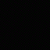 | 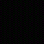 |

## Showcase `sky-physical-default`

Godot draws this sky shader as a 3D view's background, with the scene's camera, fog and directional lights (`tests/e2e/skyScenes.mjs`). A plain three.js page draws the transpiled sky with the same values. `pnpm test:shaders:e2e` draws both again and fails on any pixel over 2/255 apart.

```glsl
// NOTE: Shader automatically converted from Godot Engine 4.6.3.stable's PhysicalSkyMaterial.

shader_type sky;
render_mode use_debanding;

uniform float rayleigh : hint_range(0, 64) = 2.0;
uniform vec4 rayleigh_color : source_color = vec4(0.3, 0.405, 0.6, 1.0);
uniform float mie : hint_range(0, 1) = 0.005;
uniform float mie_eccentricity : hint_range(-1, 1) = 0.8;
uniform vec4 mie_color : source_color = vec4(0.69, 0.729, 0.812, 1.0);

uniform float turbidity : hint_range(0, 1000) = 10.0;
uniform float sun_disk_scale : hint_range(0, 360) = 1.0;
uniform vec4 ground_color : source_color = vec4(0.1, 0.07, 0.034, 1.0);
uniform float exposure : hint_range(0, 128) = 1.0;

uniform sampler2D night_sky : filter_linear, source_color, hint_default_black;

const vec3 UP = vec3( 0.0, 1.0, 0.0 );

// Optical length at zenith for molecules.
const float rayleigh_zenith_size = 8.4e3;
const float mie_zenith_size = 1.25e3;

float henyey_greenstein(float cos_theta, float g) {
	const float k = 0.0795774715459;
	return k * (1.0 - g * g) / (pow(1.0 + g * g - 2.0 * g * cos_theta, 1.5));
}

void sky() {
	if (LIGHT0_ENABLED) {
		float zenith_angle = clamp( dot(UP, normalize(LIGHT0_DIRECTION)), -1.0, 1.0 );
		float sun_energy = max(0.0, 0.757 * zenith_angle) * LIGHT0_ENERGY;
		float sun_fade = 1.0 - clamp(1.0 - exp(LIGHT0_DIRECTION.y), 0.0, 1.0);

		// Rayleigh coefficients.
		float rayleigh_coefficient = rayleigh - ( 1.0 * ( 1.0 - sun_fade ) );
		vec3 rayleigh_beta = rayleigh_coefficient * rayleigh_color.rgb * 0.0001;
		// mie coefficients from Preetham
		vec3 mie_beta = turbidity * mie * mie_color.rgb * 0.000434;

		// Optical length.
		float zenith = max(0.0, dot(UP, EYEDIR));
		float optical_mass = 1.0 / (zenith + 0.15 * pow(3.885 + 54.5 * zenith, -1.253));
		float rayleigh_scatter = rayleigh_zenith_size * optical_mass;
		float mie_scatter = mie_zenith_size * optical_mass;

		// Light extinction based on thickness of atmosphere.
		vec3 extinction = exp(-(rayleigh_beta * rayleigh_scatter + mie_beta * mie_scatter));

		// In scattering.
		float cos_theta = dot(EYEDIR, normalize(LIGHT0_DIRECTION));

		float rayleigh_phase = (3.0 / (16.0 * PI)) * (1.0 + pow(cos_theta * 0.5 + 0.5, 2.0));
		vec3 betaRTheta = rayleigh_beta * rayleigh_phase;

		float mie_phase = henyey_greenstein(cos_theta, mie_eccentricity);
		vec3 betaMTheta = mie_beta * mie_phase;

		vec3 Lin = pow(sun_energy * ((betaRTheta + betaMTheta) / (rayleigh_beta + mie_beta)) * (1.0 - extinction), vec3(1.5));
		// Hack from https://github.com/mrdoob/three.js/blob/master/examples/jsm/objects/Sky.js
		Lin *= mix(vec3(1.0), pow(sun_energy * ((betaRTheta + betaMTheta) / (rayleigh_beta + mie_beta)) * extinction, vec3(0.5)), clamp(pow(1.0 - zenith_angle, 5.0), 0.0, 1.0));

		// Hack in the ground color.
		Lin  *= mix(ground_color.rgb, vec3(1.0), smoothstep(-0.1, 0.1, dot(UP, EYEDIR)));

		// Solar disk and out-scattering.
		float sunAngularDiameterCos = cos(LIGHT0_SIZE * sun_disk_scale);
		float sunAngularDiameterCos2 = cos(LIGHT0_SIZE * sun_disk_scale * 0.5);
		float sundisk = smoothstep(sunAngularDiameterCos, sunAngularDiameterCos2, cos_theta);
		vec3 L0 = (sun_energy * extinction) * sundisk * LIGHT0_COLOR;
		

		vec3 color = Lin + L0;
		COLOR = pow(color, vec3(1.0 / (1.2 + (1.2 * sun_fade))));
		COLOR *= exposure;
	} else {
		// There is no sun, so display night_sky and nothing else.
		
		COLOR *= exposure;
	}
}
```

| Godot | Transpilation on three.js |
| --- | --- |
| 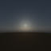 | 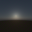 |

## Showcase `sky-physical-values`

Godot draws this sky shader as a 3D view's background, with the scene's camera, fog and directional lights (`tests/e2e/skyScenes.mjs`). A plain three.js page draws the transpiled sky with the same values. `pnpm test:shaders:e2e` draws both again and fails on any pixel over 2/255 apart.

```glsl
// NOTE: Shader automatically converted from Godot Engine 4.6.3.stable's PhysicalSkyMaterial.

shader_type sky;


uniform float rayleigh : hint_range(0, 64) = 2.0;
uniform vec4 rayleigh_color : source_color = vec4(0.3, 0.405, 0.6, 1.0);
uniform float mie : hint_range(0, 1) = 0.005;
uniform float mie_eccentricity : hint_range(-1, 1) = 0.8;
uniform vec4 mie_color : source_color = vec4(0.69, 0.729, 0.812, 1.0);

uniform float turbidity : hint_range(0, 1000) = 10.0;
uniform float sun_disk_scale : hint_range(0, 360) = 1.0;
uniform vec4 ground_color : source_color = vec4(0.1, 0.07, 0.034, 1.0);
uniform float exposure : hint_range(0, 128) = 1.0;

uniform sampler2D night_sky : filter_linear, source_color, hint_default_black;

const vec3 UP = vec3( 0.0, 1.0, 0.0 );

// Optical length at zenith for molecules.
const float rayleigh_zenith_size = 8.4e3;
const float mie_zenith_size = 1.25e3;

float henyey_greenstein(float cos_theta, float g) {
	const float k = 0.0795774715459;
	return k * (1.0 - g * g) / (pow(1.0 + g * g - 2.0 * g * cos_theta, 1.5));
}

void sky() {
	if (LIGHT0_ENABLED) {
		float zenith_angle = clamp( dot(UP, normalize(LIGHT0_DIRECTION)), -1.0, 1.0 );
		float sun_energy = max(0.0, 0.757 * zenith_angle) * LIGHT0_ENERGY;
		float sun_fade = 1.0 - clamp(1.0 - exp(LIGHT0_DIRECTION.y), 0.0, 1.0);

		// Rayleigh coefficients.
		float rayleigh_coefficient = rayleigh - ( 1.0 * ( 1.0 - sun_fade ) );
		vec3 rayleigh_beta = rayleigh_coefficient * rayleigh_color.rgb * 0.0001;
		// mie coefficients from Preetham
		vec3 mie_beta = turbidity * mie * mie_color.rgb * 0.000434;

		// Optical length.
		float zenith = max(0.0, dot(UP, EYEDIR));
		float optical_mass = 1.0 / (zenith + 0.15 * pow(3.885 + 54.5 * zenith, -1.253));
		float rayleigh_scatter = rayleigh_zenith_size * optical_mass;
		float mie_scatter = mie_zenith_size * optical_mass;

		// Light extinction based on thickness of atmosphere.
		vec3 extinction = exp(-(rayleigh_beta * rayleigh_scatter + mie_beta * mie_scatter));

		// In scattering.
		float cos_theta = dot(EYEDIR, normalize(LIGHT0_DIRECTION));

		float rayleigh_phase = (3.0 / (16.0 * PI)) * (1.0 + pow(cos_theta * 0.5 + 0.5, 2.0));
		vec3 betaRTheta = rayleigh_beta * rayleigh_phase;

		float mie_phase = henyey_greenstein(cos_theta, mie_eccentricity);
		vec3 betaMTheta = mie_beta * mie_phase;

		vec3 Lin = pow(sun_energy * ((betaRTheta + betaMTheta) / (rayleigh_beta + mie_beta)) * (1.0 - extinction), vec3(1.5));
		// Hack from https://github.com/mrdoob/three.js/blob/master/examples/jsm/objects/Sky.js
		Lin *= mix(vec3(1.0), pow(sun_energy * ((betaRTheta + betaMTheta) / (rayleigh_beta + mie_beta)) * extinction, vec3(0.5)), clamp(pow(1.0 - zenith_angle, 5.0), 0.0, 1.0));

		// Hack in the ground color.
		Lin  *= mix(ground_color.rgb, vec3(1.0), smoothstep(-0.1, 0.1, dot(UP, EYEDIR)));

		// Solar disk and out-scattering.
		float sunAngularDiameterCos = cos(LIGHT0_SIZE * sun_disk_scale);
		float sunAngularDiameterCos2 = cos(LIGHT0_SIZE * sun_disk_scale * 0.5);
		float sundisk = smoothstep(sunAngularDiameterCos, sunAngularDiameterCos2, cos_theta);
		vec3 L0 = (sun_energy * extinction) * sundisk * LIGHT0_COLOR;
		

		vec3 color = Lin + L0;
		COLOR = pow(color, vec3(1.0 / (1.2 + (1.2 * sun_fade))));
		COLOR *= exposure;
	} else {
		// There is no sun, so display night_sky and nothing else.
		
		COLOR *= exposure;
	}
}
```

| Godot | Transpilation on three.js |
| --- | --- |
|  | 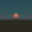 |

## Showcase `sky-panorama-unset`

Godot draws this sky shader as a 3D view's background, with the scene's camera, fog and directional lights (`tests/e2e/skyScenes.mjs`). A plain three.js page draws the transpiled sky with the same values. `pnpm test:shaders:e2e` draws both again and fails on any pixel over 2/255 apart.

```glsl
// NOTE: Shader automatically converted from Godot Engine 4.6.3.stable's PanoramaSkyMaterial.

shader_type sky;

uniform sampler2D source_panorama : filter_linear, source_color, hint_default_black;
uniform float exposure : hint_range(0, 128) = 1.0;

void sky() {
	COLOR = texture(source_panorama, SKY_COORDS).rgb * exposure;
}
```

| Godot | Transpilation on three.js |
| --- | --- |
|  |  |

## `COLOR`

`COLOR` is the colour `sky()` writes, linear. Godot's sky template holds it in its local `color`, and writes it to the frame after the environment's brightness and fog.

The transpiler emits the template's local `color`. Rows: `sky.sky.COLOR`. Godot source: `servers/rendering/shader_types.cpp:486`.

Every row is native on WebGL 2. WebGPURenderer runs the same nodes and is untested (#1788).


## `TIME`

`TIME` is the shader time in seconds. Godot adds each frame's step to it before the frame draws, in a double, and wraps it at the project setting `rendering/limits/time/time_rollover_secs`, 3600 by default. `ShaderClock` keeps the same sum and wrap: `advance(step)` before each frame, then `writeSkyBindings({ time })`. In the previewer, `PlaybackShaderTime` moves it with the playback controls instead: play advances it, pause holds it, a seek sets it to the playhead, and stop sets it to 0. A seek counts in `Playback.seeks`, so a seek to the playhead it is at sets it too. A scene with no AnimationPlayer advances it every frame, as Godot does.

The transpiler emits the template's uniform `params.time`, which `writeSkyBindings` writes as a float. Rows: `sky.global.TIME`. Godot source: `servers/rendering/shader_types.cpp:456`.

Every row is native on WebGL 2. WebGPURenderer runs the same nodes and is untested (#1788).


## `EYEDIR`

`EYEDIR` is the unit direction from the camera through the pixel, in world space. Godot's template unprojects the pixel at the far plane with the camera's inverse projection, turns it by the camera's orientation and normalises it (`sky.glsl:211-223`).

The transpiler emits the template's local `cube_normal`. Rows: `sky.sky.EYEDIR`. Godot source: `servers/rendering/shader_types.cpp:488`.

Every row is native on WebGL 2. WebGPURenderer runs the same nodes and is untested (#1788).


## `SKY_COORDS`

`SKY_COORDS` is the panorama's uv of `EYEDIR`: x from the angle about Y, y from the angle down from +Y, each from 0 to 1. Godot computes the angles with its own approximations of `atan2` and `acos` (`sky.glsl:178-232`), and the transpiler runs the same approximations.

The transpiler emits the template's local `panorama_coords`. Rows: `sky.sky.SKY_COORDS`. Godot source: `servers/rendering/shader_types.cpp:491`.

Every row is native on WebGL 2. WebGPURenderer runs the same nodes and is untested (#1788).


## `SCREEN_UV` and `FRAGCOORD`

`SCREEN_UV` is the pixel's place in the view, from 0 to 1, and `FRAGCOORD` is the pixel's window coordinate. Godot's `SCREEN_UV` is the template's `uv`, which it derives from the triangle's `uv_interp` (`sky.glsl:204`).

The transpiler emits the template's local `uv`, and `screenCoordinate` for `gl_FragCoord`. Rows: `sky.sky.SCREEN_UV`, `sky.sky.FRAGCOORD`. Godot source: `servers/rendering/shader_types.cpp:489`.

Every row is native on WebGL 2. WebGPURenderer runs the same nodes and is untested (#1788).


## `POSITION`

`POSITION` is the camera's position in world space. `writeSkyBindings` writes it from the camera's world matrix, as `sky.cpp` writes `params.position` from the camera transform.

The transpiler emits the template's uniform `params.position`. Rows: `sky.global.POSITION`. Godot source: `servers/rendering/shader_types.cpp:460`.

Every row is native on WebGL 2. WebGPURenderer runs the same nodes and is untested (#1788).


## `PI`, `TAU` and `E`

Godot writes each constant into the shader as the text of `String::num` of its C++ value (`sky.cpp:755-757`): 3.14159265358979, 6.28318530717959 and 2.71828182845905. The transpiler reads the same text as a float.

The transpiler emits `a float constant`. Rows: `sky.constants.PI`, `sky.constants.TAU`, `sky.constants.E`. Godot source: `servers/rendering/shader_types.cpp:457`.

Every row is native on WebGL 2. WebGPURenderer runs the same nodes and is untested (#1788).


## `FOG`

`FOG` starts at `vec4(0.0)`. After the scene's fog, Godot mixes the sky's colour toward `FOG.rgb` by `FOG.a` when `FOG.a` is above 0 (`sky.glsl:238`, `:297-298`). `disable_fog` turns off both.

The transpiler emits the template's local `custom_fog`. Rows: `sky.sky.FOG`. Godot source: `servers/rendering/shader_types.cpp:494`.

Every row is native on WebGL 2. WebGPURenderer runs the same nodes and is untested (#1788).


## `LIGHT0_*` to `LIGHT3_*`

Each `LIGHTn_*` reads slot n of the template's `directional_lights` buffer (`sky.cpp:761-780`). Godot fills the slots with the first four DirectionalLight3D nodes of the render's light list whose sky mode is not Light Only, and leaves `ENABLED` false in each slot past the last (`sky.cpp:1054-1112`). `DIRECTION` is the light's +Z axis, `ENERGY` its energy, `COLOR` its linear colour and `SIZE` its angular diameter in radians. A slot past the last light keeps what Godot wrote there last, so only its `ENABLED` is defined: `writeSkyBindings` writes zero there. It writes the slots from the `lights` of its scene.

The transpiler emits the template's uniforms `directional_lights.data.*`. Rows: `sky.global.LIGHT0_ENABLED`, `sky.global.LIGHT0_DIRECTION`, `sky.global.LIGHT0_ENERGY`, `sky.global.LIGHT0_COLOR`, `sky.global.LIGHT0_SIZE`, `sky.global.LIGHT1_ENABLED`, `sky.global.LIGHT1_DIRECTION`, `sky.global.LIGHT1_ENERGY`, `sky.global.LIGHT1_COLOR`, `sky.global.LIGHT1_SIZE`, `sky.global.LIGHT2_ENABLED`, `sky.global.LIGHT2_DIRECTION`, `sky.global.LIGHT2_ENERGY`, `sky.global.LIGHT2_COLOR`, `sky.global.LIGHT2_SIZE`, `sky.global.LIGHT3_ENABLED`, `sky.global.LIGHT3_DIRECTION`, `sky.global.LIGHT3_ENERGY`, `sky.global.LIGHT3_COLOR`, `sky.global.LIGHT3_SIZE`. Godot source: `servers/rendering/shader_types.cpp:465`.

Every row is native on WebGL 2. WebGPURenderer runs the same nodes and is untested (#1788).


## The half and quarter resolution passes

`use_quarter_res_pass` and `use_half_res_pass` make Godot run `sky()` into a target of a quarter and a half of the screen first, with `AT_QUARTER_RES_PASS` or `AT_HALF_RES_PASS` true (`sky.cpp:1427-1457`). The full pass then reads them as `QUARTER_RES_COLOR` and `HALF_RES_COLOR` at its `uv` (`sky.glsl:251-265`), and the half pass reads the quarter target. A colour with no pass to read is white behind the scene and black in the radiance octmap. `transpileSky` gives each pass as `half` and `quarter` of the sky, and `SkyResolutionPasses` draws them before the full pass.

The transpiler emits `the defines of the template variant, and a render target for each pass`. Rows: `sky.global.AT_HALF_RES_PASS`, `sky.global.AT_QUARTER_RES_PASS`, `sky.sky.HALF_RES_COLOR`, `sky.sky.QUARTER_RES_COLOR`, `sky render_mode use_half_res_pass`, `sky render_mode use_quarter_res_pass`. Godot source: `servers/rendering/shader_types.cpp:462`.

Every row is native on WebGL 2. WebGPURenderer runs the same nodes and is untested (#1788).


## `ALPHA`

`ALPHA` starts at 1.0 and goes to the alpha of the pass's colour (`sky.glsl:235`, `:274`). Godot draws the sky with no blending. The half and quarter passes keep it in RGBA16F, outside 0 to 1 too, and a later pass reads it as `HALF_RES_COLOR.a` or `QUARTER_RES_COLOR.a`. Behind the scene the pass writes alpha 0 (`sky.glsl:309-311`).

The transpiler emits the template's local `alpha`. Rows: `sky.sky.ALPHA`. Godot source: `servers/rendering/shader_types.cpp:487`.

Every row is native on WebGL 2. WebGPURenderer runs the same nodes and is untested (#1788).


## `RADIANCE`

A texture call on `RADIANCE` reads the sky's own radiance octmap, as Godot's compiler writes it (`shader_compiler.cpp:1319-1371`): the direction goes through `vec3_to_oct_with_border`, and `texture` becomes `textureLod` at level 0, or at the bias when the call gives one. Behind the scene it reads layer 0 of the sky's last radiance. In the octmap pass it reads black (`sky.cpp:533`). A consumer of the package binds the radiance, a layer array, with `bindRadiance`, and the read takes its layer 0. Godot's layer holds the brightness of its bake, and the package's layer holds energy 1, so a colour read multiplies by `writeSkyBindings`'s `radianceEnergy`, 1 when none is given. The previewer writes the energy its layer 0 was baked at.

The transpiler emits a `textureLod` of the template's `radiance` texture. Rows: `sky.global.RADIANCE`. Godot source: `servers/rendering/shader_types.cpp:461`.

Every row is native on WebGL 2. WebGPURenderer runs the same nodes and is untested (#1788).


## `AT_CUBEMAP_PASS`

`AT_CUBEMAP_PASS` is true while Godot draws the sky into the radiance octmap that reflections read, and false behind the scene (`sky.glsl:119-123`). `transpileSky` with the `octmap` pass gives that variant.

The transpiler emits `the defines of the template variant`. Rows: `sky.global.AT_CUBEMAP_PASS`. Godot source: `servers/rendering/shader_types.cpp:464`.

Every row is native on WebGL 2. WebGPURenderer runs the same nodes and is untested (#1788).


## Render modes

`disable_fog` defines `DISABLE_FOG`, which skips the scene's fog and `FOG` (`sky.glsl:279-301`). `use_debanding` defines `USE_DEBANDING`, which adds Godot's interleaved gradient noise of the pixel's window coordinate to the colour (`sky.glsl:313-314`).

The transpiler emits `the defines of the template variant`. Rows: `sky render_mode disable_fog`, `sky render_mode use_debanding`. Godot source: `servers/rendering/shader_types.cpp:501`.

Every row is native on WebGL 2. WebGPURenderer runs the same nodes and is untested (#1788).

