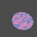

# Spatial shaders

A shader of `shader_type spatial` draws a mesh of a 3D view. Godot links it into its scene template, `forward_clustered/scene_forward_clustered.glsl`: `vertex()` and `fragment()` fill the template's code slots, each built-in reads as the template's GLSL for it, and each name of the shader takes Godot's `m_` id. The transpiler links the shader the same way and transpiles both stages of the template's colour pass to TSL. `transpileSpatial` gives the material. `withGodotAttributes` writes a geometry's position, normal and tangent as Godot's mesh storage writes an uncompressed surface. `writeSpatialBindings` writes the template's scene data from the camera, and `SCENE_BINDINGS` names the line of Godot's C++ behind each value. The material writes each object's transform as Godot's instance data just before it draws the object.

Godot 4.6.3-stable (official), probed on llvmpipe (LLVM 20.1.2). Each table shows at most 8 of a probe's rows, picked to show as many mixes of zero, subnormal, normal, infinite and NaN values as fit. The real-GL test (`pnpm test:shaders:gpu`) checks every row, bit for bit, NaN lanes compared as NaN. Generated by `pnpm godot:shader-language`: do not edit by hand.

## Showcase `spatial-default-unshaded`

Godot draws this spatial shader on a mesh of a 3D view, with the scene's camera (`tests/e2e/meshScenes.mjs`). A plain three.js page draws the transpiled material on the same mesh with the same values. `pnpm test:shaders:e2e` draws both again and fails on any pixel over 2/255 apart.

```glsl
shader_type spatial;
render_mode unshaded;

void vertex() {
	ROUGHNESS = 0.8;
}

void fragment() {
	ALBEDO = vec3(0.6);
	ROUGHNESS = 0.8;
	METALLIC = 0.2;
}
```

| Godot | Transpilation on three.js |
| --- | --- |
|  |  |

## Showcase `spatial-unshaded-moved`

Godot draws this spatial shader on a mesh of a 3D view, with the scene's camera (`tests/e2e/meshScenes.mjs`). A plain three.js page draws the transpiled material on the same mesh with the same values. `pnpm test:shaders:e2e` draws both again and fails on any pixel over 2/255 apart.

```glsl
shader_type spatial;
render_mode unshaded;

void vertex() {
	ROUGHNESS = 0.8;
}

void fragment() {
	ALBEDO = vec3(0.6);
	ROUGHNESS = 0.8;
	METALLIC = 0.2;
}
```

| Godot | Transpilation on three.js |
| --- | --- |
|  |  |

## Showcase `spatial-mirrored-x`

Godot draws this spatial shader on a mesh of a 3D view, with the scene's camera (`tests/e2e/meshScenes.mjs`). A plain three.js page draws the transpiled material on the same mesh with the same values. `pnpm test:shaders:e2e` draws both again and fails on any pixel over 2/255 apart.

```glsl
shader_type spatial;
render_mode unshaded;

void vertex() {
	ROUGHNESS = 0.8;
}

void fragment() {
	ALBEDO = vec3(0.6);
	ROUGHNESS = 0.8;
	METALLIC = 0.2;
}
```

| Godot | Transpilation on three.js |
| --- | --- |
|  |  |

## Showcase `spatial-mirrored-xyz`

Godot draws this spatial shader on a mesh of a 3D view, with the scene's camera (`tests/e2e/meshScenes.mjs`). A plain three.js page draws the transpiled material on the same mesh with the same values. `pnpm test:shaders:e2e` draws both again and fails on any pixel over 2/255 apart.

```glsl
shader_type spatial;
render_mode unshaded;

void vertex() {
	ROUGHNESS = 0.8;
}

void fragment() {
	ALBEDO = vec3(0.6);
	ROUGHNESS = 0.8;
	METALLIC = 0.2;
}
```

| Godot | Transpilation on three.js |
| --- | --- |
|  |  |

## Showcase `spatial-uniform-scale`

Godot draws this spatial shader on a mesh of a 3D view, with the scene's camera (`tests/e2e/meshScenes.mjs`). A plain three.js page draws the transpiled material on the same mesh with the same values. `pnpm test:shaders:e2e` draws both again and fails on any pixel over 2/255 apart.

```glsl
shader_type spatial;
render_mode unshaded;

void vertex() {
	ROUGHNESS = 0.8;
}

void fragment() {
	ALBEDO = vec3(0.6);
	ROUGHNESS = 0.8;
	METALLIC = 0.2;
}
```

| Godot | Transpilation on three.js |
| --- | --- |
|  |  |

## Showcase `spatial-far-translation`

Godot draws this spatial shader on a mesh of a 3D view, with the scene's camera (`tests/e2e/meshScenes.mjs`). A plain three.js page draws the transpiled material on the same mesh with the same values. `pnpm test:shaders:e2e` draws both again and fails on any pixel over 2/255 apart.

```glsl
shader_type spatial;
render_mode unshaded;

void vertex() {
	ROUGHNESS = 0.8;
}

void fragment() {
	ALBEDO = vec3(0.6);
	ROUGHNESS = 0.8;
	METALLIC = 0.2;
}
```

| Godot | Transpilation on three.js |
| --- | --- |
|  |  |

## Showcase `spatial-parent`

Godot draws this spatial shader on a mesh of a 3D view, with the scene's camera (`tests/e2e/meshScenes.mjs`). A plain three.js page draws the transpiled material on the same mesh with the same values. `pnpm test:shaders:e2e` draws both again and fails on any pixel over 2/255 apart.

```glsl
shader_type spatial;
render_mode unshaded;

void vertex() {
	ROUGHNESS = 0.8;
}

void fragment() {
	ALBEDO = vec3(0.6);
	ROUGHNESS = 0.8;
	METALLIC = 0.2;
}
```

| Godot | Transpilation on three.js |
| --- | --- |
|  |  |

## Showcase `spatial-shared-material`

Godot draws this spatial shader on a mesh of a 3D view, with the scene's camera (`tests/e2e/meshScenes.mjs`). A plain three.js page draws the transpiled material on the same mesh with the same values. `pnpm test:shaders:e2e` draws both again and fails on any pixel over 2/255 apart.

```glsl
shader_type spatial;
render_mode unshaded;

void vertex() {
	ROUGHNESS = 0.8;
}

void fragment() {
	ALBEDO = vec3(0.6);
	ROUGHNESS = 0.8;
	METALLIC = 0.2;
}
```

| Godot | Transpilation on three.js |
| --- | --- |
|  |  |

## Showcase `spatial-fov-narrow`

Godot draws this spatial shader on a mesh of a 3D view, with the scene's camera (`tests/e2e/meshScenes.mjs`). A plain three.js page draws the transpiled material on the same mesh with the same values. `pnpm test:shaders:e2e` draws both again and fails on any pixel over 2/255 apart.

```glsl
shader_type spatial;
render_mode unshaded;

void vertex() {
	ROUGHNESS = 0.8;
}

void fragment() {
	ALBEDO = vec3(0.6);
	ROUGHNESS = 0.8;
	METALLIC = 0.2;
}
```

| Godot | Transpilation on three.js |
| --- | --- |
|  |  |

## Showcase `spatial-fov-wide`

Godot draws this spatial shader on a mesh of a 3D view, with the scene's camera (`tests/e2e/meshScenes.mjs`). A plain three.js page draws the transpiled material on the same mesh with the same values. `pnpm test:shaders:e2e` draws both again and fails on any pixel over 2/255 apart.

```glsl
shader_type spatial;
render_mode unshaded;

void vertex() {
	ROUGHNESS = 0.8;
}

void fragment() {
	ALBEDO = vec3(0.6);
	ROUGHNESS = 0.8;
	METALLIC = 0.2;
}
```

| Godot | Transpilation on three.js |
| --- | --- |
|  |  |

## Showcase `spatial-orthogonal`

Godot draws this spatial shader on a mesh of a 3D view, with the scene's camera (`tests/e2e/meshScenes.mjs`). A plain three.js page draws the transpiled material on the same mesh with the same values. `pnpm test:shaders:e2e` draws both again and fails on any pixel over 2/255 apart.

```glsl
shader_type spatial;
render_mode unshaded;

void vertex() {
	ROUGHNESS = 0.8;
}

void fragment() {
	ALBEDO = vec3(0.6);
	ROUGHNESS = 0.8;
	METALLIC = 0.2;
}
```

| Godot | Transpilation on three.js |
| --- | --- |
|  |  |

## Showcase `spatial-frustum`

Godot draws this spatial shader on a mesh of a 3D view, with the scene's camera (`tests/e2e/meshScenes.mjs`). A plain three.js page draws the transpiled material on the same mesh with the same values. `pnpm test:shaders:e2e` draws both again and fails on any pixel over 2/255 apart.

```glsl
shader_type spatial;
render_mode unshaded;

void vertex() {
	ROUGHNESS = 0.8;
}

void fragment() {
	ALBEDO = vec3(0.6);
	ROUGHNESS = 0.8;
	METALLIC = 0.2;
}
```

| Godot | Transpilation on three.js |
| --- | --- |
|  |  |

## Showcase `spatial-near-far`

Godot draws this spatial shader on a mesh of a 3D view, with the scene's camera (`tests/e2e/meshScenes.mjs`). A plain three.js page draws the transpiled material on the same mesh with the same values. `pnpm test:shaders:e2e` draws both again and fails on any pixel over 2/255 apart.

```glsl
shader_type spatial;
render_mode unshaded;

void vertex() {
	ROUGHNESS = 0.8;
}

void fragment() {
	ALBEDO = vec3(0.6);
	ROUGHNESS = 0.8;
	METALLIC = 0.2;
}
```

| Godot | Transpilation on three.js |
| --- | --- |
|  |  |

## Showcase `spatial-wide-viewport`

Godot draws this spatial shader on a mesh of a 3D view, with the scene's camera (`tests/e2e/meshScenes.mjs`). A plain three.js page draws the transpiled material on the same mesh with the same values. `pnpm test:shaders:e2e` draws both again and fails on any pixel over 2/255 apart.

```glsl
shader_type spatial;
render_mode unshaded;

void vertex() {
	ROUGHNESS = 0.8;
}

void fragment() {
	ALBEDO = vec3(0.6);
	ROUGHNESS = 0.8;
	METALLIC = 0.2;
}
```

| Godot | Transpilation on three.js |
| --- | --- |
|  |  |

## Showcase `spatial-normal`

Godot draws this spatial shader on a mesh of a 3D view, with the scene's camera (`tests/e2e/meshScenes.mjs`). A plain three.js page draws the transpiled material on the same mesh with the same values. `pnpm test:shaders:e2e` draws both again and fails on any pixel over 2/255 apart.

```glsl
shader_type spatial;
render_mode unshaded;

void fragment() {
	ALBEDO = NORMAL * 0.5 + 0.5;
}
```

| Godot | Transpilation on three.js |
| --- | --- |
|  |  |

## Showcase `spatial-tangent`

Godot draws this spatial shader on a mesh of a 3D view, with the scene's camera (`tests/e2e/meshScenes.mjs`). A plain three.js page draws the transpiled material on the same mesh with the same values. `pnpm test:shaders:e2e` draws both again and fails on any pixel over 2/255 apart.

```glsl
shader_type spatial;
render_mode unshaded;

void fragment() {
	ALBEDO = TANGENT * 0.5 + 0.5;
}
```

| Godot | Transpilation on three.js |
| --- | --- |
|  |  |

## Showcase `spatial-binormal`

Godot draws this spatial shader on a mesh of a 3D view, with the scene's camera (`tests/e2e/meshScenes.mjs`). A plain three.js page draws the transpiled material on the same mesh with the same values. `pnpm test:shaders:e2e` draws both again and fails on any pixel over 2/255 apart.

```glsl
shader_type spatial;
render_mode unshaded;

void fragment() {
	ALBEDO = BINORMAL * 0.5 + 0.5;
}
```

| Godot | Transpilation on three.js |
| --- | --- |
|  |  |

## Showcase `spatial-tangent-made-up`

Godot draws this spatial shader on a mesh of a 3D view, with the scene's camera (`tests/e2e/meshScenes.mjs`). A plain three.js page draws the transpiled material on the same mesh with the same values. `pnpm test:shaders:e2e` draws both again and fails on any pixel over 2/255 apart.

```glsl
shader_type spatial;
render_mode unshaded;

void fragment() {
	ALBEDO = TANGENT * 0.5 + 0.5;
}
```

| Godot | Transpilation on three.js |
| --- | --- |
|  |  |

## Showcase `spatial-binormal-made-up`

Godot draws this spatial shader on a mesh of a 3D view, with the scene's camera (`tests/e2e/meshScenes.mjs`). A plain three.js page draws the transpiled material on the same mesh with the same values. `pnpm test:shaders:e2e` draws both again and fails on any pixel over 2/255 apart.

```glsl
shader_type spatial;
render_mode unshaded;

void fragment() {
	ALBEDO = BINORMAL * 0.5 + 0.5;
}
```

| Godot | Transpilation on three.js |
| --- | --- |
|  |  |

## Showcase `spatial-uv`

Godot draws this spatial shader on a mesh of a 3D view, with the scene's camera (`tests/e2e/meshScenes.mjs`). A plain three.js page draws the transpiled material on the same mesh with the same values. `pnpm test:shaders:e2e` draws both again and fails on any pixel over 2/255 apart.

```glsl
shader_type spatial;
render_mode unshaded;

void fragment() {
	ALBEDO = vec3(UV, 0.0);
}
```

| Godot | Transpilation on three.js |
| --- | --- |
|  |  |

## Showcase `spatial-uv2`

Godot draws this spatial shader on a mesh of a 3D view, with the scene's camera (`tests/e2e/meshScenes.mjs`). A plain three.js page draws the transpiled material on the same mesh with the same values. `pnpm test:shaders:e2e` draws both again and fails on any pixel over 2/255 apart.

```glsl
shader_type spatial;
render_mode unshaded;

void fragment() {
	ALBEDO = vec3(UV2, 0.0);
}
```

| Godot | Transpilation on three.js |
| --- | --- |
|  |  |

## Showcase `spatial-color`

Godot draws this spatial shader on a mesh of a 3D view, with the scene's camera (`tests/e2e/meshScenes.mjs`). A plain three.js page draws the transpiled material on the same mesh with the same values. `pnpm test:shaders:e2e` draws both again and fails on any pixel over 2/255 apart.

```glsl
shader_type spatial;
render_mode unshaded;

void fragment() {
	ALBEDO = COLOR.rgb;
}
```

| Godot | Transpilation on three.js |
| --- | --- |
|  |  |

## Showcase `spatial-compressed`

Godot draws this spatial shader on a mesh of a 3D view, with the scene's camera (`tests/e2e/meshScenes.mjs`). A plain three.js page draws the transpiled material on the same mesh with the same values. `pnpm test:shaders:e2e` draws both again and fails on any pixel over 2/255 apart.

```glsl
shader_type spatial;
render_mode unshaded;

void fragment() {
	ALBEDO = NORMAL * 0.5 + 0.5;
}
```

| Godot | Transpilation on three.js |
| --- | --- |
|  |  |

## Showcase `spatial-varying-smooth`

Godot draws this spatial shader on a mesh of a 3D view, with the scene's camera (`tests/e2e/meshScenes.mjs`). A plain three.js page draws the transpiled material on the same mesh with the same values. `pnpm test:shaders:e2e` draws both again and fails on any pixel over 2/255 apart.

```glsl
shader_type spatial;
render_mode unshaded;
varying vec3 v;

void vertex() {
	v = NORMAL * 0.5 + 0.5;
}

void fragment() {
	ALBEDO = v;
}
```

| Godot | Transpilation on three.js |
| --- | --- |
|  |  |

## Showcase `spatial-varying-flat`

Godot draws this spatial shader on a mesh of a 3D view, with the scene's camera (`tests/e2e/meshScenes.mjs`). A plain three.js page draws the transpiled material on the same mesh with the same values. `pnpm test:shaders:e2e` draws both again and fails on any pixel over 2/255 apart.

```glsl
shader_type spatial;
render_mode unshaded;
varying flat vec3 v;

void vertex() {
	v = NORMAL * 0.5 + 0.5;
}

void fragment() {
	ALBEDO = v;
}
```

| Godot | Transpilation on three.js |
| --- | --- |
|  |  |

## Showcase `spatial-varying-int`

Godot draws this spatial shader on a mesh of a 3D view, with the scene's camera (`tests/e2e/meshScenes.mjs`). A plain three.js page draws the transpiled material on the same mesh with the same values. `pnpm test:shaders:e2e` draws both again and fails on any pixel over 2/255 apart.

```glsl
shader_type spatial;
render_mode unshaded;
varying flat int band;

void vertex() {
	band = int(UV.y * 6.0);
}

void fragment() {
	ALBEDO = vec3(float(band) / 6.0);
}
```

| Godot | Transpilation on three.js |
| --- | --- |
|  |  |

## Showcase `spatial-varying-matrix`

Godot draws this spatial shader on a mesh of a 3D view, with the scene's camera (`tests/e2e/meshScenes.mjs`). A plain three.js page draws the transpiled material on the same mesh with the same values. `pnpm test:shaders:e2e` draws both again and fails on any pixel over 2/255 apart.

```glsl
shader_type spatial;
render_mode unshaded;
varying mat3 frame;

void vertex() {
	frame = mat3(TANGENT, BINORMAL, NORMAL);
}

void fragment() {
	ALBEDO = frame[0] * 0.5 + 0.5;
}
```

| Godot | Transpilation on three.js |
| --- | --- |
|  |  |

## Showcase `spatial-varying-array`

Godot draws this spatial shader on a mesh of a 3D view, with the scene's camera (`tests/e2e/meshScenes.mjs`). A plain three.js page draws the transpiled material on the same mesh with the same values. `pnpm test:shaders:e2e` draws both again and fails on any pixel over 2/255 apart.

```glsl
shader_type spatial;
render_mode unshaded;
varying vec2 pair[2];

void vertex() {
	pair[0] = UV; pair[1] = UV2;
}

void fragment() {
	ALBEDO = vec3(pair[0], pair[1].x);
}
```

| Godot | Transpilation on three.js |
| --- | --- |
|  |  |

## Showcase `spatial-varying-array-computed`

Godot draws this spatial shader on a mesh of a 3D view, with the scene's camera (`tests/e2e/meshScenes.mjs`). A plain three.js page draws the transpiled material on the same mesh with the same values. `pnpm test:shaders:e2e` draws both again and fails on any pixel over 2/255 apart.

```glsl
shader_type spatial;
render_mode unshaded;
varying float bands[12];

void vertex() {
	for (int i = 0; i < 12; i++) { bands[i] = fract(UV.x * float(i + 1)); }
}

void fragment() {
	ALBEDO = vec3(bands[int(UV.y * 11.99)], bands[11], bands[int(UV.x * 5.0)]);
}
```

| Godot | Transpilation on three.js |
| --- | --- |
|  |  |

## Showcase `spatial-varying-fragment`

Godot draws this spatial shader on a mesh of a 3D view, with the scene's camera (`tests/e2e/meshScenes.mjs`). A plain three.js page draws the transpiled material on the same mesh with the same values. `pnpm test:shaders:e2e` draws both again and fails on any pixel over 2/255 apart.

```glsl
shader_type spatial;
render_mode unshaded;
varying vec3 tint;

void vertex() {
	
}

void fragment() {
	tint = vec3(0.8, 0.4, 0.2); ALBEDO = tint * UV.x;
}
```

| Godot | Transpilation on three.js |
| --- | --- |
|  |  |

## Showcase `spatial-vertex-model-matrix`

Godot draws this spatial shader on a mesh of a 3D view, with the scene's camera (`tests/e2e/meshScenes.mjs`). A plain three.js page draws the transpiled material on the same mesh with the same values. `pnpm test:shaders:e2e` draws both again and fails on any pixel over 2/255 apart.

```glsl
shader_type spatial;
render_mode unshaded;
varying vec3 shown;

void vertex() {
	shown = (MODEL_MATRIX * vec4(0.3, -0.2, 0.5, 1.0)).xyz * 0.3 + 0.5;
}

void fragment() {
	ALBEDO = shown;
}
```

| Godot | Transpilation on three.js |
| --- | --- |
|  |  |

## Showcase `spatial-fragment-model-matrix`

Godot draws this spatial shader on a mesh of a 3D view, with the scene's camera (`tests/e2e/meshScenes.mjs`). A plain three.js page draws the transpiled material on the same mesh with the same values. `pnpm test:shaders:e2e` draws both again and fails on any pixel over 2/255 apart.

```glsl
shader_type spatial;
render_mode unshaded;


void vertex() {
	
}

void fragment() {
	ALBEDO = (MODEL_MATRIX * vec4(0.3, -0.2, 0.5, 1.0)).xyz * 0.3 + 0.5;
}
```

| Godot | Transpilation on three.js |
| --- | --- |
|  |  |

## Showcase `spatial-vertex-model-normal-matrix`

Godot draws this spatial shader on a mesh of a 3D view, with the scene's camera (`tests/e2e/meshScenes.mjs`). A plain three.js page draws the transpiled material on the same mesh with the same values. `pnpm test:shaders:e2e` draws both again and fails on any pixel over 2/255 apart.

```glsl
shader_type spatial;
render_mode unshaded;
varying vec3 shown;

void vertex() {
	shown = (MODEL_NORMAL_MATRIX * vec4(0.3, -0.2, 0.5, 1.0).xyz) * 0.5 + 0.5;
}

void fragment() {
	ALBEDO = shown;
}
```

| Godot | Transpilation on three.js |
| --- | --- |
|  |  |

## Showcase `spatial-fragment-model-normal-matrix`

Godot draws this spatial shader on a mesh of a 3D view, with the scene's camera (`tests/e2e/meshScenes.mjs`). A plain three.js page draws the transpiled material on the same mesh with the same values. `pnpm test:shaders:e2e` draws both again and fails on any pixel over 2/255 apart.

```glsl
shader_type spatial;
render_mode unshaded;


void vertex() {
	
}

void fragment() {
	ALBEDO = (MODEL_NORMAL_MATRIX * vec4(0.3, -0.2, 0.5, 1.0).xyz) * 0.5 + 0.5;
}
```

| Godot | Transpilation on three.js |
| --- | --- |
|  |  |

## Showcase `spatial-vertex-view-matrix`

Godot draws this spatial shader on a mesh of a 3D view, with the scene's camera (`tests/e2e/meshScenes.mjs`). A plain three.js page draws the transpiled material on the same mesh with the same values. `pnpm test:shaders:e2e` draws both again and fails on any pixel over 2/255 apart.

```glsl
shader_type spatial;
render_mode unshaded;
varying vec3 shown;

void vertex() {
	shown = (VIEW_MATRIX * vec4(0.3, -0.2, 0.5, 1.0)).xyz * 0.15 + 0.5;
}

void fragment() {
	ALBEDO = shown;
}
```

| Godot | Transpilation on three.js |
| --- | --- |
|  |  |

## Showcase `spatial-fragment-view-matrix`

Godot draws this spatial shader on a mesh of a 3D view, with the scene's camera (`tests/e2e/meshScenes.mjs`). A plain three.js page draws the transpiled material on the same mesh with the same values. `pnpm test:shaders:e2e` draws both again and fails on any pixel over 2/255 apart.

```glsl
shader_type spatial;
render_mode unshaded;


void vertex() {
	
}

void fragment() {
	ALBEDO = (VIEW_MATRIX * vec4(0.3, -0.2, 0.5, 1.0)).xyz * 0.15 + 0.5;
}
```

| Godot | Transpilation on three.js |
| --- | --- |
|  |  |

## Showcase `spatial-vertex-inv-view-matrix`

Godot draws this spatial shader on a mesh of a 3D view, with the scene's camera (`tests/e2e/meshScenes.mjs`). A plain three.js page draws the transpiled material on the same mesh with the same values. `pnpm test:shaders:e2e` draws both again and fails on any pixel over 2/255 apart.

```glsl
shader_type spatial;
render_mode unshaded;
varying vec3 shown;

void vertex() {
	shown = (INV_VIEW_MATRIX * vec4(0.3, -0.2, 0.5, 1.0)).xyz * 0.2 + 0.4;
}

void fragment() {
	ALBEDO = shown;
}
```

| Godot | Transpilation on three.js |
| --- | --- |
|  |  |

## Showcase `spatial-fragment-inv-view-matrix`

Godot draws this spatial shader on a mesh of a 3D view, with the scene's camera (`tests/e2e/meshScenes.mjs`). A plain three.js page draws the transpiled material on the same mesh with the same values. `pnpm test:shaders:e2e` draws both again and fails on any pixel over 2/255 apart.

```glsl
shader_type spatial;
render_mode unshaded;


void vertex() {
	
}

void fragment() {
	ALBEDO = (INV_VIEW_MATRIX * vec4(0.3, -0.2, 0.5, 1.0)).xyz * 0.2 + 0.4;
}
```

| Godot | Transpilation on three.js |
| --- | --- |
|  |  |

## Showcase `spatial-vertex-inv-projection-matrix`

Godot draws this spatial shader on a mesh of a 3D view, with the scene's camera (`tests/e2e/meshScenes.mjs`). A plain three.js page draws the transpiled material on the same mesh with the same values. `pnpm test:shaders:e2e` draws both again and fails on any pixel over 2/255 apart.

```glsl
shader_type spatial;
render_mode unshaded;
varying vec3 shown;

void vertex() {
	shown = (INV_PROJECTION_MATRIX * vec4(0.3, -0.2, 0.5, 1.0)).xyw * vec3(0.3, 0.3, 0.03) + vec3(0.5, 0.5, 0.5);
}

void fragment() {
	ALBEDO = shown;
}
```

| Godot | Transpilation on three.js |
| --- | --- |
|  |  |

## Showcase `spatial-fragment-inv-projection-matrix`

Godot draws this spatial shader on a mesh of a 3D view, with the scene's camera (`tests/e2e/meshScenes.mjs`). A plain three.js page draws the transpiled material on the same mesh with the same values. `pnpm test:shaders:e2e` draws both again and fails on any pixel over 2/255 apart.

```glsl
shader_type spatial;
render_mode unshaded;


void vertex() {
	
}

void fragment() {
	ALBEDO = (INV_PROJECTION_MATRIX * vec4(0.3, -0.2, 0.5, 1.0)).xyw * vec3(0.3, 0.3, 0.03) + vec3(0.5, 0.5, 0.5);
}
```

| Godot | Transpilation on three.js |
| --- | --- |
|  |  |

## Showcase `spatial-vertex-viewport-size`

Godot draws this spatial shader on a mesh of a 3D view, with the scene's camera (`tests/e2e/meshScenes.mjs`). A plain three.js page draws the transpiled material on the same mesh with the same values. `pnpm test:shaders:e2e` draws both again and fails on any pixel over 2/255 apart.

```glsl
shader_type spatial;
render_mode unshaded;
varying vec3 shown;

void vertex() {
	shown = vec3(VIEWPORT_SIZE / vec2(128.0, 96.0), 0.5);
}

void fragment() {
	ALBEDO = shown;
}
```

| Godot | Transpilation on three.js |
| --- | --- |
|  |  |

## Showcase `spatial-fragment-viewport-size`

Godot draws this spatial shader on a mesh of a 3D view, with the scene's camera (`tests/e2e/meshScenes.mjs`). A plain three.js page draws the transpiled material on the same mesh with the same values. `pnpm test:shaders:e2e` draws both again and fails on any pixel over 2/255 apart.

```glsl
shader_type spatial;
render_mode unshaded;


void vertex() {
	
}

void fragment() {
	ALBEDO = vec3(VIEWPORT_SIZE / vec2(128.0, 96.0), 0.5);
}
```

| Godot | Transpilation on three.js |
| --- | --- |
|  |  |

## Showcase `spatial-vertex-node-position-world`

Godot draws this spatial shader on a mesh of a 3D view, with the scene's camera (`tests/e2e/meshScenes.mjs`). A plain three.js page draws the transpiled material on the same mesh with the same values. `pnpm test:shaders:e2e` draws both again and fails on any pixel over 2/255 apart.

```glsl
shader_type spatial;
render_mode unshaded;
varying vec3 shown;

void vertex() {
	shown = NODE_POSITION_WORLD * 0.5 + 0.5;
}

void fragment() {
	ALBEDO = shown;
}
```

| Godot | Transpilation on three.js |
| --- | --- |
|  |  |

## Showcase `spatial-fragment-node-position-world`

Godot draws this spatial shader on a mesh of a 3D view, with the scene's camera (`tests/e2e/meshScenes.mjs`). A plain three.js page draws the transpiled material on the same mesh with the same values. `pnpm test:shaders:e2e` draws both again and fails on any pixel over 2/255 apart.

```glsl
shader_type spatial;
render_mode unshaded;


void vertex() {
	
}

void fragment() {
	ALBEDO = NODE_POSITION_WORLD * 0.5 + 0.5;
}
```

| Godot | Transpilation on three.js |
| --- | --- |
|  |  |

## Showcase `spatial-vertex-camera-position-world`

Godot draws this spatial shader on a mesh of a 3D view, with the scene's camera (`tests/e2e/meshScenes.mjs`). A plain three.js page draws the transpiled material on the same mesh with the same values. `pnpm test:shaders:e2e` draws both again and fails on any pixel over 2/255 apart.

```glsl
shader_type spatial;
render_mode unshaded;
varying vec3 shown;

void vertex() {
	shown = CAMERA_POSITION_WORLD * 0.2 + 0.5;
}

void fragment() {
	ALBEDO = shown;
}
```

| Godot | Transpilation on three.js |
| --- | --- |
|  |  |

## Showcase `spatial-fragment-camera-position-world`

Godot draws this spatial shader on a mesh of a 3D view, with the scene's camera (`tests/e2e/meshScenes.mjs`). A plain three.js page draws the transpiled material on the same mesh with the same values. `pnpm test:shaders:e2e` draws both again and fails on any pixel over 2/255 apart.

```glsl
shader_type spatial;
render_mode unshaded;


void vertex() {
	
}

void fragment() {
	ALBEDO = CAMERA_POSITION_WORLD * 0.2 + 0.5;
}
```

| Godot | Transpilation on three.js |
| --- | --- |
|  |  |

## Showcase `spatial-vertex-camera-direction-world`

Godot draws this spatial shader on a mesh of a 3D view, with the scene's camera (`tests/e2e/meshScenes.mjs`). A plain three.js page draws the transpiled material on the same mesh with the same values. `pnpm test:shaders:e2e` draws both again and fails on any pixel over 2/255 apart.

```glsl
shader_type spatial;
render_mode unshaded;
varying vec3 shown;

void vertex() {
	shown = CAMERA_DIRECTION_WORLD * 0.5 + 0.5;
}

void fragment() {
	ALBEDO = shown;
}
```

| Godot | Transpilation on three.js |
| --- | --- |
|  |  |

## Showcase `spatial-fragment-camera-direction-world`

Godot draws this spatial shader on a mesh of a 3D view, with the scene's camera (`tests/e2e/meshScenes.mjs`). A plain three.js page draws the transpiled material on the same mesh with the same values. `pnpm test:shaders:e2e` draws both again and fails on any pixel over 2/255 apart.

```glsl
shader_type spatial;
render_mode unshaded;


void vertex() {
	
}

void fragment() {
	ALBEDO = CAMERA_DIRECTION_WORLD * 0.5 + 0.5;
}
```

| Godot | Transpilation on three.js |
| --- | --- |
|  |  |

## Showcase `spatial-vertex-node-position-view`

Godot draws this spatial shader on a mesh of a 3D view, with the scene's camera (`tests/e2e/meshScenes.mjs`). A plain three.js page draws the transpiled material on the same mesh with the same values. `pnpm test:shaders:e2e` draws both again and fails on any pixel over 2/255 apart.

```glsl
shader_type spatial;
render_mode unshaded;
varying vec3 shown;

void vertex() {
	shown = NODE_POSITION_VIEW * 0.12 + 0.5;
}

void fragment() {
	ALBEDO = shown;
}
```

| Godot | Transpilation on three.js |
| --- | --- |
|  |  |

## Showcase `spatial-fragment-node-position-view`

Godot draws this spatial shader on a mesh of a 3D view, with the scene's camera (`tests/e2e/meshScenes.mjs`). A plain three.js page draws the transpiled material on the same mesh with the same values. `pnpm test:shaders:e2e` draws both again and fails on any pixel over 2/255 apart.

```glsl
shader_type spatial;
render_mode unshaded;


void vertex() {
	
}

void fragment() {
	ALBEDO = NODE_POSITION_VIEW * 0.12 + 0.5;
}
```

| Godot | Transpilation on three.js |
| --- | --- |
|  |  |

## Showcase `spatial-vertex-camera-visible-layers`

Godot draws this spatial shader on a mesh of a 3D view, with the scene's camera (`tests/e2e/meshScenes.mjs`). A plain three.js page draws the transpiled material on the same mesh with the same values. `pnpm test:shaders:e2e` draws both again and fails on any pixel over 2/255 apart.

```glsl
shader_type spatial;
render_mode unshaded;
varying vec3 shown;

void vertex() {
	shown = vec3(float(CAMERA_VISIBLE_LAYERS & 0xffu) / 510.0, float(CAMERA_VISIBLE_LAYERS >> 16u) / 30.0, 0.2);
}

void fragment() {
	ALBEDO = shown;
}
```

| Godot | Transpilation on three.js |
| --- | --- |
|  |  |

## Showcase `spatial-fragment-camera-visible-layers`

Godot draws this spatial shader on a mesh of a 3D view, with the scene's camera (`tests/e2e/meshScenes.mjs`). A plain three.js page draws the transpiled material on the same mesh with the same values. `pnpm test:shaders:e2e` draws both again and fails on any pixel over 2/255 apart.

```glsl
shader_type spatial;
render_mode unshaded;


void vertex() {
	
}

void fragment() {
	ALBEDO = vec3(float(CAMERA_VISIBLE_LAYERS & 0xffu) / 510.0, float(CAMERA_VISIBLE_LAYERS >> 16u) / 30.0, 0.2);
}
```

| Godot | Transpilation on three.js |
| --- | --- |
|  |  |

## Showcase `spatial-vertex-views`

Godot draws this spatial shader on a mesh of a 3D view, with the scene's camera (`tests/e2e/meshScenes.mjs`). A plain three.js page draws the transpiled material on the same mesh with the same values. `pnpm test:shaders:e2e` draws both again and fails on any pixel over 2/255 apart.

```glsl
shader_type spatial;
render_mode unshaded;
varying vec3 shown;

void vertex() {
	shown = vec3(float(VIEW_INDEX) + 0.25, float(VIEW_MONO_LEFT) + 0.5, float(VIEW_RIGHT) * 0.75) + EYE_OFFSET;
}

void fragment() {
	ALBEDO = shown;
}
```

| Godot | Transpilation on three.js |
| --- | --- |
|  |  |

## Showcase `spatial-fragment-views`

Godot draws this spatial shader on a mesh of a 3D view, with the scene's camera (`tests/e2e/meshScenes.mjs`). A plain three.js page draws the transpiled material on the same mesh with the same values. `pnpm test:shaders:e2e` draws both again and fails on any pixel over 2/255 apart.

```glsl
shader_type spatial;
render_mode unshaded;


void vertex() {
	
}

void fragment() {
	ALBEDO = vec3(float(VIEW_INDEX) + 0.25, float(VIEW_MONO_LEFT) + 0.5, float(VIEW_RIGHT) * 0.75) + EYE_OFFSET;
}
```

| Godot | Transpilation on three.js |
| --- | --- |
|  |  |

## Showcase `spatial-vertex-vertex`

Godot draws this spatial shader on a mesh of a 3D view, with the scene's camera (`tests/e2e/meshScenes.mjs`). A plain three.js page draws the transpiled material on the same mesh with the same values. `pnpm test:shaders:e2e` draws both again and fails on any pixel over 2/255 apart.

```glsl
shader_type spatial;
render_mode unshaded;
varying vec3 shown;

void vertex() {
	shown = VERTEX * 0.5 + 0.5;
}

void fragment() {
	ALBEDO = shown;
}
```

| Godot | Transpilation on three.js |
| --- | --- |
|  |  |

## Showcase `spatial-vertex-vertex-write`

Godot draws this spatial shader on a mesh of a 3D view, with the scene's camera (`tests/e2e/meshScenes.mjs`). A plain three.js page draws the transpiled material on the same mesh with the same values. `pnpm test:shaders:e2e` draws both again and fails on any pixel over 2/255 apart.

```glsl
shader_type spatial;
render_mode unshaded;


void vertex() {
	VERTEX *= vec3(0.6, 1.0, 1.2);
}

void fragment() {
	ALBEDO = NORMAL * 0.5 + 0.5;
}
```

| Godot | Transpilation on three.js |
| --- | --- |
|  |  |

## Showcase `spatial-vertex-position`

Godot draws this spatial shader on a mesh of a 3D view, with the scene's camera (`tests/e2e/meshScenes.mjs`). A plain three.js page draws the transpiled material on the same mesh with the same values. `pnpm test:shaders:e2e` draws both again and fails on any pixel over 2/255 apart.

```glsl
shader_type spatial;
render_mode unshaded;


void vertex() {
	POSITION = PROJECTION_MATRIX * MODELVIEW_MATRIX * vec4(VERTEX * 0.8, 1.0);
}

void fragment() {
	ALBEDO = vec3(UV, 0.5);
}
```

| Godot | Transpilation on three.js |
| --- | --- |
|  |  |

## Showcase `spatial-vertex-modelview-normal`

Godot draws this spatial shader on a mesh of a 3D view, with the scene's camera (`tests/e2e/meshScenes.mjs`). A plain three.js page draws the transpiled material on the same mesh with the same values. `pnpm test:shaders:e2e` draws both again and fails on any pixel over 2/255 apart.

```glsl
shader_type spatial;
render_mode unshaded;
varying vec3 shown;

void vertex() {
	shown = MODELVIEW_NORMAL_MATRIX * NORMAL * 0.5 + 0.5;
}

void fragment() {
	ALBEDO = shown;
}
```

| Godot | Transpilation on three.js |
| --- | --- |
|  |  |

## Showcase `spatial-vertex-projection-matrix`

Godot draws this spatial shader on a mesh of a 3D view, with the scene's camera (`tests/e2e/meshScenes.mjs`). A plain three.js page draws the transpiled material on the same mesh with the same values. `pnpm test:shaders:e2e` draws both again and fails on any pixel over 2/255 apart.

```glsl
shader_type spatial;
render_mode unshaded;
varying vec3 shown;

void vertex() {
	shown = vec3((PROJECTION_MATRIX * vec4(0.3, -0.2, 0.5, 1.0)).x + (PROJECTION_MATRIX * vec4(0.3, -0.2, 0.5, 1.0)).y, (PROJECTION_MATRIX * vec4(0.3, -0.2, 0.5, 1.0)).z, (PROJECTION_MATRIX * vec4(0.3, -0.2, 0.5, 1.0)).w) * 0.3 + 0.5;
}

void fragment() {
	ALBEDO = shown;
}
```

| Godot | Transpilation on three.js |
| --- | --- |
|  |  |

## Showcase `spatial-vertex-main-camera`

Godot draws this spatial shader on a mesh of a 3D view, with the scene's camera (`tests/e2e/meshScenes.mjs`). A plain three.js page draws the transpiled material on the same mesh with the same values. `pnpm test:shaders:e2e` draws both again and fails on any pixel over 2/255 apart.

```glsl
shader_type spatial;
render_mode unshaded;
varying vec3 shown;

void vertex() {
	shown = (MAIN_CAM_INV_VIEW_MATRIX * vec4(0.3, -0.2, 0.5, 1.0)).xyz * 0.2 + 0.4;
}

void fragment() {
	ALBEDO = shown;
}
```

| Godot | Transpilation on three.js |
| --- | --- |
|  |  |

## Showcase `spatial-vertex-color`

Godot draws this spatial shader on a mesh of a 3D view, with the scene's camera (`tests/e2e/meshScenes.mjs`). A plain three.js page draws the transpiled material on the same mesh with the same values. `pnpm test:shaders:e2e` draws both again and fails on any pixel over 2/255 apart.

```glsl
shader_type spatial;
render_mode unshaded;


void vertex() {
	COLOR.rgb = COLOR.bgr * 0.8;
}

void fragment() {
	ALBEDO = COLOR.rgb;
}
```

| Godot | Transpilation on three.js |
| --- | --- |
|  |  |

## Showcase `spatial-vertex-ids`

Godot draws this spatial shader on a mesh of a 3D view, with the scene's camera (`tests/e2e/meshScenes.mjs`). A plain three.js page draws the transpiled material on the same mesh with the same values. `pnpm test:shaders:e2e` draws both again and fails on any pixel over 2/255 apart.

```glsl
shader_type spatial;
render_mode unshaded;
varying vec3 shown;

void vertex() {
	shown = vec3(fract(float(VERTEX_ID) / 7.0), float(INSTANCE_ID) + 0.25, 0.5);
}

void fragment() {
	ALBEDO = shown;
}
```

| Godot | Transpilation on three.js |
| --- | --- |
|  |  |

## Showcase `spatial-vertex-instance-custom`

Godot draws this spatial shader on a mesh of a 3D view, with the scene's camera (`tests/e2e/meshScenes.mjs`). A plain three.js page draws the transpiled material on the same mesh with the same values. `pnpm test:shaders:e2e` draws both again and fails on any pixel over 2/255 apart.

```glsl
shader_type spatial;
render_mode unshaded;
varying vec3 shown;

void vertex() {
	shown = INSTANCE_CUSTOM.rgb + 0.25;
}

void fragment() {
	ALBEDO = shown;
}
```

| Godot | Transpilation on three.js |
| --- | --- |
|  |  |

## Showcase `spatial-vertex-custom0`

Godot draws this spatial shader on a mesh of a 3D view, with the scene's camera (`tests/e2e/meshScenes.mjs`). A plain three.js page draws the transpiled material on the same mesh with the same values. `pnpm test:shaders:e2e` draws both again and fails on any pixel over 2/255 apart.

```glsl
shader_type spatial;
render_mode unshaded;
varying vec3 shown;

void vertex() {
	shown = CUSTOM0.rgb * CUSTOM0.a;
}

void fragment() {
	ALBEDO = shown;
}
```

| Godot | Transpilation on three.js |
| --- | --- |
|  |  |

## Showcase `spatial-vertex-custom1`

Godot draws this spatial shader on a mesh of a 3D view, with the scene's camera (`tests/e2e/meshScenes.mjs`). A plain three.js page draws the transpiled material on the same mesh with the same values. `pnpm test:shaders:e2e` draws both again and fails on any pixel over 2/255 apart.

```glsl
shader_type spatial;
render_mode unshaded;
varying vec3 shown;

void vertex() {
	shown = CUSTOM1.rgb * CUSTOM1.a;
}

void fragment() {
	ALBEDO = shown;
}
```

| Godot | Transpilation on three.js |
| --- | --- |
|  |  |

## Showcase `spatial-vertex-custom2`

Godot draws this spatial shader on a mesh of a 3D view, with the scene's camera (`tests/e2e/meshScenes.mjs`). A plain three.js page draws the transpiled material on the same mesh with the same values. `pnpm test:shaders:e2e` draws both again and fails on any pixel over 2/255 apart.

```glsl
shader_type spatial;
render_mode unshaded;
varying vec3 shown;

void vertex() {
	shown = CUSTOM2.rgb * CUSTOM2.a;
}

void fragment() {
	ALBEDO = shown;
}
```

| Godot | Transpilation on three.js |
| --- | --- |
|  |  |

## Showcase `spatial-vertex-custom3`

Godot draws this spatial shader on a mesh of a 3D view, with the scene's camera (`tests/e2e/meshScenes.mjs`). A plain three.js page draws the transpiled material on the same mesh with the same values. `pnpm test:shaders:e2e` draws both again and fails on any pixel over 2/255 apart.

```glsl
shader_type spatial;
render_mode unshaded;
varying vec3 shown;

void vertex() {
	shown = CUSTOM3.rgb * CUSTOM3.a;
}

void fragment() {
	ALBEDO = shown;
}
```

| Godot | Transpilation on three.js |
| --- | --- |
|  |  |

## Showcase `spatial-color-missing`

Godot draws this spatial shader on a mesh of a 3D view, with the scene's camera (`tests/e2e/meshScenes.mjs`). A plain three.js page draws the transpiled material on the same mesh with the same values. `pnpm test:shaders:e2e` draws both again and fails on any pixel over 2/255 apart.

```glsl
shader_type spatial;
render_mode unshaded;


void vertex() {
	
}

void fragment() {
	ALBEDO = COLOR.rgb * 0.7 + vec3(UV, 0.0) * 0.2;
}
```

| Godot | Transpilation on three.js |
| --- | --- |
|  |  |

## Showcase `spatial-vertex-custom-missing`

Godot draws this spatial shader on a mesh of a 3D view, with the scene's camera (`tests/e2e/meshScenes.mjs`). A plain three.js page draws the transpiled material on the same mesh with the same values. `pnpm test:shaders:e2e` draws both again and fails on any pixel over 2/255 apart.

```glsl
shader_type spatial;
render_mode unshaded;
varying vec3 shown;

void vertex() {
	shown = CUSTOM0.rgb * 0.5 + CUSTOM0.a * 0.25;
}

void fragment() {
	ALBEDO = shown;
}
```

| Godot | Transpilation on three.js |
| --- | --- |
|  |  |

## Showcase `spatial-vertex-bone-indices`

Godot draws this spatial shader on a mesh of a 3D view, with the scene's camera (`tests/e2e/meshScenes.mjs`). A plain three.js page draws the transpiled material on the same mesh with the same values. `pnpm test:shaders:e2e` draws both again and fails on any pixel over 2/255 apart.

```glsl
shader_type spatial;
render_mode unshaded;
varying vec3 shown;

void vertex() {
	shown = vec3(BONE_INDICES.xyz % uvec3(8u)) / 8.0 + float(BONE_INDICES.w) * 0.02;
}

void fragment() {
	ALBEDO = shown;
}
```

| Godot | Transpilation on three.js |
| --- | --- |
|  |  |

## Showcase `spatial-vertex-bone-weights`

Godot draws this spatial shader on a mesh of a 3D view, with the scene's camera (`tests/e2e/meshScenes.mjs`). A plain three.js page draws the transpiled material on the same mesh with the same values. `pnpm test:shaders:e2e` draws both again and fails on any pixel over 2/255 apart.

```glsl
shader_type spatial;
render_mode unshaded;
varying vec3 shown;

void vertex() {
	shown = BONE_WEIGHTS.rgb + BONE_WEIGHTS.a * 0.4;
}

void fragment() {
	ALBEDO = shown;
}
```

| Godot | Transpilation on three.js |
| --- | --- |
|  |  |

## Showcase `spatial-vertex-z-clip-scale`

Godot draws this spatial shader on a mesh of a 3D view, with the scene's camera (`tests/e2e/meshScenes.mjs`). A plain three.js page draws the transpiled material on the same mesh with the same values. `pnpm test:shaders:e2e` draws both again and fails on any pixel over 2/255 apart.

```glsl
shader_type spatial;
render_mode unshaded;


void vertex() {
	Z_CLIP_SCALE = 0.05;
}

void fragment() {
	ALBEDO = vec3(0.9, 0.3, 0.1);
}
```

| Godot | Transpilation on three.js |
| --- | --- |
|  |  |

## Showcase `spatial-fragment-vertex`

Godot draws this spatial shader on a mesh of a 3D view, with the scene's camera (`tests/e2e/meshScenes.mjs`). A plain three.js page draws the transpiled material on the same mesh with the same values. `pnpm test:shaders:e2e` draws both again and fails on any pixel over 2/255 apart.

```glsl
shader_type spatial;
render_mode unshaded;


void vertex() {
	
}

void fragment() {
	ALBEDO = VERTEX * 0.15 + 0.6;
}
```

| Godot | Transpilation on three.js |
| --- | --- |
|  |  |

## Showcase `spatial-fragment-light-vertex`

Godot draws this spatial shader on a mesh of a 3D view, with the scene's camera (`tests/e2e/meshScenes.mjs`). A plain three.js page draws the transpiled material on the same mesh with the same values. `pnpm test:shaders:e2e` draws both again and fails on any pixel over 2/255 apart.

```glsl
shader_type spatial;
render_mode unshaded;


void vertex() {
	
}

void fragment() {
	LIGHT_VERTEX = VERTEX * 0.5;
	ALBEDO = LIGHT_VERTEX * 0.3 + 0.6;
}
```

| Godot | Transpilation on three.js |
| --- | --- |
|  |  |

## Showcase `spatial-fragment-fragcoord`

Godot draws this spatial shader on a mesh of a 3D view, with the scene's camera (`tests/e2e/meshScenes.mjs`). A plain three.js page draws the transpiled material on the same mesh with the same values. `pnpm test:shaders:e2e` draws both again and fails on any pixel over 2/255 apart.

```glsl
shader_type spatial;
render_mode unshaded;


void vertex() {
	
}

void fragment() {
	ALBEDO = vec3(FRAGCOORD.xy / 64.0, FRAGCOORD.z);
}
```

| Godot | Transpilation on three.js |
| --- | --- |
|  |  |

## Showcase `spatial-fragment-front-facing`

Godot draws this spatial shader on a mesh of a 3D view, with the scene's camera (`tests/e2e/meshScenes.mjs`). A plain three.js page draws the transpiled material on the same mesh with the same values. `pnpm test:shaders:e2e` draws both again and fails on any pixel over 2/255 apart.

```glsl
shader_type spatial;
render_mode unshaded;


void vertex() {
	
}

void fragment() {
	ALBEDO = FRONT_FACING ? vec3(0.2, 0.7, 0.3) : vec3(0.8, 0.1, 0.1);
}
```

| Godot | Transpilation on three.js |
| --- | --- |
|  |  |

## Showcase `spatial-fragment-view`

Godot draws this spatial shader on a mesh of a 3D view, with the scene's camera (`tests/e2e/meshScenes.mjs`). A plain three.js page draws the transpiled material on the same mesh with the same values. `pnpm test:shaders:e2e` draws both again and fails on any pixel over 2/255 apart.

```glsl
shader_type spatial;
render_mode unshaded;


void vertex() {
	
}

void fragment() {
	ALBEDO = VIEW * 0.5 + 0.5;
}
```

| Godot | Transpilation on three.js |
| --- | --- |
|  |  |

## Showcase `spatial-fragment-screen-uv`

Godot draws this spatial shader on a mesh of a 3D view, with the scene's camera (`tests/e2e/meshScenes.mjs`). A plain three.js page draws the transpiled material on the same mesh with the same values. `pnpm test:shaders:e2e` draws both again and fails on any pixel over 2/255 apart.

```glsl
shader_type spatial;
render_mode unshaded;


void vertex() {
	
}

void fragment() {
	ALBEDO = vec3(SCREEN_UV, 0.5);
}
```

| Godot | Transpilation on three.js |
| --- | --- |
|  |  |

## Showcase `spatial-fragment-projection-matrix`

Godot draws this spatial shader on a mesh of a 3D view, with the scene's camera (`tests/e2e/meshScenes.mjs`). A plain three.js page draws the transpiled material on the same mesh with the same values. `pnpm test:shaders:e2e` draws both again and fails on any pixel over 2/255 apart.

```glsl
shader_type spatial;
render_mode unshaded;


void vertex() {
	
}

void fragment() {
	ALBEDO = vec3((PROJECTION_MATRIX * vec4(0.3, -0.2, 0.5, 1.0)).x + (PROJECTION_MATRIX * vec4(0.3, -0.2, 0.5, 1.0)).y, (PROJECTION_MATRIX * vec4(0.3, -0.2, 0.5, 1.0)).z, (PROJECTION_MATRIX * vec4(0.3, -0.2, 0.5, 1.0)).w) * 0.3 + 0.5;
}
```

| Godot | Transpilation on three.js |
| --- | --- |
|  |  |

## Showcase `spatial-constants`

Godot draws this spatial shader on a mesh of a 3D view, with the scene's camera (`tests/e2e/meshScenes.mjs`). A plain three.js page draws the transpiled material on the same mesh with the same values. `pnpm test:shaders:e2e` draws both again and fails on any pixel over 2/255 apart.

```glsl
shader_type spatial;
render_mode unshaded;


void vertex() {
	
}

void fragment() {
	ALBEDO = vec3(PI / 4.0, TAU / 8.0 - 0.3, E / 3.0) * 0.8 + vec3(OUTPUT_IS_SRGB ? 0.1 : 0.0, CLIP_SPACE_FAR * 0.5 + 0.1, IS_MULTIVIEW ? 0.1 : 0.0);
}
```

| Godot | Transpilation on three.js |
| --- | --- |
|  |  |

## Showcase `spatial-time-fraction`

Godot draws this spatial shader on a mesh of a 3D view, with the scene's camera (`tests/e2e/meshScenes.mjs`). A plain three.js page draws the transpiled material on the same mesh with the same values. `pnpm test:shaders:e2e` draws both again and fails on any pixel over 2/255 apart.

```glsl
shader_type spatial;
render_mode unshaded;
varying float early;

void vertex() {
	early = TIME;
}

void fragment() {
	ALBEDO = vec3(fract(early), TIME * 0.2, 0.5);
}
```

| Godot | Transpilation on three.js |
| --- | --- |
|  |  |

## Showcase `spatial-time-rolled-over`

Godot draws this spatial shader on a mesh of a 3D view, with the scene's camera (`tests/e2e/meshScenes.mjs`). A plain three.js page draws the transpiled material on the same mesh with the same values. `pnpm test:shaders:e2e` draws both again and fails on any pixel over 2/255 apart.

```glsl
shader_type spatial;
render_mode unshaded;
varying float early;

void vertex() {
	early = TIME;
}

void fragment() {
	ALBEDO = vec3(fract(early), TIME * 0.2, 0.5);
}
```

| Godot | Transpilation on three.js |
| --- | --- |
|  |  |

## Showcase `spatial-exposure`

Godot draws this spatial shader on a mesh of a 3D view, with the scene's camera (`tests/e2e/meshScenes.mjs`). A plain three.js page draws the transpiled material on the same mesh with the same values. `pnpm test:shaders:e2e` draws both again and fails on any pixel over 2/255 apart.

```glsl
shader_type spatial;
render_mode unshaded;


void vertex() {
	
}

void fragment() {
	ALBEDO = vec3(EXPOSURE * 0.5, IN_SHADOW_PASS ? 0.9 : 0.1, 0.4);
}
```

| Godot | Transpilation on three.js |
| --- | --- |
|  |  |

## Render mode `unshaded`

`unshaded` defines `MODE_UNSHADED`, so the template writes `ALBEDO` and `ALPHA` to the frame with no light, fog or ambient light (`scene_forward_clustered.glsl:2978-2981`).

The transpiler emits `the defines of the template variant`. Rows: `spatial render_mode unshaded`. Godot source: `servers/rendering/shader_types.cpp:239`.

Every row is native on WebGL 2. WebGPURenderer runs the same nodes and is untested (#1788).


## `ALBEDO`, `ROUGHNESS` and `METALLIC`

`ALBEDO` is the surface colour `fragment()` writes, linear. `ROUGHNESS` and `METALLIC` are the surface's roughness and metalness, which an unshaded surface reads in no colour. Godot's template holds each in a local of `fragment_shader`, or of `vertex_shader` for the vertex stage's `ROUGHNESS`.

The transpiler emits the template's locals `albedo`, `roughness` and `metallic`. Rows: `spatial.vertex.ROUGHNESS`, `spatial.fragment.ALBEDO`, `spatial.fragment.METALLIC`, `spatial.fragment.ROUGHNESS`. Godot source: `servers/rendering/shader_types.cpp:102`.

Every row is native on WebGL 2. WebGPURenderer runs the same nodes and is untested (#1788).


## `NORMAL`, `TANGENT`, `BINORMAL`, `UV`, `UV2` and `COLOR`

The mesh's attributes as `fragment()` reads them, interpolated: the normal, tangent and binormal in view space, the two UV sets and the vertex colour. `withGodotAttributes` stores them as Godot stores an uncompressed surface: the normal and tangent as 16-bit octahedrons, the colour as four bytes. With no tangent array, Godot makes a tangent up from the normal, and so does the transpiler.

The transpiler emits the template's varyings `normal_interp`, `tangent_interp`, `binormal_interp`, `uv_interp`, `uv2_interp` and `color_interp`. Rows: `spatial.fragment.NORMAL`, `spatial.fragment.TANGENT`, `spatial.fragment.BINORMAL`, `spatial.fragment.UV`, `spatial.fragment.UV2`, `spatial.fragment.COLOR`. Godot source: `servers/rendering/shader_types.cpp:139`.

Every row is native on WebGL 2. WebGPURenderer runs the same nodes and is untested (#1788).


## `NORMAL`, `TANGENT`, `BINORMAL`, `UV` and `UV2` in `vertex()`

The mesh's attributes as `vertex()` reads and writes them, for one vertex: the normal, tangent and binormal in model space, and the two UV sets. Godot's template holds each in a local of `vertex_shader`, which it turns to view space and writes to its varying after `vertex()` returns.

The transpiler emits the template's locals `normal`, `tangent`, `binormal`, `uv_interp` and `uv2_interp` of the vertex stage. Rows: `spatial.vertex.NORMAL`, `spatial.vertex.TANGENT`, `spatial.vertex.BINORMAL`, `spatial.vertex.UV`, `spatial.vertex.UV2`. Godot source: `servers/rendering/shader_types.cpp:90`.

Every row is native on WebGL 2. WebGPURenderer runs the same nodes and is untested (#1788).


## The vertex and its ids in `vertex()`

`VERTEX` is the vertex in model space, which the template turns to view space after `vertex()` returns. A write to `POSITION` replaces the template's clip position. `COLOR` is the vertex colour that `fragment()` reads. `VERTEX_ID` and `INSTANCE_ID` are GL's vertex and instance index. A mesh outside a MultiMesh has an `INSTANCE_CUSTOM` of zero.

The transpiler emits the template's locals `vertex`, `position`, `color_interp` and `instance_custom`, three's `vertexIndex`, and an instance index of 0. Rows: `spatial.vertex.VERTEX`, `spatial.vertex.POSITION`, `spatial.vertex.COLOR`, `spatial.vertex.INSTANCE_ID`, `spatial.vertex.INSTANCE_CUSTOM`, `spatial.vertex.VERTEX_ID`. Godot source: `servers/rendering/shader_types.cpp:89`.

Every row is native on WebGL 2. WebGPURenderer runs the same nodes and is untested (#1788).


## Custom arrays, bones and `Z_CLIP_SCALE` in `vertex()`

`CUSTOM0` to `CUSTOM3` are a mesh's custom arrays, each a `vec4` with the missing lanes read as 0 and the last as 1. `BONE_INDICES` and `BONE_WEIGHTS` are the four bones of a vertex and their weights, read with no skeleton as the arrays hold them. `withGodotAttributes` reads the custom arrays from the attributes `custom0` to `custom3`, and the bones from three's `skinIndex` and `skinWeight`. A write to `Z_CLIP_SCALE` pulls the depth towards the camera: the template mixes the clip position's z with its w.

The transpiler emits the attributes `custom0_attrib` to `custom3_attrib`, `bone_attrib` as 16-bit integers and `weight_attrib`, and the template's local `z_clip_scale`. Rows: `spatial.vertex.Z_CLIP_SCALE`, `spatial.vertex.BONE_INDICES`, `spatial.vertex.BONE_WEIGHTS`, `spatial.vertex.CUSTOM0`, `spatial.vertex.CUSTOM1`, `spatial.vertex.CUSTOM2`, `spatial.vertex.CUSTOM3`. Godot source: `servers/rendering/shader_types.cpp:98`.

Every row is native on WebGL 2. WebGPURenderer runs the same nodes and is untested (#1788).


## Matrices

The object's, camera's and projection's matrices as both stages read them. The template reads the object's matrix from the instance data and the others from its scene data. The projection is Vulkan's: y flipped and depth reversed into 0 to 1. `MODELVIEW_MATRIX` and `MODELVIEW_NORMAL_MATRIX` are products the vertex stage works out.

The transpiler emits the template's uniforms `scene_data_block.data.*` and its instance rows. Rows: `spatial.vertex.MODEL_MATRIX`, `spatial.vertex.MODEL_NORMAL_MATRIX`, `spatial.vertex.VIEW_MATRIX`, `spatial.vertex.INV_VIEW_MATRIX`, `spatial.vertex.PROJECTION_MATRIX`, `spatial.vertex.INV_PROJECTION_MATRIX`, `spatial.vertex.MODELVIEW_MATRIX`, `spatial.vertex.MODELVIEW_NORMAL_MATRIX`, `spatial.vertex.MAIN_CAM_INV_VIEW_MATRIX`, `spatial.fragment.MODEL_MATRIX`, `spatial.fragment.MODEL_NORMAL_MATRIX`, `spatial.fragment.VIEW_MATRIX`, `spatial.fragment.INV_VIEW_MATRIX`, `spatial.fragment.PROJECTION_MATRIX`, `spatial.fragment.INV_PROJECTION_MATRIX`. Godot source: `servers/rendering/shader_types.cpp:113`.

Every row is native on WebGL 2. WebGPURenderer runs the same nodes and is untested (#1788).


## Positions, layers and the viewport

The object's origin in world and view space, the camera's position and backward axis in world space, the camera's 20 visual layers as bits, and the viewport's size in pixels. Godot's template reads each from a column of a matrix or a field of its scene data.

The transpiler emits `the template's text for each built-in, read from its uniforms`. Rows: `spatial.vertex.VIEWPORT_SIZE`, `spatial.vertex.NODE_POSITION_WORLD`, `spatial.vertex.CAMERA_POSITION_WORLD`, `spatial.vertex.CAMERA_DIRECTION_WORLD`, `spatial.vertex.CAMERA_VISIBLE_LAYERS`, `spatial.vertex.NODE_POSITION_VIEW`, `spatial.fragment.NODE_POSITION_WORLD`, `spatial.fragment.CAMERA_POSITION_WORLD`, `spatial.fragment.CAMERA_DIRECTION_WORLD`, `spatial.fragment.CAMERA_VISIBLE_LAYERS`, `spatial.fragment.NODE_POSITION_VIEW`, `spatial.fragment.VIEWPORT_SIZE`. Godot source: `servers/rendering/shader_types.cpp:121`.

Every row is native on WebGL 2. WebGPURenderer runs the same nodes and is untested (#1788).


## Views

A view with one eye has a `VIEW_INDEX` of 0 and an `EYE_OFFSET` of zero. `VIEW_MONO_LEFT` is 0 and `VIEW_RIGHT` is 1.

The transpiler emits `the template's text with no multiview define`. Rows: `spatial.vertex.VIEW_INDEX`, `spatial.vertex.VIEW_MONO_LEFT`, `spatial.vertex.VIEW_RIGHT`, `spatial.vertex.EYE_OFFSET`, `spatial.fragment.VIEW_INDEX`, `spatial.fragment.VIEW_MONO_LEFT`, `spatial.fragment.VIEW_RIGHT`, `spatial.fragment.EYE_OFFSET`. Godot source: `servers/rendering/shader_types.cpp:130`.

Every row is native on WebGL 2. WebGPURenderer runs the same nodes and is untested (#1788).


## The fragment and the view in `fragment()`

`VERTEX` is the fragment's position in view space and `VIEW` the unit vector from it to the camera. `LIGHT_VERTEX` starts as `VERTEX`, and only the light reads a write to it. `FRAGCOORD` is the pixel's centre and its depth, with y down as Vulkan has it. `SCREEN_UV` is `FRAGCOORD.xy` over the viewport's size. `FRONT_FACING` is true for a face Godot sees from the front.

The transpiler emits the template's locals, `gl_FragCoord` as Vulkan's and three's `frontFacing`. Rows: `spatial.fragment.VERTEX`, `spatial.fragment.LIGHT_VERTEX`, `spatial.fragment.FRAGCOORD`, `spatial.fragment.FRONT_FACING`, `spatial.fragment.VIEW`, `spatial.fragment.SCREEN_UV`. Godot source: `servers/rendering/shader_types.cpp:135`.

Every row is native on WebGL 2. WebGPURenderer runs the same nodes and is untested (#1788).


## Constants and the global built-ins

`PI`, `TAU` and `E` are numbers. Godot's colour pass writes linear colour with Vulkan's depth, so `OUTPUT_IS_SRGB` is false, `CLIP_SPACE_FAR` is 0 and `IS_MULTIVIEW` is false. `EXPOSURE` is 1 over the camera's exposure normalisation, which is 1 with no camera attributes. `IN_SHADOW_PASS` is false in the colour pass. `TIME` is the scene's time in seconds, which rolls over as the sky's does.

The transpiler emits `the template's text for each built-in, and the scene data's time, exposure and flags`. Rows: `spatial.global.TIME`, `spatial.global.EXPOSURE`, `spatial.global.IN_SHADOW_PASS`, `spatial.constants.PI`, `spatial.constants.TAU`, `spatial.constants.E`, `spatial.constants.OUTPUT_IS_SRGB`, `spatial.constants.CLIP_SPACE_FAR`, `spatial.constants.IS_MULTIVIEW`. Godot source: `servers/rendering/shader_types.cpp:79`.

Every row is native on WebGL 2. WebGPURenderer runs the same nodes and is untested (#1788).


## Varyings

`varying flat int band;` declares a value that `vertex()` writes and `fragment()` reads. Godot declares a varying that the vertex stage writes, or that no stage writes, as an `out` of the vertex stage and an `in` of the fragment stage, `flat` when the shader says so (`shader_compiler.cpp:688-737`). A `smooth` varying interpolates, as one with no qualifier does. A varying that `fragment()` writes is a global of the fragment stage only. Godot refuses a `bool` varying in `vertex()`, and declares none that no stage writes.

The transpiler emits a TSL varying for each varying, `flat` as Godot declares it, and one varying for each element of an array, as three declares no array varying. Rows: `flat`, `smooth`, `varying`. Godot source: `servers/rendering/shader_language.cpp:324`.

Every row is native on WebGL 2. WebGPURenderer runs the same nodes and is untested (#1788).

