# Spatial shaders

A shader of `shader_type spatial` draws a mesh of a 3D view. Godot links it into its scene template, `forward_clustered/scene_forward_clustered.glsl`: `vertex()` and `fragment()` fill the template's code slots, each built-in reads as the template's GLSL for it, and each name of the shader takes Godot's `m_` id. The transpiler links the shader the same way and transpiles both stages of the template's colour pass to TSL. `transpileSpatial` gives the material. `withGodotAttributes` writes a geometry's position, normal and tangent as Godot's mesh storage writes an uncompressed surface. `writeSpatialBindings` writes the template's scene data from the camera, and `SCENE_BINDINGS` names the line of Godot's C++ behind each value. The material writes each object's transform as Godot's instance data just before it draws the object. In the previewer, a ShaderMaterial with an `unshaded` spatial shader draws on each surface of an unskinned mesh: a MeshInstance3D's mesh, `surface_material_override` and `material_override`. A lit shader, and a shader on any other draw, such as a skinned mesh, a MultiMesh or a `next_pass`, draw Godot's default 3D surface, and the previewer logs a warning that names the draw.

Godot 4.6.3-stable (official), probed on llvmpipe (LLVM 20.1.2). Each table shows at most 8 of a probe's rows, picked to show as many mixes of zero, subnormal, normal, infinite and NaN values as fit. The real-GL test (`pnpm test:shaders:gpu`) checks every row, bit for bit, NaN lanes compared as NaN. Generated by `pnpm godot:shader-language`: do not edit by hand.

## Showcase `spatial-default-unshaded`

Godot draws this spatial shader on a mesh of a 3D view, with the scene's camera (`tests/e2e/meshScenes.mjs`). A plain three.js page draws the transpiled material on the same mesh with the same values. `pnpm test:shaders:e2e` draws both again and fails on any pixel over 2/255 apart.

```glsl
shader_type spatial;
render_mode unshaded;

void vertex() {
	ROUGHNESS = 0.8;
}

void fragment() {
	ALBEDO = vec3(0.6);
	ROUGHNESS = 0.8;
	METALLIC = 0.2;
}
```

| Godot | Transpilation on three.js |
| --- | --- |
|  |  |

## Showcase `spatial-unshaded-moved`

Godot draws this spatial shader on a mesh of a 3D view, with the scene's camera (`tests/e2e/meshScenes.mjs`). A plain three.js page draws the transpiled material on the same mesh with the same values. `pnpm test:shaders:e2e` draws both again and fails on any pixel over 2/255 apart.

```glsl
shader_type spatial;
render_mode unshaded;

void vertex() {
	ROUGHNESS = 0.8;
}

void fragment() {
	ALBEDO = vec3(0.6);
	ROUGHNESS = 0.8;
	METALLIC = 0.2;
}
```

| Godot | Transpilation on three.js |
| --- | --- |
|  |  |

## Showcase `spatial-mirrored-x`

Godot draws this spatial shader on a mesh of a 3D view, with the scene's camera (`tests/e2e/meshScenes.mjs`). A plain three.js page draws the transpiled material on the same mesh with the same values. `pnpm test:shaders:e2e` draws both again and fails on any pixel over 2/255 apart.

```glsl
shader_type spatial;
render_mode unshaded;

void vertex() {
	ROUGHNESS = 0.8;
}

void fragment() {
	ALBEDO = vec3(0.6);
	ROUGHNESS = 0.8;
	METALLIC = 0.2;
}
```

| Godot | Transpilation on three.js |
| --- | --- |
|  |  |

## Showcase `spatial-mirrored-xyz`

Godot draws this spatial shader on a mesh of a 3D view, with the scene's camera (`tests/e2e/meshScenes.mjs`). A plain three.js page draws the transpiled material on the same mesh with the same values. `pnpm test:shaders:e2e` draws both again and fails on any pixel over 2/255 apart.

```glsl
shader_type spatial;
render_mode unshaded;

void vertex() {
	ROUGHNESS = 0.8;
}

void fragment() {
	ALBEDO = vec3(0.6);
	ROUGHNESS = 0.8;
	METALLIC = 0.2;
}
```

| Godot | Transpilation on three.js |
| --- | --- |
|  |  |

## Showcase `spatial-uniform-scale`

Godot draws this spatial shader on a mesh of a 3D view, with the scene's camera (`tests/e2e/meshScenes.mjs`). A plain three.js page draws the transpiled material on the same mesh with the same values. `pnpm test:shaders:e2e` draws both again and fails on any pixel over 2/255 apart.

```glsl
shader_type spatial;
render_mode unshaded;

void vertex() {
	ROUGHNESS = 0.8;
}

void fragment() {
	ALBEDO = vec3(0.6);
	ROUGHNESS = 0.8;
	METALLIC = 0.2;
}
```

| Godot | Transpilation on three.js |
| --- | --- |
|  |  |

## Showcase `spatial-far-translation`

Godot draws this spatial shader on a mesh of a 3D view, with the scene's camera (`tests/e2e/meshScenes.mjs`). A plain three.js page draws the transpiled material on the same mesh with the same values. `pnpm test:shaders:e2e` draws both again and fails on any pixel over 2/255 apart.

```glsl
shader_type spatial;
render_mode unshaded;

void vertex() {
	ROUGHNESS = 0.8;
}

void fragment() {
	ALBEDO = vec3(0.6);
	ROUGHNESS = 0.8;
	METALLIC = 0.2;
}
```

| Godot | Transpilation on three.js |
| --- | --- |
|  |  |

## Showcase `spatial-parent`

Godot draws this spatial shader on a mesh of a 3D view, with the scene's camera (`tests/e2e/meshScenes.mjs`). A plain three.js page draws the transpiled material on the same mesh with the same values. `pnpm test:shaders:e2e` draws both again and fails on any pixel over 2/255 apart.

```glsl
shader_type spatial;
render_mode unshaded;

void vertex() {
	ROUGHNESS = 0.8;
}

void fragment() {
	ALBEDO = vec3(0.6);
	ROUGHNESS = 0.8;
	METALLIC = 0.2;
}
```

| Godot | Transpilation on three.js |
| --- | --- |
|  |  |

## Showcase `spatial-shared-material`

Godot draws this spatial shader on a mesh of a 3D view, with the scene's camera (`tests/e2e/meshScenes.mjs`). A plain three.js page draws the transpiled material on the same mesh with the same values. `pnpm test:shaders:e2e` draws both again and fails on any pixel over 2/255 apart.

```glsl
shader_type spatial;
render_mode unshaded;

void vertex() {
	ROUGHNESS = 0.8;
}

void fragment() {
	ALBEDO = vec3(0.6);
	ROUGHNESS = 0.8;
	METALLIC = 0.2;
}
```

| Godot | Transpilation on three.js |
| --- | --- |
|  |  |

## Showcase `spatial-fov-narrow`

Godot draws this spatial shader on a mesh of a 3D view, with the scene's camera (`tests/e2e/meshScenes.mjs`). A plain three.js page draws the transpiled material on the same mesh with the same values. `pnpm test:shaders:e2e` draws both again and fails on any pixel over 2/255 apart.

```glsl
shader_type spatial;
render_mode unshaded;

void vertex() {
	ROUGHNESS = 0.8;
}

void fragment() {
	ALBEDO = vec3(0.6);
	ROUGHNESS = 0.8;
	METALLIC = 0.2;
}
```

| Godot | Transpilation on three.js |
| --- | --- |
|  |  |

## Showcase `spatial-fov-wide`

Godot draws this spatial shader on a mesh of a 3D view, with the scene's camera (`tests/e2e/meshScenes.mjs`). A plain three.js page draws the transpiled material on the same mesh with the same values. `pnpm test:shaders:e2e` draws both again and fails on any pixel over 2/255 apart.

```glsl
shader_type spatial;
render_mode unshaded;

void vertex() {
	ROUGHNESS = 0.8;
}

void fragment() {
	ALBEDO = vec3(0.6);
	ROUGHNESS = 0.8;
	METALLIC = 0.2;
}
```

| Godot | Transpilation on three.js |
| --- | --- |
|  |  |

## Showcase `spatial-orthogonal`

Godot draws this spatial shader on a mesh of a 3D view, with the scene's camera (`tests/e2e/meshScenes.mjs`). A plain three.js page draws the transpiled material on the same mesh with the same values. `pnpm test:shaders:e2e` draws both again and fails on any pixel over 2/255 apart.

```glsl
shader_type spatial;
render_mode unshaded;

void vertex() {
	ROUGHNESS = 0.8;
}

void fragment() {
	ALBEDO = vec3(0.6);
	ROUGHNESS = 0.8;
	METALLIC = 0.2;
}
```

| Godot | Transpilation on three.js |
| --- | --- |
|  |  |

## Showcase `spatial-frustum`

Godot draws this spatial shader on a mesh of a 3D view, with the scene's camera (`tests/e2e/meshScenes.mjs`). A plain three.js page draws the transpiled material on the same mesh with the same values. `pnpm test:shaders:e2e` draws both again and fails on any pixel over 2/255 apart.

```glsl
shader_type spatial;
render_mode unshaded;

void vertex() {
	ROUGHNESS = 0.8;
}

void fragment() {
	ALBEDO = vec3(0.6);
	ROUGHNESS = 0.8;
	METALLIC = 0.2;
}
```

| Godot | Transpilation on three.js |
| --- | --- |
|  |  |

## Showcase `spatial-near-far`

Godot draws this spatial shader on a mesh of a 3D view, with the scene's camera (`tests/e2e/meshScenes.mjs`). A plain three.js page draws the transpiled material on the same mesh with the same values. `pnpm test:shaders:e2e` draws both again and fails on any pixel over 2/255 apart.

```glsl
shader_type spatial;
render_mode unshaded;

void vertex() {
	ROUGHNESS = 0.8;
}

void fragment() {
	ALBEDO = vec3(0.6);
	ROUGHNESS = 0.8;
	METALLIC = 0.2;
}
```

| Godot | Transpilation on three.js |
| --- | --- |
|  |  |

## Showcase `spatial-wide-viewport`

Godot draws this spatial shader on a mesh of a 3D view, with the scene's camera (`tests/e2e/meshScenes.mjs`). A plain three.js page draws the transpiled material on the same mesh with the same values. `pnpm test:shaders:e2e` draws both again and fails on any pixel over 2/255 apart.

```glsl
shader_type spatial;
render_mode unshaded;

void vertex() {
	ROUGHNESS = 0.8;
}

void fragment() {
	ALBEDO = vec3(0.6);
	ROUGHNESS = 0.8;
	METALLIC = 0.2;
}
```

| Godot | Transpilation on three.js |
| --- | --- |
|  |  |

## Showcase `spatial-normal`

Godot draws this spatial shader on a mesh of a 3D view, with the scene's camera (`tests/e2e/meshScenes.mjs`). A plain three.js page draws the transpiled material on the same mesh with the same values. `pnpm test:shaders:e2e` draws both again and fails on any pixel over 2/255 apart.

```glsl
shader_type spatial;
render_mode unshaded;

void fragment() {
	ALBEDO = NORMAL * 0.5 + 0.5;
}
```

| Godot | Transpilation on three.js |
| --- | --- |
|  |  |

## Showcase `spatial-tangent`

Godot draws this spatial shader on a mesh of a 3D view, with the scene's camera (`tests/e2e/meshScenes.mjs`). A plain three.js page draws the transpiled material on the same mesh with the same values. `pnpm test:shaders:e2e` draws both again and fails on any pixel over 2/255 apart.

```glsl
shader_type spatial;
render_mode unshaded;

void fragment() {
	ALBEDO = TANGENT * 0.5 + 0.5;
}
```

| Godot | Transpilation on three.js |
| --- | --- |
|  |  |

## Showcase `spatial-binormal`

Godot draws this spatial shader on a mesh of a 3D view, with the scene's camera (`tests/e2e/meshScenes.mjs`). A plain three.js page draws the transpiled material on the same mesh with the same values. `pnpm test:shaders:e2e` draws both again and fails on any pixel over 2/255 apart.

```glsl
shader_type spatial;
render_mode unshaded;

void fragment() {
	ALBEDO = BINORMAL * 0.5 + 0.5;
}
```

| Godot | Transpilation on three.js |
| --- | --- |
|  |  |

## Showcase `spatial-tangent-made-up`

Godot draws this spatial shader on a mesh of a 3D view, with the scene's camera (`tests/e2e/meshScenes.mjs`). A plain three.js page draws the transpiled material on the same mesh with the same values. `pnpm test:shaders:e2e` draws both again and fails on any pixel over 2/255 apart.

```glsl
shader_type spatial;
render_mode unshaded;

void fragment() {
	ALBEDO = TANGENT * 0.5 + 0.5;
}
```

| Godot | Transpilation on three.js |
| --- | --- |
|  |  |

## Showcase `spatial-binormal-made-up`

Godot draws this spatial shader on a mesh of a 3D view, with the scene's camera (`tests/e2e/meshScenes.mjs`). A plain three.js page draws the transpiled material on the same mesh with the same values. `pnpm test:shaders:e2e` draws both again and fails on any pixel over 2/255 apart.

```glsl
shader_type spatial;
render_mode unshaded;

void fragment() {
	ALBEDO = BINORMAL * 0.5 + 0.5;
}
```

| Godot | Transpilation on three.js |
| --- | --- |
|  |  |

## Showcase `spatial-uv`

Godot draws this spatial shader on a mesh of a 3D view, with the scene's camera (`tests/e2e/meshScenes.mjs`). A plain three.js page draws the transpiled material on the same mesh with the same values. `pnpm test:shaders:e2e` draws both again and fails on any pixel over 2/255 apart.

```glsl
shader_type spatial;
render_mode unshaded;

void fragment() {
	ALBEDO = vec3(UV, 0.0);
}
```

| Godot | Transpilation on three.js |
| --- | --- |
|  |  |

## Showcase `spatial-uv2`

Godot draws this spatial shader on a mesh of a 3D view, with the scene's camera (`tests/e2e/meshScenes.mjs`). A plain three.js page draws the transpiled material on the same mesh with the same values. `pnpm test:shaders:e2e` draws both again and fails on any pixel over 2/255 apart.

```glsl
shader_type spatial;
render_mode unshaded;

void fragment() {
	ALBEDO = vec3(UV2, 0.0);
}
```

| Godot | Transpilation on three.js |
| --- | --- |
|  |  |

## Showcase `spatial-color`

Godot draws this spatial shader on a mesh of a 3D view, with the scene's camera (`tests/e2e/meshScenes.mjs`). A plain three.js page draws the transpiled material on the same mesh with the same values. `pnpm test:shaders:e2e` draws both again and fails on any pixel over 2/255 apart.

```glsl
shader_type spatial;
render_mode unshaded;

void fragment() {
	ALBEDO = COLOR.rgb;
}
```

| Godot | Transpilation on three.js |
| --- | --- |
|  |  |

## Showcase `spatial-compressed`

Godot draws this spatial shader on a mesh of a 3D view, with the scene's camera (`tests/e2e/meshScenes.mjs`). A plain three.js page draws the transpiled material on the same mesh with the same values. `pnpm test:shaders:e2e` draws both again and fails on any pixel over 2/255 apart.

```glsl
shader_type spatial;
render_mode unshaded;

void fragment() {
	ALBEDO = NORMAL * 0.5 + 0.5;
}
```

| Godot | Transpilation on three.js |
| --- | --- |
|  |  |

## Showcase `spatial-varying-smooth`

Godot draws this spatial shader on a mesh of a 3D view, with the scene's camera (`tests/e2e/meshScenes.mjs`). A plain three.js page draws the transpiled material on the same mesh with the same values. `pnpm test:shaders:e2e` draws both again and fails on any pixel over 2/255 apart.

```glsl
shader_type spatial;
render_mode unshaded;
varying vec3 v;

void vertex() {
	v = NORMAL * 0.5 + 0.5;
}

void fragment() {
	ALBEDO = v;
}
```

| Godot | Transpilation on three.js |
| --- | --- |
|  |  |

## Showcase `spatial-varying-flat`

Godot draws this spatial shader on a mesh of a 3D view, with the scene's camera (`tests/e2e/meshScenes.mjs`). A plain three.js page draws the transpiled material on the same mesh with the same values. `pnpm test:shaders:e2e` draws both again and fails on any pixel over 2/255 apart.

```glsl
shader_type spatial;
render_mode unshaded;
varying flat vec3 v;

void vertex() {
	v = NORMAL * 0.5 + 0.5;
}

void fragment() {
	ALBEDO = v;
}
```

| Godot | Transpilation on three.js |
| --- | --- |
|  |  |

## Showcase `spatial-varying-int`

Godot draws this spatial shader on a mesh of a 3D view, with the scene's camera (`tests/e2e/meshScenes.mjs`). A plain three.js page draws the transpiled material on the same mesh with the same values. `pnpm test:shaders:e2e` draws both again and fails on any pixel over 2/255 apart.

```glsl
shader_type spatial;
render_mode unshaded;
varying flat int band;

void vertex() {
	band = int(UV.y * 6.0);
}

void fragment() {
	ALBEDO = vec3(float(band) / 6.0);
}
```

| Godot | Transpilation on three.js |
| --- | --- |
|  |  |

## Showcase `spatial-varying-matrix`

Godot draws this spatial shader on a mesh of a 3D view, with the scene's camera (`tests/e2e/meshScenes.mjs`). A plain three.js page draws the transpiled material on the same mesh with the same values. `pnpm test:shaders:e2e` draws both again and fails on any pixel over 2/255 apart.

```glsl
shader_type spatial;
render_mode unshaded;
varying mat3 frame;

void vertex() {
	frame = mat3(TANGENT, BINORMAL, NORMAL);
}

void fragment() {
	ALBEDO = frame[0] * 0.5 + 0.5;
}
```

| Godot | Transpilation on three.js |
| --- | --- |
|  |  |

## Showcase `spatial-varying-array`

Godot draws this spatial shader on a mesh of a 3D view, with the scene's camera (`tests/e2e/meshScenes.mjs`). A plain three.js page draws the transpiled material on the same mesh with the same values. `pnpm test:shaders:e2e` draws both again and fails on any pixel over 2/255 apart.

```glsl
shader_type spatial;
render_mode unshaded;
varying vec2 pair[2];

void vertex() {
	pair[0] = UV; pair[1] = UV2;
}

void fragment() {
	ALBEDO = vec3(pair[0], pair[1].x);
}
```

| Godot | Transpilation on three.js |
| --- | --- |
|  |  |

## Showcase `spatial-varying-array-computed`

Godot draws this spatial shader on a mesh of a 3D view, with the scene's camera (`tests/e2e/meshScenes.mjs`). A plain three.js page draws the transpiled material on the same mesh with the same values. `pnpm test:shaders:e2e` draws both again and fails on any pixel over 2/255 apart.

```glsl
shader_type spatial;
render_mode unshaded;
varying float bands[12];

void vertex() {
	for (int i = 0; i < 12; i++) { bands[i] = fract(UV.x * float(i + 1)); }
}

void fragment() {
	ALBEDO = vec3(bands[int(UV.y * 11.99)], bands[11], bands[int(UV.x * 5.0)]);
}
```

| Godot | Transpilation on three.js |
| --- | --- |
|  | 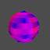 |

## Showcase `spatial-varying-fragment`

Godot draws this spatial shader on a mesh of a 3D view, with the scene's camera (`tests/e2e/meshScenes.mjs`). A plain three.js page draws the transpiled material on the same mesh with the same values. `pnpm test:shaders:e2e` draws both again and fails on any pixel over 2/255 apart.

```glsl
shader_type spatial;
render_mode unshaded;
varying vec3 tint;

void vertex() {
	
}

void fragment() {
	tint = vec3(0.8, 0.4, 0.2); ALBEDO = tint * UV.x;
}
```

| Godot | Transpilation on three.js |
| --- | --- |
| 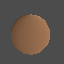 |  |

## Showcase `spatial-vertex-model-matrix`

Godot draws this spatial shader on a mesh of a 3D view, with the scene's camera (`tests/e2e/meshScenes.mjs`). A plain three.js page draws the transpiled material on the same mesh with the same values. `pnpm test:shaders:e2e` draws both again and fails on any pixel over 2/255 apart.

```glsl
shader_type spatial;
render_mode unshaded;
varying vec3 shown;

void vertex() {
	shown = (MODEL_MATRIX * vec4(0.3, -0.2, 0.5, 1.0)).xyz * 0.3 + 0.5;
}

void fragment() {
	ALBEDO = shown;
}
```

| Godot | Transpilation on three.js |
| --- | --- |
|  |  |

## Showcase `spatial-fragment-model-matrix`

Godot draws this spatial shader on a mesh of a 3D view, with the scene's camera (`tests/e2e/meshScenes.mjs`). A plain three.js page draws the transpiled material on the same mesh with the same values. `pnpm test:shaders:e2e` draws both again and fails on any pixel over 2/255 apart.

```glsl
shader_type spatial;
render_mode unshaded;


void vertex() {
	
}

void fragment() {
	ALBEDO = (MODEL_MATRIX * vec4(0.3, -0.2, 0.5, 1.0)).xyz * 0.3 + 0.5;
}
```

| Godot | Transpilation on three.js |
| --- | --- |
|  |  |

## Showcase `spatial-vertex-model-normal-matrix`

Godot draws this spatial shader on a mesh of a 3D view, with the scene's camera (`tests/e2e/meshScenes.mjs`). A plain three.js page draws the transpiled material on the same mesh with the same values. `pnpm test:shaders:e2e` draws both again and fails on any pixel over 2/255 apart.

```glsl
shader_type spatial;
render_mode unshaded;
varying vec3 shown;

void vertex() {
	shown = (MODEL_NORMAL_MATRIX * vec4(0.3, -0.2, 0.5, 1.0).xyz) * 0.5 + 0.5;
}

void fragment() {
	ALBEDO = shown;
}
```

| Godot | Transpilation on three.js |
| --- | --- |
|  |  |

## Showcase `spatial-fragment-model-normal-matrix`

Godot draws this spatial shader on a mesh of a 3D view, with the scene's camera (`tests/e2e/meshScenes.mjs`). A plain three.js page draws the transpiled material on the same mesh with the same values. `pnpm test:shaders:e2e` draws both again and fails on any pixel over 2/255 apart.

```glsl
shader_type spatial;
render_mode unshaded;


void vertex() {
	
}

void fragment() {
	ALBEDO = (MODEL_NORMAL_MATRIX * vec4(0.3, -0.2, 0.5, 1.0).xyz) * 0.5 + 0.5;
}
```

| Godot | Transpilation on three.js |
| --- | --- |
|  |  |

## Showcase `spatial-vertex-view-matrix`

Godot draws this spatial shader on a mesh of a 3D view, with the scene's camera (`tests/e2e/meshScenes.mjs`). A plain three.js page draws the transpiled material on the same mesh with the same values. `pnpm test:shaders:e2e` draws both again and fails on any pixel over 2/255 apart.

```glsl
shader_type spatial;
render_mode unshaded;
varying vec3 shown;

void vertex() {
	shown = (VIEW_MATRIX * vec4(0.3, -0.2, 0.5, 1.0)).xyz * 0.15 + 0.5;
}

void fragment() {
	ALBEDO = shown;
}
```

| Godot | Transpilation on three.js |
| --- | --- |
|  |  |

## Showcase `spatial-fragment-view-matrix`

Godot draws this spatial shader on a mesh of a 3D view, with the scene's camera (`tests/e2e/meshScenes.mjs`). A plain three.js page draws the transpiled material on the same mesh with the same values. `pnpm test:shaders:e2e` draws both again and fails on any pixel over 2/255 apart.

```glsl
shader_type spatial;
render_mode unshaded;


void vertex() {
	
}

void fragment() {
	ALBEDO = (VIEW_MATRIX * vec4(0.3, -0.2, 0.5, 1.0)).xyz * 0.15 + 0.5;
}
```

| Godot | Transpilation on three.js |
| --- | --- |
|  |  |

## Showcase `spatial-vertex-inv-view-matrix`

Godot draws this spatial shader on a mesh of a 3D view, with the scene's camera (`tests/e2e/meshScenes.mjs`). A plain three.js page draws the transpiled material on the same mesh with the same values. `pnpm test:shaders:e2e` draws both again and fails on any pixel over 2/255 apart.

```glsl
shader_type spatial;
render_mode unshaded;
varying vec3 shown;

void vertex() {
	shown = (INV_VIEW_MATRIX * vec4(0.3, -0.2, 0.5, 1.0)).xyz * 0.2 + 0.4;
}

void fragment() {
	ALBEDO = shown;
}
```

| Godot | Transpilation on three.js |
| --- | --- |
|  |  |

## Showcase `spatial-fragment-inv-view-matrix`

Godot draws this spatial shader on a mesh of a 3D view, with the scene's camera (`tests/e2e/meshScenes.mjs`). A plain three.js page draws the transpiled material on the same mesh with the same values. `pnpm test:shaders:e2e` draws both again and fails on any pixel over 2/255 apart.

```glsl
shader_type spatial;
render_mode unshaded;


void vertex() {
	
}

void fragment() {
	ALBEDO = (INV_VIEW_MATRIX * vec4(0.3, -0.2, 0.5, 1.0)).xyz * 0.2 + 0.4;
}
```

| Godot | Transpilation on three.js |
| --- | --- |
|  |  |

## Showcase `spatial-vertex-inv-projection-matrix`

Godot draws this spatial shader on a mesh of a 3D view, with the scene's camera (`tests/e2e/meshScenes.mjs`). A plain three.js page draws the transpiled material on the same mesh with the same values. `pnpm test:shaders:e2e` draws both again and fails on any pixel over 2/255 apart.

```glsl
shader_type spatial;
render_mode unshaded;
varying vec3 shown;

void vertex() {
	shown = (INV_PROJECTION_MATRIX * vec4(0.3, -0.2, 0.5, 1.0)).xyw * vec3(0.3, 0.3, 0.03) + vec3(0.5, 0.5, 0.5);
}

void fragment() {
	ALBEDO = shown;
}
```

| Godot | Transpilation on three.js |
| --- | --- |
|  |  |

## Showcase `spatial-fragment-inv-projection-matrix`

Godot draws this spatial shader on a mesh of a 3D view, with the scene's camera (`tests/e2e/meshScenes.mjs`). A plain three.js page draws the transpiled material on the same mesh with the same values. `pnpm test:shaders:e2e` draws both again and fails on any pixel over 2/255 apart.

```glsl
shader_type spatial;
render_mode unshaded;


void vertex() {
	
}

void fragment() {
	ALBEDO = (INV_PROJECTION_MATRIX * vec4(0.3, -0.2, 0.5, 1.0)).xyw * vec3(0.3, 0.3, 0.03) + vec3(0.5, 0.5, 0.5);
}
```

| Godot | Transpilation on three.js |
| --- | --- |
|  |  |

## Showcase `spatial-vertex-viewport-size`

Godot draws this spatial shader on a mesh of a 3D view, with the scene's camera (`tests/e2e/meshScenes.mjs`). A plain three.js page draws the transpiled material on the same mesh with the same values. `pnpm test:shaders:e2e` draws both again and fails on any pixel over 2/255 apart.

```glsl
shader_type spatial;
render_mode unshaded;
varying vec3 shown;

void vertex() {
	shown = vec3(VIEWPORT_SIZE / vec2(128.0, 96.0), 0.5);
}

void fragment() {
	ALBEDO = shown;
}
```

| Godot | Transpilation on three.js |
| --- | --- |
|  |  |

## Showcase `spatial-fragment-viewport-size`

Godot draws this spatial shader on a mesh of a 3D view, with the scene's camera (`tests/e2e/meshScenes.mjs`). A plain three.js page draws the transpiled material on the same mesh with the same values. `pnpm test:shaders:e2e` draws both again and fails on any pixel over 2/255 apart.

```glsl
shader_type spatial;
render_mode unshaded;


void vertex() {
	
}

void fragment() {
	ALBEDO = vec3(VIEWPORT_SIZE / vec2(128.0, 96.0), 0.5);
}
```

| Godot | Transpilation on three.js |
| --- | --- |
|  |  |

## Showcase `spatial-vertex-node-position-world`

Godot draws this spatial shader on a mesh of a 3D view, with the scene's camera (`tests/e2e/meshScenes.mjs`). A plain three.js page draws the transpiled material on the same mesh with the same values. `pnpm test:shaders:e2e` draws both again and fails on any pixel over 2/255 apart.

```glsl
shader_type spatial;
render_mode unshaded;
varying vec3 shown;

void vertex() {
	shown = NODE_POSITION_WORLD * 0.5 + 0.5;
}

void fragment() {
	ALBEDO = shown;
}
```

| Godot | Transpilation on three.js |
| --- | --- |
|  |  |

## Showcase `spatial-fragment-node-position-world`

Godot draws this spatial shader on a mesh of a 3D view, with the scene's camera (`tests/e2e/meshScenes.mjs`). A plain three.js page draws the transpiled material on the same mesh with the same values. `pnpm test:shaders:e2e` draws both again and fails on any pixel over 2/255 apart.

```glsl
shader_type spatial;
render_mode unshaded;


void vertex() {
	
}

void fragment() {
	ALBEDO = NODE_POSITION_WORLD * 0.5 + 0.5;
}
```

| Godot | Transpilation on three.js |
| --- | --- |
|  |  |

## Showcase `spatial-vertex-camera-position-world`

Godot draws this spatial shader on a mesh of a 3D view, with the scene's camera (`tests/e2e/meshScenes.mjs`). A plain three.js page draws the transpiled material on the same mesh with the same values. `pnpm test:shaders:e2e` draws both again and fails on any pixel over 2/255 apart.

```glsl
shader_type spatial;
render_mode unshaded;
varying vec3 shown;

void vertex() {
	shown = CAMERA_POSITION_WORLD * 0.2 + 0.5;
}

void fragment() {
	ALBEDO = shown;
}
```

| Godot | Transpilation on three.js |
| --- | --- |
|  |  |

## Showcase `spatial-fragment-camera-position-world`

Godot draws this spatial shader on a mesh of a 3D view, with the scene's camera (`tests/e2e/meshScenes.mjs`). A plain three.js page draws the transpiled material on the same mesh with the same values. `pnpm test:shaders:e2e` draws both again and fails on any pixel over 2/255 apart.

```glsl
shader_type spatial;
render_mode unshaded;


void vertex() {
	
}

void fragment() {
	ALBEDO = CAMERA_POSITION_WORLD * 0.2 + 0.5;
}
```

| Godot | Transpilation on three.js |
| --- | --- |
|  |  |

## Showcase `spatial-vertex-camera-direction-world`

Godot draws this spatial shader on a mesh of a 3D view, with the scene's camera (`tests/e2e/meshScenes.mjs`). A plain three.js page draws the transpiled material on the same mesh with the same values. `pnpm test:shaders:e2e` draws both again and fails on any pixel over 2/255 apart.

```glsl
shader_type spatial;
render_mode unshaded;
varying vec3 shown;

void vertex() {
	shown = CAMERA_DIRECTION_WORLD * 0.5 + 0.5;
}

void fragment() {
	ALBEDO = shown;
}
```

| Godot | Transpilation on three.js |
| --- | --- |
|  |  |

## Showcase `spatial-fragment-camera-direction-world`

Godot draws this spatial shader on a mesh of a 3D view, with the scene's camera (`tests/e2e/meshScenes.mjs`). A plain three.js page draws the transpiled material on the same mesh with the same values. `pnpm test:shaders:e2e` draws both again and fails on any pixel over 2/255 apart.

```glsl
shader_type spatial;
render_mode unshaded;


void vertex() {
	
}

void fragment() {
	ALBEDO = CAMERA_DIRECTION_WORLD * 0.5 + 0.5;
}
```

| Godot | Transpilation on three.js |
| --- | --- |
|  |  |

## Showcase `spatial-vertex-node-position-view`

Godot draws this spatial shader on a mesh of a 3D view, with the scene's camera (`tests/e2e/meshScenes.mjs`). A plain three.js page draws the transpiled material on the same mesh with the same values. `pnpm test:shaders:e2e` draws both again and fails on any pixel over 2/255 apart.

```glsl
shader_type spatial;
render_mode unshaded;
varying vec3 shown;

void vertex() {
	shown = NODE_POSITION_VIEW * 0.12 + 0.5;
}

void fragment() {
	ALBEDO = shown;
}
```

| Godot | Transpilation on three.js |
| --- | --- |
|  |  |

## Showcase `spatial-fragment-node-position-view`

Godot draws this spatial shader on a mesh of a 3D view, with the scene's camera (`tests/e2e/meshScenes.mjs`). A plain three.js page draws the transpiled material on the same mesh with the same values. `pnpm test:shaders:e2e` draws both again and fails on any pixel over 2/255 apart.

```glsl
shader_type spatial;
render_mode unshaded;


void vertex() {
	
}

void fragment() {
	ALBEDO = NODE_POSITION_VIEW * 0.12 + 0.5;
}
```

| Godot | Transpilation on three.js |
| --- | --- |
|  |  |

## Showcase `spatial-vertex-camera-visible-layers`

Godot draws this spatial shader on a mesh of a 3D view, with the scene's camera (`tests/e2e/meshScenes.mjs`). A plain three.js page draws the transpiled material on the same mesh with the same values. `pnpm test:shaders:e2e` draws both again and fails on any pixel over 2/255 apart.

```glsl
shader_type spatial;
render_mode unshaded;
varying vec3 shown;

void vertex() {
	shown = vec3(float(CAMERA_VISIBLE_LAYERS & 0xffu) / 510.0, float(CAMERA_VISIBLE_LAYERS >> 16u) / 30.0, 0.2);
}

void fragment() {
	ALBEDO = shown;
}
```

| Godot | Transpilation on three.js |
| --- | --- |
|  |  |

## Showcase `spatial-fragment-camera-visible-layers`

Godot draws this spatial shader on a mesh of a 3D view, with the scene's camera (`tests/e2e/meshScenes.mjs`). A plain three.js page draws the transpiled material on the same mesh with the same values. `pnpm test:shaders:e2e` draws both again and fails on any pixel over 2/255 apart.

```glsl
shader_type spatial;
render_mode unshaded;


void vertex() {
	
}

void fragment() {
	ALBEDO = vec3(float(CAMERA_VISIBLE_LAYERS & 0xffu) / 510.0, float(CAMERA_VISIBLE_LAYERS >> 16u) / 30.0, 0.2);
}
```

| Godot | Transpilation on three.js |
| --- | --- |
|  |  |

## Showcase `spatial-vertex-views`

Godot draws this spatial shader on a mesh of a 3D view, with the scene's camera (`tests/e2e/meshScenes.mjs`). A plain three.js page draws the transpiled material on the same mesh with the same values. `pnpm test:shaders:e2e` draws both again and fails on any pixel over 2/255 apart.

```glsl
shader_type spatial;
render_mode unshaded;
varying vec3 shown;

void vertex() {
	shown = vec3(float(VIEW_INDEX) + 0.25, float(VIEW_MONO_LEFT) + 0.5, float(VIEW_RIGHT) * 0.75) + EYE_OFFSET;
}

void fragment() {
	ALBEDO = shown;
}
```

| Godot | Transpilation on three.js |
| --- | --- |
|  |  |

## Showcase `spatial-fragment-views`

Godot draws this spatial shader on a mesh of a 3D view, with the scene's camera (`tests/e2e/meshScenes.mjs`). A plain three.js page draws the transpiled material on the same mesh with the same values. `pnpm test:shaders:e2e` draws both again and fails on any pixel over 2/255 apart.

```glsl
shader_type spatial;
render_mode unshaded;


void vertex() {
	
}

void fragment() {
	ALBEDO = vec3(float(VIEW_INDEX) + 0.25, float(VIEW_MONO_LEFT) + 0.5, float(VIEW_RIGHT) * 0.75) + EYE_OFFSET;
}
```

| Godot | Transpilation on three.js |
| --- | --- |
|  |  |

## Showcase `spatial-vertex-vertex`

Godot draws this spatial shader on a mesh of a 3D view, with the scene's camera (`tests/e2e/meshScenes.mjs`). A plain three.js page draws the transpiled material on the same mesh with the same values. `pnpm test:shaders:e2e` draws both again and fails on any pixel over 2/255 apart.

```glsl
shader_type spatial;
render_mode unshaded;
varying vec3 shown;

void vertex() {
	shown = VERTEX * 0.5 + 0.5;
}

void fragment() {
	ALBEDO = shown;
}
```

| Godot | Transpilation on three.js |
| --- | --- |
|  |  |

## Showcase `spatial-vertex-vertex-write`

Godot draws this spatial shader on a mesh of a 3D view, with the scene's camera (`tests/e2e/meshScenes.mjs`). A plain three.js page draws the transpiled material on the same mesh with the same values. `pnpm test:shaders:e2e` draws both again and fails on any pixel over 2/255 apart.

```glsl
shader_type spatial;
render_mode unshaded;


void vertex() {
	VERTEX *= vec3(0.6, 1.0, 1.2);
}

void fragment() {
	ALBEDO = NORMAL * 0.5 + 0.5;
}
```

| Godot | Transpilation on three.js |
| --- | --- |
| 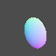 |  |

## Showcase `spatial-vertex-position`

Godot draws this spatial shader on a mesh of a 3D view, with the scene's camera (`tests/e2e/meshScenes.mjs`). A plain three.js page draws the transpiled material on the same mesh with the same values. `pnpm test:shaders:e2e` draws both again and fails on any pixel over 2/255 apart.

```glsl
shader_type spatial;
render_mode unshaded;


void vertex() {
	POSITION = PROJECTION_MATRIX * MODELVIEW_MATRIX * vec4(VERTEX * 0.8, 1.0);
}

void fragment() {
	ALBEDO = vec3(UV, 0.5);
}
```

| Godot | Transpilation on three.js |
| --- | --- |
|  |  |

## Showcase `spatial-vertex-modelview-normal`

Godot draws this spatial shader on a mesh of a 3D view, with the scene's camera (`tests/e2e/meshScenes.mjs`). A plain three.js page draws the transpiled material on the same mesh with the same values. `pnpm test:shaders:e2e` draws both again and fails on any pixel over 2/255 apart.

```glsl
shader_type spatial;
render_mode unshaded;
varying vec3 shown;

void vertex() {
	shown = MODELVIEW_NORMAL_MATRIX * NORMAL * 0.5 + 0.5;
}

void fragment() {
	ALBEDO = shown;
}
```

| Godot | Transpilation on three.js |
| --- | --- |
|  | 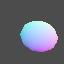 |

## Showcase `spatial-vertex-projection-matrix`

Godot draws this spatial shader on a mesh of a 3D view, with the scene's camera (`tests/e2e/meshScenes.mjs`). A plain three.js page draws the transpiled material on the same mesh with the same values. `pnpm test:shaders:e2e` draws both again and fails on any pixel over 2/255 apart.

```glsl
shader_type spatial;
render_mode unshaded;
varying vec3 shown;

void vertex() {
	shown = vec3((PROJECTION_MATRIX * vec4(0.3, -0.2, 0.5, 1.0)).x + (PROJECTION_MATRIX * vec4(0.3, -0.2, 0.5, 1.0)).y, (PROJECTION_MATRIX * vec4(0.3, -0.2, 0.5, 1.0)).z, (PROJECTION_MATRIX * vec4(0.3, -0.2, 0.5, 1.0)).w) * 0.3 + 0.5;
}

void fragment() {
	ALBEDO = shown;
}
```

| Godot | Transpilation on three.js |
| --- | --- |
|  |  |

## Showcase `spatial-vertex-main-camera`

Godot draws this spatial shader on a mesh of a 3D view, with the scene's camera (`tests/e2e/meshScenes.mjs`). A plain three.js page draws the transpiled material on the same mesh with the same values. `pnpm test:shaders:e2e` draws both again and fails on any pixel over 2/255 apart.

```glsl
shader_type spatial;
render_mode unshaded;
varying vec3 shown;

void vertex() {
	shown = (MAIN_CAM_INV_VIEW_MATRIX * vec4(0.3, -0.2, 0.5, 1.0)).xyz * 0.2 + 0.4;
}

void fragment() {
	ALBEDO = shown;
}
```

| Godot | Transpilation on three.js |
| --- | --- |
|  |  |

## Showcase `spatial-vertex-color`

Godot draws this spatial shader on a mesh of a 3D view, with the scene's camera (`tests/e2e/meshScenes.mjs`). A plain three.js page draws the transpiled material on the same mesh with the same values. `pnpm test:shaders:e2e` draws both again and fails on any pixel over 2/255 apart.

```glsl
shader_type spatial;
render_mode unshaded;


void vertex() {
	COLOR.rgb = COLOR.bgr * 0.8;
}

void fragment() {
	ALBEDO = COLOR.rgb;
}
```

| Godot | Transpilation on three.js |
| --- | --- |
|  |  |

## Showcase `spatial-vertex-ids`

Godot draws this spatial shader on a mesh of a 3D view, with the scene's camera (`tests/e2e/meshScenes.mjs`). A plain three.js page draws the transpiled material on the same mesh with the same values. `pnpm test:shaders:e2e` draws both again and fails on any pixel over 2/255 apart.

```glsl
shader_type spatial;
render_mode unshaded;
varying vec3 shown;

void vertex() {
	shown = vec3(fract(float(VERTEX_ID) / 7.0), float(INSTANCE_ID) + 0.25, 0.5);
}

void fragment() {
	ALBEDO = shown;
}
```

| Godot | Transpilation on three.js |
| --- | --- |
|  |  |

## Showcase `spatial-vertex-instance-custom`

Godot draws this spatial shader on a mesh of a 3D view, with the scene's camera (`tests/e2e/meshScenes.mjs`). A plain three.js page draws the transpiled material on the same mesh with the same values. `pnpm test:shaders:e2e` draws both again and fails on any pixel over 2/255 apart.

```glsl
shader_type spatial;
render_mode unshaded;
varying vec3 shown;

void vertex() {
	shown = INSTANCE_CUSTOM.rgb + 0.25;
}

void fragment() {
	ALBEDO = shown;
}
```

| Godot | Transpilation on three.js |
| --- | --- |
|  |  |

## Showcase `spatial-vertex-custom0`

Godot draws this spatial shader on a mesh of a 3D view, with the scene's camera (`tests/e2e/meshScenes.mjs`). A plain three.js page draws the transpiled material on the same mesh with the same values. `pnpm test:shaders:e2e` draws both again and fails on any pixel over 2/255 apart.

```glsl
shader_type spatial;
render_mode unshaded;
varying vec3 shown;

void vertex() {
	shown = CUSTOM0.rgb * CUSTOM0.a;
}

void fragment() {
	ALBEDO = shown;
}
```

| Godot | Transpilation on three.js |
| --- | --- |
|  |  |

## Showcase `spatial-vertex-custom1`

Godot draws this spatial shader on a mesh of a 3D view, with the scene's camera (`tests/e2e/meshScenes.mjs`). A plain three.js page draws the transpiled material on the same mesh with the same values. `pnpm test:shaders:e2e` draws both again and fails on any pixel over 2/255 apart.

```glsl
shader_type spatial;
render_mode unshaded;
varying vec3 shown;

void vertex() {
	shown = CUSTOM1.rgb * CUSTOM1.a;
}

void fragment() {
	ALBEDO = shown;
}
```

| Godot | Transpilation on three.js |
| --- | --- |
|  |  |

## Showcase `spatial-vertex-custom2`

Godot draws this spatial shader on a mesh of a 3D view, with the scene's camera (`tests/e2e/meshScenes.mjs`). A plain three.js page draws the transpiled material on the same mesh with the same values. `pnpm test:shaders:e2e` draws both again and fails on any pixel over 2/255 apart.

```glsl
shader_type spatial;
render_mode unshaded;
varying vec3 shown;

void vertex() {
	shown = CUSTOM2.rgb * CUSTOM2.a;
}

void fragment() {
	ALBEDO = shown;
}
```

| Godot | Transpilation on three.js |
| --- | --- |
|  |  |

## Showcase `spatial-vertex-custom3`

Godot draws this spatial shader on a mesh of a 3D view, with the scene's camera (`tests/e2e/meshScenes.mjs`). A plain three.js page draws the transpiled material on the same mesh with the same values. `pnpm test:shaders:e2e` draws both again and fails on any pixel over 2/255 apart.

```glsl
shader_type spatial;
render_mode unshaded;
varying vec3 shown;

void vertex() {
	shown = CUSTOM3.rgb * CUSTOM3.a;
}

void fragment() {
	ALBEDO = shown;
}
```

| Godot | Transpilation on three.js |
| --- | --- |
|  |  |

## Showcase `spatial-color-missing`

Godot draws this spatial shader on a mesh of a 3D view, with the scene's camera (`tests/e2e/meshScenes.mjs`). A plain three.js page draws the transpiled material on the same mesh with the same values. `pnpm test:shaders:e2e` draws both again and fails on any pixel over 2/255 apart.

```glsl
shader_type spatial;
render_mode unshaded;


void vertex() {
	
}

void fragment() {
	ALBEDO = COLOR.rgb * 0.7 + vec3(UV, 0.0) * 0.2;
}
```

| Godot | Transpilation on three.js |
| --- | --- |
|  |  |

## Showcase `spatial-vertex-custom-missing`

Godot draws this spatial shader on a mesh of a 3D view, with the scene's camera (`tests/e2e/meshScenes.mjs`). A plain three.js page draws the transpiled material on the same mesh with the same values. `pnpm test:shaders:e2e` draws both again and fails on any pixel over 2/255 apart.

```glsl
shader_type spatial;
render_mode unshaded;
varying vec3 shown;

void vertex() {
	shown = CUSTOM0.rgb * 0.5 + CUSTOM0.a * 0.25;
}

void fragment() {
	ALBEDO = shown;
}
```

| Godot | Transpilation on three.js |
| --- | --- |
|  |  |

## Showcase `spatial-vertex-bone-indices`

Godot draws this spatial shader on a mesh of a 3D view, with the scene's camera (`tests/e2e/meshScenes.mjs`). A plain three.js page draws the transpiled material on the same mesh with the same values. `pnpm test:shaders:e2e` draws both again and fails on any pixel over 2/255 apart.

```glsl
shader_type spatial;
render_mode unshaded;
varying vec3 shown;

void vertex() {
	shown = vec3(BONE_INDICES.xyz % uvec3(8u)) / 8.0 + float(BONE_INDICES.w) * 0.02;
}

void fragment() {
	ALBEDO = shown;
}
```

| Godot | Transpilation on three.js |
| --- | --- |
|  |  |

## Showcase `spatial-vertex-bone-weights`

Godot draws this spatial shader on a mesh of a 3D view, with the scene's camera (`tests/e2e/meshScenes.mjs`). A plain three.js page draws the transpiled material on the same mesh with the same values. `pnpm test:shaders:e2e` draws both again and fails on any pixel over 2/255 apart.

```glsl
shader_type spatial;
render_mode unshaded;
varying vec3 shown;

void vertex() {
	shown = BONE_WEIGHTS.rgb + BONE_WEIGHTS.a * 0.4;
}

void fragment() {
	ALBEDO = shown;
}
```

| Godot | Transpilation on three.js |
| --- | --- |
|  |  |

## Showcase `spatial-vertex-z-clip-scale`

Godot draws this spatial shader on a mesh of a 3D view, with the scene's camera (`tests/e2e/meshScenes.mjs`). A plain three.js page draws the transpiled material on the same mesh with the same values. `pnpm test:shaders:e2e` draws both again and fails on any pixel over 2/255 apart.

```glsl
shader_type spatial;
render_mode unshaded;


void vertex() {
	Z_CLIP_SCALE = 0.05;
}

void fragment() {
	ALBEDO = vec3(0.9, 0.3, 0.1);
}
```

| Godot | Transpilation on three.js |
| --- | --- |
|  |  |

## Showcase `spatial-fragment-vertex`

Godot draws this spatial shader on a mesh of a 3D view, with the scene's camera (`tests/e2e/meshScenes.mjs`). A plain three.js page draws the transpiled material on the same mesh with the same values. `pnpm test:shaders:e2e` draws both again and fails on any pixel over 2/255 apart.

```glsl
shader_type spatial;
render_mode unshaded;


void vertex() {
	
}

void fragment() {
	ALBEDO = VERTEX * 0.15 + 0.6;
}
```

| Godot | Transpilation on three.js |
| --- | --- |
|  |  |

## Showcase `spatial-fragment-light-vertex`

Godot draws this spatial shader on a mesh of a 3D view, with the scene's camera (`tests/e2e/meshScenes.mjs`). A plain three.js page draws the transpiled material on the same mesh with the same values. `pnpm test:shaders:e2e` draws both again and fails on any pixel over 2/255 apart.

```glsl
shader_type spatial;
render_mode unshaded;


void vertex() {
	
}

void fragment() {
	LIGHT_VERTEX = VERTEX * 0.5;
	ALBEDO = LIGHT_VERTEX * 0.3 + 0.6;
}
```

| Godot | Transpilation on three.js |
| --- | --- |
|  |  |

## Showcase `spatial-fragment-fragcoord`

Godot draws this spatial shader on a mesh of a 3D view, with the scene's camera (`tests/e2e/meshScenes.mjs`). A plain three.js page draws the transpiled material on the same mesh with the same values. `pnpm test:shaders:e2e` draws both again and fails on any pixel over 2/255 apart.

```glsl
shader_type spatial;
render_mode unshaded;


void vertex() {
	
}

void fragment() {
	ALBEDO = vec3(FRAGCOORD.xy / 64.0, FRAGCOORD.z);
}
```

| Godot | Transpilation on three.js |
| --- | --- |
|  |  |

## Showcase `spatial-fragment-front-facing`

Godot draws this spatial shader on a mesh of a 3D view, with the scene's camera (`tests/e2e/meshScenes.mjs`). A plain three.js page draws the transpiled material on the same mesh with the same values. `pnpm test:shaders:e2e` draws both again and fails on any pixel over 2/255 apart.

```glsl
shader_type spatial;
render_mode unshaded;


void vertex() {
	
}

void fragment() {
	ALBEDO = FRONT_FACING ? vec3(0.2, 0.7, 0.3) : vec3(0.8, 0.1, 0.1);
}
```

| Godot | Transpilation on three.js |
| --- | --- |
|  |  |

## Showcase `spatial-fragment-view`

Godot draws this spatial shader on a mesh of a 3D view, with the scene's camera (`tests/e2e/meshScenes.mjs`). A plain three.js page draws the transpiled material on the same mesh with the same values. `pnpm test:shaders:e2e` draws both again and fails on any pixel over 2/255 apart.

```glsl
shader_type spatial;
render_mode unshaded;


void vertex() {
	
}

void fragment() {
	ALBEDO = VIEW * 0.5 + 0.5;
}
```

| Godot | Transpilation on three.js |
| --- | --- |
|  |  |

## Showcase `spatial-fragment-screen-uv`

Godot draws this spatial shader on a mesh of a 3D view, with the scene's camera (`tests/e2e/meshScenes.mjs`). A plain three.js page draws the transpiled material on the same mesh with the same values. `pnpm test:shaders:e2e` draws both again and fails on any pixel over 2/255 apart.

```glsl
shader_type spatial;
render_mode unshaded;


void vertex() {
	
}

void fragment() {
	ALBEDO = vec3(SCREEN_UV, 0.5);
}
```

| Godot | Transpilation on three.js |
| --- | --- |
|  |  |

## Showcase `spatial-fragment-projection-matrix`

Godot draws this spatial shader on a mesh of a 3D view, with the scene's camera (`tests/e2e/meshScenes.mjs`). A plain three.js page draws the transpiled material on the same mesh with the same values. `pnpm test:shaders:e2e` draws both again and fails on any pixel over 2/255 apart.

```glsl
shader_type spatial;
render_mode unshaded;


void vertex() {
	
}

void fragment() {
	ALBEDO = vec3((PROJECTION_MATRIX * vec4(0.3, -0.2, 0.5, 1.0)).x + (PROJECTION_MATRIX * vec4(0.3, -0.2, 0.5, 1.0)).y, (PROJECTION_MATRIX * vec4(0.3, -0.2, 0.5, 1.0)).z, (PROJECTION_MATRIX * vec4(0.3, -0.2, 0.5, 1.0)).w) * 0.3 + 0.5;
}
```

| Godot | Transpilation on three.js |
| --- | --- |
|  |  |

## Showcase `spatial-constants`

Godot draws this spatial shader on a mesh of a 3D view, with the scene's camera (`tests/e2e/meshScenes.mjs`). A plain three.js page draws the transpiled material on the same mesh with the same values. `pnpm test:shaders:e2e` draws both again and fails on any pixel over 2/255 apart.

```glsl
shader_type spatial;
render_mode unshaded;


void vertex() {
	
}

void fragment() {
	ALBEDO = vec3(PI / 4.0, TAU / 8.0 - 0.3, E / 3.0) * 0.8 + vec3(OUTPUT_IS_SRGB ? 0.1 : 0.0, CLIP_SPACE_FAR * 0.5 + 0.1, IS_MULTIVIEW ? 0.1 : 0.0);
}
```

| Godot | Transpilation on three.js |
| --- | --- |
|  |  |

## Showcase `spatial-time-fraction`

Godot draws this spatial shader on a mesh of a 3D view, with the scene's camera (`tests/e2e/meshScenes.mjs`). A plain three.js page draws the transpiled material on the same mesh with the same values. `pnpm test:shaders:e2e` draws both again and fails on any pixel over 2/255 apart.

```glsl
shader_type spatial;
render_mode unshaded;
varying float early;

void vertex() {
	early = TIME;
}

void fragment() {
	ALBEDO = vec3(fract(early), TIME * 0.2, 0.5);
}
```

| Godot | Transpilation on three.js |
| --- | --- |
|  |  |

## Showcase `spatial-time-rolled-over`

Godot draws this spatial shader on a mesh of a 3D view, with the scene's camera (`tests/e2e/meshScenes.mjs`). A plain three.js page draws the transpiled material on the same mesh with the same values. `pnpm test:shaders:e2e` draws both again and fails on any pixel over 2/255 apart.

```glsl
shader_type spatial;
render_mode unshaded;
varying float early;

void vertex() {
	early = TIME;
}

void fragment() {
	ALBEDO = vec3(fract(early), TIME * 0.2, 0.5);
}
```

| Godot | Transpilation on three.js |
| --- | --- |
|  |  |

## Showcase `spatial-exposure`

Godot draws this spatial shader on a mesh of a 3D view, with the scene's camera (`tests/e2e/meshScenes.mjs`). A plain three.js page draws the transpiled material on the same mesh with the same values. `pnpm test:shaders:e2e` draws both again and fails on any pixel over 2/255 apart.

```glsl
shader_type spatial;
render_mode unshaded;


void vertex() {
	
}

void fragment() {
	ALBEDO = vec3(EXPOSURE * 0.5, IN_SHADOW_PASS ? 0.9 : 0.1, 0.4);
}
```

| Godot | Transpilation on three.js |
| --- | --- |
|  |  |

## Showcase `spatial-cull-back`

Godot draws this spatial shader on a mesh of a 3D view, with the scene's camera (`tests/e2e/meshScenes.mjs`). A plain three.js page draws the transpiled material on the same mesh with the same values. `pnpm test:shaders:e2e` draws both again and fails on any pixel over 2/255 apart.

```glsl
shader_type spatial;
render_mode unshaded, cull_back;

void fragment() {
	ALBEDO = FRONT_FACING ? vec3(UV, 0.3) : vec3(0.9, 0.3, UV.y);
}
```

| Godot | Transpilation on three.js |
| --- | --- |
|  |  |

## Showcase `spatial-cull-front`

Godot draws this spatial shader on a mesh of a 3D view, with the scene's camera (`tests/e2e/meshScenes.mjs`). A plain three.js page draws the transpiled material on the same mesh with the same values. `pnpm test:shaders:e2e` draws both again and fails on any pixel over 2/255 apart.

```glsl
shader_type spatial;
render_mode unshaded, cull_front;

void fragment() {
	ALBEDO = FRONT_FACING ? vec3(UV, 0.3) : vec3(0.9, 0.3, UV.y);
}
```

| Godot | Transpilation on three.js |
| --- | --- |
|  |  |

## Showcase `spatial-cull-disabled`

Godot draws this spatial shader on a mesh of a 3D view, with the scene's camera (`tests/e2e/meshScenes.mjs`). A plain three.js page draws the transpiled material on the same mesh with the same values. `pnpm test:shaders:e2e` draws both again and fails on any pixel over 2/255 apart.

```glsl
shader_type spatial;
render_mode unshaded, cull_disabled;

void fragment() {
	ALBEDO = FRONT_FACING ? vec3(UV, 0.3) : vec3(0.9, 0.3, UV.y);
}
```

| Godot | Transpilation on three.js |
| --- | --- |
|  |  |

## Showcase `spatial-cull-front-mirrored`

Godot draws this spatial shader on a mesh of a 3D view, with the scene's camera (`tests/e2e/meshScenes.mjs`). A plain three.js page draws the transpiled material on the same mesh with the same values. `pnpm test:shaders:e2e` draws both again and fails on any pixel over 2/255 apart.

```glsl
shader_type spatial;
render_mode unshaded, cull_front;

void fragment() {
	ALBEDO = FRONT_FACING ? vec3(UV, 0.3) : vec3(0.9, 0.3, UV.y);
}
```

| Godot | Transpilation on three.js |
| --- | --- |
|  | 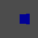 |

## Showcase `spatial-cull-disabled-normal`

Godot draws this spatial shader on a mesh of a 3D view, with the scene's camera (`tests/e2e/meshScenes.mjs`). A plain three.js page draws the transpiled material on the same mesh with the same values. `pnpm test:shaders:e2e` draws both again and fails on any pixel over 2/255 apart.

```glsl
shader_type spatial;
render_mode unshaded, cull_disabled;

void fragment() {
	ALBEDO = NORMAL * 0.5 + 0.5;
}
```

| Godot | Transpilation on three.js |
| --- | --- |
|  |  |

## Showcase `spatial-depth-test-default`

Godot draws this spatial shader on a mesh of a 3D view, with the scene's camera (`tests/e2e/meshScenes.mjs`). A plain three.js page draws the transpiled material on the same mesh with the same values. `pnpm test:shaders:e2e` draws both again and fails on any pixel over 2/255 apart.

```glsl
shader_type spatial;
render_mode unshaded, depth_test_default;

void fragment() {
	ALBEDO = vec3(0.2, 0.5, UV.y);
}
```

| Godot | Transpilation on three.js |
| --- | --- |
|  |  |

## Showcase `spatial-depth-test-disabled`

Godot draws this spatial shader on a mesh of a 3D view, with the scene's camera (`tests/e2e/meshScenes.mjs`). A plain three.js page draws the transpiled material on the same mesh with the same values. `pnpm test:shaders:e2e` draws both again and fails on any pixel over 2/255 apart.

```glsl
shader_type spatial;
render_mode unshaded, depth_test_disabled;

void fragment() {
	ALBEDO = vec3(0.2, 0.5, UV.y);
}
```

| Godot | Transpilation on three.js |
| --- | --- |
|  |  |

## Showcase `spatial-depth-test-inverted`

Godot draws this spatial shader on a mesh of a 3D view, with the scene's camera (`tests/e2e/meshScenes.mjs`). A plain three.js page draws the transpiled material on the same mesh with the same values. `pnpm test:shaders:e2e` draws both again and fails on any pixel over 2/255 apart.

```glsl
shader_type spatial;
render_mode unshaded, depth_test_inverted;

void fragment() {
	ALBEDO = vec3(0.2, 0.5, UV.y);
}
```

| Godot | Transpilation on three.js |
| --- | --- |
|  |  |

## Showcase `spatial-depth-draw-opaque`

Godot draws this spatial shader on a mesh of a 3D view, with the scene's camera (`tests/e2e/meshScenes.mjs`). A plain three.js page draws the transpiled material on the same mesh with the same values. `pnpm test:shaders:e2e` draws both again and fails on any pixel over 2/255 apart.

```glsl
shader_type spatial;
render_mode unshaded, depth_draw_opaque;

void fragment() {
	ALBEDO = vec3(0.1, UV.x * 0.5, 0.6);
}
```

| Godot | Transpilation on three.js |
| --- | --- |
|  |  |

## Showcase `spatial-depth-draw-always`

Godot draws this spatial shader on a mesh of a 3D view, with the scene's camera (`tests/e2e/meshScenes.mjs`). A plain three.js page draws the transpiled material on the same mesh with the same values. `pnpm test:shaders:e2e` draws both again and fails on any pixel over 2/255 apart.

```glsl
shader_type spatial;
render_mode unshaded, blend_add, depth_draw_always;

void fragment() {
	ALBEDO = vec3(0.1, UV.x * 0.5, 0.6);
}
```

| Godot | Transpilation on three.js |
| --- | --- |
|  |  |

## Showcase `spatial-depth-draw-opaque-alpha-pass`

Godot draws this spatial shader on a mesh of a 3D view, with the scene's camera (`tests/e2e/meshScenes.mjs`). A plain three.js page draws the transpiled material on the same mesh with the same values. `pnpm test:shaders:e2e` draws both again and fails on any pixel over 2/255 apart.

```glsl
shader_type spatial;
render_mode unshaded, blend_add, depth_draw_opaque;

void fragment() {
	ALBEDO = vec3(0.1, UV.x * 0.5, 0.6);
}
```

| Godot | Transpilation on three.js |
| --- | --- |
|  |  |

## Showcase `spatial-depth-draw-never`

Godot draws this spatial shader on a mesh of a 3D view, with the scene's camera (`tests/e2e/meshScenes.mjs`). A plain three.js page draws the transpiled material on the same mesh with the same values. `pnpm test:shaders:e2e` draws both again and fails on any pixel over 2/255 apart.

```glsl
shader_type spatial;
render_mode unshaded, depth_draw_never;

void fragment() {
	ALBEDO = vec3(0.1, UV.x * 0.5, 0.6);
}
```

| Godot | Transpilation on three.js |
| --- | --- |
|  |  |

## Showcase `spatial-blend-mix`

Godot draws this spatial shader on a mesh of a 3D view, with the scene's camera (`tests/e2e/meshScenes.mjs`). A plain three.js page draws the transpiled material on the same mesh with the same values. `pnpm test:shaders:e2e` draws both again and fails on any pixel over 2/255 apart.

```glsl
shader_type spatial;
render_mode unshaded, blend_mix;

void fragment() {
	ALBEDO = vec3(UV * 0.4, 0.3);
}
```

| Godot | Transpilation on three.js |
| --- | --- |
|  |  |

## Showcase `spatial-blend-add`

Godot draws this spatial shader on a mesh of a 3D view, with the scene's camera (`tests/e2e/meshScenes.mjs`). A plain three.js page draws the transpiled material on the same mesh with the same values. `pnpm test:shaders:e2e` draws both again and fails on any pixel over 2/255 apart.

```glsl
shader_type spatial;
render_mode unshaded, blend_add;

void fragment() {
	ALBEDO = vec3(UV * 0.4, 0.3);
}
```

| Godot | Transpilation on three.js |
| --- | --- |
|  |  |

## Showcase `spatial-blend-sub`

Godot draws this spatial shader on a mesh of a 3D view, with the scene's camera (`tests/e2e/meshScenes.mjs`). A plain three.js page draws the transpiled material on the same mesh with the same values. `pnpm test:shaders:e2e` draws both again and fails on any pixel over 2/255 apart.

```glsl
shader_type spatial;
render_mode unshaded, blend_sub;

void fragment() {
	ALBEDO = vec3(UV * 0.4, 0.3);
}
```

| Godot | Transpilation on three.js |
| --- | --- |
|  |  |

## Showcase `spatial-blend-mul`

Godot draws this spatial shader on a mesh of a 3D view, with the scene's camera (`tests/e2e/meshScenes.mjs`). A plain three.js page draws the transpiled material on the same mesh with the same values. `pnpm test:shaders:e2e` draws both again and fails on any pixel over 2/255 apart.

```glsl
shader_type spatial;
render_mode unshaded, blend_mul;

void fragment() {
	ALBEDO = vec3(UV * 0.4, 0.3);
}
```

| Godot | Transpilation on three.js |
| --- | --- |
|  |  |

## Showcase `spatial-blend-premul-alpha`

Godot draws this spatial shader on a mesh of a 3D view, with the scene's camera (`tests/e2e/meshScenes.mjs`). A plain three.js page draws the transpiled material on the same mesh with the same values. `pnpm test:shaders:e2e` draws both again and fails on any pixel over 2/255 apart.

```glsl
shader_type spatial;
render_mode unshaded, blend_premul_alpha;

void fragment() {
	ALBEDO = vec3(UV * 0.4, 0.3);
}
```

| Godot | Transpilation on three.js |
| --- | --- |
|  |  |

## Showcase `spatial-skip-vertex-transform`

Godot draws this spatial shader on a mesh of a 3D view, with the scene's camera (`tests/e2e/meshScenes.mjs`). A plain three.js page draws the transpiled material on the same mesh with the same values. `pnpm test:shaders:e2e` draws both again and fails on any pixel over 2/255 apart.

```glsl
shader_type spatial;
render_mode unshaded, skip_vertex_transform;

void vertex() {
	VERTEX = (MODELVIEW_MATRIX * vec4(VERTEX * vec3(1.0, 0.7, 1.0), 1.0)).xyz;
	NORMAL = normalize(MODELVIEW_NORMAL_MATRIX * NORMAL);
}

void fragment() {
	ALBEDO = NORMAL * 0.5 + 0.5;
}
```

| Godot | Transpilation on three.js |
| --- | --- |
|  | 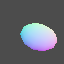 |

## Showcase `spatial-world-vertex-coords`

Godot draws this spatial shader on a mesh of a 3D view, with the scene's camera (`tests/e2e/meshScenes.mjs`). A plain three.js page draws the transpiled material on the same mesh with the same values. `pnpm test:shaders:e2e` draws both again and fails on any pixel over 2/255 apart.

```glsl
shader_type spatial;
render_mode unshaded, world_vertex_coords;

void vertex() {
	VERTEX.y += 0.4 * VERTEX.x;
	NORMAL = normalize(NORMAL + vec3(0.0, 0.3, 0.0));
}

void fragment() {
	ALBEDO = NORMAL * 0.5 + 0.5;
}
```

| Godot | Transpilation on three.js |
| --- | --- |
|  |  |

## Showcase `spatial-ensure-correct-normals`

Godot draws this spatial shader on a mesh of a 3D view, with the scene's camera (`tests/e2e/meshScenes.mjs`). A plain three.js page draws the transpiled material on the same mesh with the same values. `pnpm test:shaders:e2e` draws both again and fails on any pixel over 2/255 apart.

```glsl
shader_type spatial;
render_mode unshaded, ensure_correct_normals;

void vertex() {
	
}

void fragment() {
	ALBEDO = NORMAL * 0.5 + 0.5;
}
```

| Godot | Transpilation on three.js |
| --- | --- |
|  | 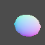 |

## Showcase `spatial-alpha`

Godot draws this spatial shader on a mesh of a 3D view, with the scene's camera (`tests/e2e/meshScenes.mjs`). A plain three.js page draws the transpiled material on the same mesh with the same values. `pnpm test:shaders:e2e` draws both again and fails on any pixel over 2/255 apart.

```glsl
shader_type spatial;
render_mode unshaded;

void fragment() {
	ALBEDO = vec3(UV * 0.4, 0.3);
	ALPHA = UV.x;
}
```

| Godot | Transpilation on three.js |
| --- | --- |
|  |  |

## Showcase `spatial-alpha-blend-mix`

Godot draws this spatial shader on a mesh of a 3D view, with the scene's camera (`tests/e2e/meshScenes.mjs`). A plain three.js page draws the transpiled material on the same mesh with the same values. `pnpm test:shaders:e2e` draws both again and fails on any pixel over 2/255 apart.

```glsl
shader_type spatial;
render_mode unshaded, blend_mix;

void fragment() {
	ALBEDO = vec3(UV * 0.4, 0.3);
	ALPHA = UV.x;
}
```

| Godot | Transpilation on three.js |
| --- | --- |
|  |  |

## Showcase `spatial-alpha-blend-premul-alpha`

Godot draws this spatial shader on a mesh of a 3D view, with the scene's camera (`tests/e2e/meshScenes.mjs`). A plain three.js page draws the transpiled material on the same mesh with the same values. `pnpm test:shaders:e2e` draws both again and fails on any pixel over 2/255 apart.

```glsl
shader_type spatial;
render_mode unshaded, blend_premul_alpha;

void fragment() {
	ALBEDO = vec3(UV * 0.4, 0.3);
	ALPHA = UV.x;
}
```

| Godot | Transpilation on three.js |
| --- | --- |
|  |  |

## Showcase `spatial-alpha-premul-alpha-factor`

Godot draws this spatial shader on a mesh of a 3D view, with the scene's camera (`tests/e2e/meshScenes.mjs`). A plain three.js page draws the transpiled material on the same mesh with the same values. `pnpm test:shaders:e2e` draws both again and fails on any pixel over 2/255 apart.

```glsl
shader_type spatial;
render_mode unshaded, blend_premul_alpha;

void fragment() {
	ALBEDO = vec3(UV * 0.4, 0.3);
	ALPHA = UV.x;
	PREMUL_ALPHA_FACTOR = UV.y;
}
```

| Godot | Transpilation on three.js |
| --- | --- |
|  |  |

## Showcase `spatial-alpha-scissor`

Godot draws this spatial shader on a mesh of a 3D view, with the scene's camera (`tests/e2e/meshScenes.mjs`). A plain three.js page draws the transpiled material on the same mesh with the same values. `pnpm test:shaders:e2e` draws both again and fails on any pixel over 2/255 apart.

```glsl
shader_type spatial;
render_mode unshaded;

void fragment() {
	ALBEDO = vec3(0.1, UV.x * 0.5, 0.6);
	ALPHA = UV.y;
	ALPHA_SCISSOR_THRESHOLD = 0.5;
}
```

| Godot | Transpilation on three.js |
| --- | --- |
|  |  |

## Showcase `spatial-alpha-hash`

Godot draws this spatial shader on a mesh of a 3D view, with the scene's camera (`tests/e2e/meshScenes.mjs`). A plain three.js page draws the transpiled material on the same mesh with the same values. `pnpm test:shaders:e2e` draws both again and fails on any pixel over 2/255 apart.

```glsl
shader_type spatial;
render_mode unshaded;

void fragment() {
	ALBEDO = vec3(UV * 0.4, 0.3);
	ALPHA = UV.x;
	ALPHA_HASH_SCALE = 1.0;
}
```

| Godot | Transpilation on three.js |
| --- | --- |
|  |  |

## Showcase `spatial-alpha-antialiasing-edge`

Godot draws this spatial shader on a mesh of a 3D view, with the scene's camera (`tests/e2e/meshScenes.mjs`). A plain three.js page draws the transpiled material on the same mesh with the same values. `pnpm test:shaders:e2e` draws both again and fails on any pixel over 2/255 apart.

```glsl
shader_type spatial;
render_mode unshaded;

void fragment() {
	ALBEDO = vec3(UV * 0.4, 0.3);
	ALPHA = UV.x;
	ALPHA_SCISSOR_THRESHOLD = 0.5;
	ALPHA_ANTIALIASING_EDGE = 0.2;
	ALPHA_TEXTURE_COORDINATE = UV * 64.0;
}
```

| Godot | Transpilation on three.js |
| --- | --- |
|  |  |

## Showcase `spatial-depth-prepass-alpha`

Godot draws this spatial shader on a mesh of a 3D view, with the scene's camera (`tests/e2e/meshScenes.mjs`). A plain three.js page draws the transpiled material on the same mesh with the same values. `pnpm test:shaders:e2e` draws both again and fails on any pixel over 2/255 apart.

```glsl
shader_type spatial;
render_mode unshaded, depth_prepass_alpha;

void fragment() {
	ALBEDO = vec3(0.1, UV.x * 0.5, 0.6);
	ALPHA = min(UV.y * 1.5, 1.0);
}
```

| Godot | Transpilation on three.js |
| --- | --- |
|  |  |

## Showcase `spatial-alpha-to-coverage`

Godot draws this spatial shader on a mesh of a 3D view, with the scene's camera (`tests/e2e/meshScenes.mjs`). A plain three.js page draws the transpiled material on the same mesh with the same values. `pnpm test:shaders:e2e` draws both again and fails on any pixel over 2/255 apart.

```glsl
shader_type spatial;
render_mode unshaded, alpha_to_coverage;

void fragment() {
	ALBEDO = vec3(UV * 0.4, 0.3);
	ALPHA = step(0.5, UV.x);
}
```

| Godot | Transpilation on three.js |
| --- | --- |
|  |  |

## Showcase `spatial-alpha-to-coverage-and-one`

Godot draws this spatial shader on a mesh of a 3D view, with the scene's camera (`tests/e2e/meshScenes.mjs`). A plain three.js page draws the transpiled material on the same mesh with the same values. `pnpm test:shaders:e2e` draws both again and fails on any pixel over 2/255 apart.

```glsl
shader_type spatial;
render_mode unshaded, alpha_to_coverage_and_one;

void fragment() {
	ALBEDO = vec3(UV * 0.4, 0.3);
	ALPHA = step(0.5, UV.x);
}
```

| Godot | Transpilation on three.js |
| --- | --- |
|  |  |

## Showcase `spatial-alpha-to-coverage-blend-add`

Godot draws this spatial shader on a mesh of a 3D view, with the scene's camera (`tests/e2e/meshScenes.mjs`). A plain three.js page draws the transpiled material on the same mesh with the same values. `pnpm test:shaders:e2e` draws both again and fails on any pixel over 2/255 apart.

```glsl
shader_type spatial;
render_mode unshaded, blend_add, alpha_to_coverage;

void fragment() {
	ALBEDO = vec3(UV * 0.4, 0.3);
	ALPHA = step(0.5, UV.x);
}
```

| Godot | Transpilation on three.js |
| --- | --- |
|  |  |

## Showcase `spatial-alpha-to-coverage-msaa-4x`

Godot draws this spatial shader on a mesh of a 3D view, with the scene's camera (`tests/e2e/meshScenes.mjs`). A plain three.js page draws the transpiled material on the same mesh with the same values. `pnpm test:shaders:e2e` draws both again and fails on any pixel over 2/255 apart.

```glsl
shader_type spatial;
render_mode unshaded, alpha_to_coverage;

void fragment() {
	ALBEDO = vec3(UV * 0.4, 0.3);
	ALPHA = step(0.5, UV.x);
}
```

| Godot | Transpilation on three.js |
| --- | --- |
|  |  |

## Showcase `spatial-alpha-to-coverage-and-one-msaa-4x`

Godot draws this spatial shader on a mesh of a 3D view, with the scene's camera (`tests/e2e/meshScenes.mjs`). A plain three.js page draws the transpiled material on the same mesh with the same values. `pnpm test:shaders:e2e` draws both again and fails on any pixel over 2/255 apart.

```glsl
shader_type spatial;
render_mode unshaded, alpha_to_coverage_and_one;

void fragment() {
	ALBEDO = vec3(UV * 0.4, 0.3);
	ALPHA = step(0.5, UV.x);
}
```

| Godot | Transpilation on three.js |
| --- | --- |
|  |  |

## Showcase `spatial-depth`

Godot draws this spatial shader on a mesh of a 3D view, with the scene's camera (`tests/e2e/meshScenes.mjs`). A plain three.js page draws the transpiled material on the same mesh with the same values. `pnpm test:shaders:e2e` draws both again and fails on any pixel over 2/255 apart.

```glsl
shader_type spatial;
render_mode unshaded;

void fragment() {
	ALBEDO = vec3(0.2, 0.5, UV.y);
	DEPTH = UV.x;
}
```

| Godot | Transpilation on three.js |
| --- | --- |
|  |  |

## Showcase `spatial-depth-own-prepass`

Godot draws this spatial shader on a mesh of a 3D view, with the scene's camera (`tests/e2e/meshScenes.mjs`). A plain three.js page draws the transpiled material on the same mesh with the same values. `pnpm test:shaders:e2e` draws both again and fails on any pixel over 2/255 apart.

```glsl
shader_type spatial;
render_mode unshaded;

void vertex() {
	VERTEX = VERTEX;
}

void fragment() {
	ALBEDO = vec3(0.2, 0.5, UV.y);
	DEPTH = UV.x;
}
```

| Godot | Transpilation on three.js |
| --- | --- |
|  |  |

## Showcase `spatial-depth-compatibility`

Godot draws this spatial shader on a mesh of a 3D view, with the scene's camera (`tests/e2e/meshScenes.mjs`). A plain three.js page draws the transpiled material on the same mesh with the same values. `pnpm test:shaders:e2e` draws both again and fails on any pixel over 2/255 apart.

```glsl
shader_type spatial;
render_mode unshaded;

void fragment() {
	ALBEDO = vec3(0.0, 1.0, 1.0);
	DEPTH = UV.x;
}
```

| Godot | Transpilation on three.js |
| --- | --- |
|  |  |

## Showcase `spatial-cull-front-compatibility`

Godot draws this spatial shader on a mesh of a 3D view, with the scene's camera (`tests/e2e/meshScenes.mjs`). A plain three.js page draws the transpiled material on the same mesh with the same values. `pnpm test:shaders:e2e` draws both again and fails on any pixel over 2/255 apart.

```glsl
shader_type spatial;
render_mode unshaded, cull_front;

void fragment() {
	ALBEDO = vec3(0.0, 1.0, 1.0);
}
```

| Godot | Transpilation on three.js |
| --- | --- |
|  |  |

## Showcase `spatial-stencil-compare-always`

Godot draws this spatial shader on a mesh of a 3D view, with the scene's camera (`tests/e2e/meshScenes.mjs`). A plain three.js page draws the transpiled material on the same mesh with the same values. `pnpm test:shaders:e2e` draws both again and fails on any pixel over 2/255 apart.

```glsl
shader_type spatial;
render_mode unshaded, depth_test_disabled;
stencil_mode read, compare_always, 1;
void fragment() {
	ALBEDO = vec3(0.0, 0.0, 1.0);
}
```

| Godot | Transpilation on three.js |
| --- | --- |
|  |  |

## Showcase `spatial-stencil-compare-less`

Godot draws this spatial shader on a mesh of a 3D view, with the scene's camera (`tests/e2e/meshScenes.mjs`). A plain three.js page draws the transpiled material on the same mesh with the same values. `pnpm test:shaders:e2e` draws both again and fails on any pixel over 2/255 apart.

```glsl
shader_type spatial;
render_mode unshaded, depth_test_disabled;
stencil_mode read, compare_less, 1;
void fragment() {
	ALBEDO = vec3(0.0, 0.0, 1.0);
}
```

| Godot | Transpilation on three.js |
| --- | --- |
|  |  |

## Showcase `spatial-stencil-compare-equal`

Godot draws this spatial shader on a mesh of a 3D view, with the scene's camera (`tests/e2e/meshScenes.mjs`). A plain three.js page draws the transpiled material on the same mesh with the same values. `pnpm test:shaders:e2e` draws both again and fails on any pixel over 2/255 apart.

```glsl
shader_type spatial;
render_mode unshaded, depth_test_disabled;
stencil_mode read, compare_equal, 1;
void fragment() {
	ALBEDO = vec3(0.0, 0.0, 1.0);
}
```

| Godot | Transpilation on three.js |
| --- | --- |
| 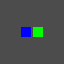 |  |

## Showcase `spatial-stencil-compare-less-or-equal`

Godot draws this spatial shader on a mesh of a 3D view, with the scene's camera (`tests/e2e/meshScenes.mjs`). A plain three.js page draws the transpiled material on the same mesh with the same values. `pnpm test:shaders:e2e` draws both again and fails on any pixel over 2/255 apart.

```glsl
shader_type spatial;
render_mode unshaded, depth_test_disabled;
stencil_mode read, compare_less_or_equal, 1;
void fragment() {
	ALBEDO = vec3(0.0, 0.0, 1.0);
}
```

| Godot | Transpilation on three.js |
| --- | --- |
|  |  |

## Showcase `spatial-stencil-compare-greater`

Godot draws this spatial shader on a mesh of a 3D view, with the scene's camera (`tests/e2e/meshScenes.mjs`). A plain three.js page draws the transpiled material on the same mesh with the same values. `pnpm test:shaders:e2e` draws both again and fails on any pixel over 2/255 apart.

```glsl
shader_type spatial;
render_mode unshaded, depth_test_disabled;
stencil_mode read, compare_greater, 1;
void fragment() {
	ALBEDO = vec3(0.0, 0.0, 1.0);
}
```

| Godot | Transpilation on three.js |
| --- | --- |
|  |  |

## Showcase `spatial-stencil-compare-not-equal`

Godot draws this spatial shader on a mesh of a 3D view, with the scene's camera (`tests/e2e/meshScenes.mjs`). A plain three.js page draws the transpiled material on the same mesh with the same values. `pnpm test:shaders:e2e` draws both again and fails on any pixel over 2/255 apart.

```glsl
shader_type spatial;
render_mode unshaded, depth_test_disabled;
stencil_mode read, compare_not_equal, 1;
void fragment() {
	ALBEDO = vec3(0.0, 0.0, 1.0);
}
```

| Godot | Transpilation on three.js |
| --- | --- |
|  | 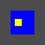 |

## Showcase `spatial-stencil-compare-greater-or-equal`

Godot draws this spatial shader on a mesh of a 3D view, with the scene's camera (`tests/e2e/meshScenes.mjs`). A plain three.js page draws the transpiled material on the same mesh with the same values. `pnpm test:shaders:e2e` draws both again and fails on any pixel over 2/255 apart.

```glsl
shader_type spatial;
render_mode unshaded, depth_test_disabled;
stencil_mode read, compare_greater_or_equal, 1;
void fragment() {
	ALBEDO = vec3(0.0, 0.0, 1.0);
}
```

| Godot | Transpilation on three.js |
| --- | --- |
|  | 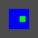 |

## Showcase `spatial-stencil-compare-without-read`

Godot draws this spatial shader on a mesh of a 3D view, with the scene's camera (`tests/e2e/meshScenes.mjs`). A plain three.js page draws the transpiled material on the same mesh with the same values. `pnpm test:shaders:e2e` draws both again and fails on any pixel over 2/255 apart.

```glsl
shader_type spatial;
render_mode unshaded, depth_test_disabled;
stencil_mode compare_equal, 1;
void fragment() {
	ALBEDO = vec3(0.0, 0.0, 1.0);
}
```

| Godot | Transpilation on three.js |
| --- | --- |
|  |  |

## Showcase `spatial-stencil-reference-255`

Godot draws this spatial shader on a mesh of a 3D view, with the scene's camera (`tests/e2e/meshScenes.mjs`). A plain three.js page draws the transpiled material on the same mesh with the same values. `pnpm test:shaders:e2e` draws both again and fails on any pixel over 2/255 apart.

```glsl
shader_type spatial;
render_mode unshaded, depth_test_disabled;
stencil_mode read, compare_less, 254;
void fragment() {
	ALBEDO = vec3(0.0, 0.0, 1.0);
}
```

| Godot | Transpilation on three.js |
| --- | --- |
|  |  |

## Showcase `spatial-stencil-write-covered`

Godot draws this spatial shader on a mesh of a 3D view, with the scene's camera (`tests/e2e/meshScenes.mjs`). A plain three.js page draws the transpiled material on the same mesh with the same values. `pnpm test:shaders:e2e` draws both again and fails on any pixel over 2/255 apart.

```glsl
shader_type spatial;
render_mode unshaded, depth_test_disabled;
stencil_mode read, compare_equal, 1;
void fragment() {
	ALBEDO = vec3(0.0, 0.0, 1.0);
}
```

| Godot | Transpilation on three.js |
| --- | --- |
|  |  |

## Showcase `spatial-stencil-write-depth-fail`

Godot draws this spatial shader on a mesh of a 3D view, with the scene's camera (`tests/e2e/meshScenes.mjs`). A plain three.js page draws the transpiled material on the same mesh with the same values. `pnpm test:shaders:e2e` draws both again and fails on any pixel over 2/255 apart.

```glsl
shader_type spatial;
render_mode unshaded, depth_test_disabled;
stencil_mode read, compare_equal, 1;
void fragment() {
	ALBEDO = vec3(0.0, 0.0, 1.0);
}
```

| Godot | Transpilation on three.js |
| --- | --- |
| 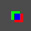 |  |

## Showcase `spatial-stencil-write-prepass-off`

Godot draws this spatial shader on a mesh of a 3D view, with the scene's camera (`tests/e2e/meshScenes.mjs`). A plain three.js page draws the transpiled material on the same mesh with the same values. `pnpm test:shaders:e2e` draws both again and fails on any pixel over 2/255 apart.

```glsl
shader_type spatial;
render_mode unshaded, depth_test_disabled;
stencil_mode read, compare_equal, 1;
void fragment() {
	ALBEDO = vec3(0.0, 0.0, 1.0);
}
```

| Godot | Transpilation on three.js |
| --- | --- |
|  |  |

## Showcase `spatial-stencil-write-compatibility`

Godot draws this spatial shader on a mesh of a 3D view, with the scene's camera (`tests/e2e/meshScenes.mjs`). A plain three.js page draws the transpiled material on the same mesh with the same values. `pnpm test:shaders:e2e` draws both again and fails on any pixel over 2/255 apart.

```glsl
shader_type spatial;
render_mode unshaded, depth_test_disabled;
stencil_mode read, compare_equal, 1;
void fragment() {
	ALBEDO = vec3(0.0, 0.0, 1.0);
}
```

| Godot | Transpilation on three.js |
| --- | --- |
| 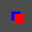 |  |

## Showcase `spatial-stencil-write-mobile`

Godot draws this spatial shader on a mesh of a 3D view, with the scene's camera (`tests/e2e/meshScenes.mjs`). A plain three.js page draws the transpiled material on the same mesh with the same values. `pnpm test:shaders:e2e` draws both again and fails on any pixel over 2/255 apart.

```glsl
shader_type spatial;
render_mode unshaded, depth_test_disabled;
stencil_mode read, compare_equal, 1;
void fragment() {
	ALBEDO = vec3(0.0, 0.0, 1.0);
}
```

| Godot | Transpilation on three.js |
| --- | --- |
|  |  |

## Showcase `spatial-fog`

Godot draws this spatial shader on a mesh of a 3D view, with the scene's camera (`tests/e2e/meshScenes.mjs`). A plain three.js page draws the transpiled material on the same mesh with the same values. `pnpm test:shaders:e2e` draws both again and fails on any pixel over 2/255 apart.

```glsl
shader_type spatial;
render_mode unshaded;

void fragment() {
	ALBEDO = vec3(0.2, 0.5, UV.y);
	FOG = vec4(0.9, 0.2, 0.1, UV.x);
}
```

| Godot | Transpilation on three.js |
| --- | --- |
|  |  |

## Showcase `spatial-fog-colour`

Godot draws this spatial shader on a mesh of a 3D view, with the scene's camera (`tests/e2e/meshScenes.mjs`). A plain three.js page draws the transpiled material on the same mesh with the same values. `pnpm test:shaders:e2e` draws both again and fails on any pixel over 2/255 apart.

```glsl
shader_type spatial;
render_mode unshaded;

void fragment() {
	ALBEDO = vec3(0.2, 0.5, UV.y);
	FOG.rgb = vec3(0.1, 0.6, 0.3) * UV.y;
}
```

| Godot | Transpilation on three.js |
| --- | --- |
|  |  |

## Showcase `spatial-fog-disabled`

Godot draws this spatial shader on a mesh of a 3D view, with the scene's camera (`tests/e2e/meshScenes.mjs`). A plain three.js page draws the transpiled material on the same mesh with the same values. `pnpm test:shaders:e2e` draws both again and fails on any pixel over 2/255 apart.

```glsl
shader_type spatial;
render_mode unshaded, fog_disabled;

void fragment() {
	ALBEDO = vec3(0.2, 0.5, UV.y);
	FOG = vec4(0.9, 0.2, 0.1, 1.0);
}
```

| Godot | Transpilation on three.js |
| --- | --- |
|  |  |

## Showcase `spatial-fog-premul-alpha`

Godot draws this spatial shader on a mesh of a 3D view, with the scene's camera (`tests/e2e/meshScenes.mjs`). A plain three.js page draws the transpiled material on the same mesh with the same values. `pnpm test:shaders:e2e` draws both again and fails on any pixel over 2/255 apart.

```glsl
shader_type spatial;
render_mode unshaded, blend_premul_alpha;

void fragment() {
	ALBEDO = vec3(UV * 0.4, 0.3);
	ALPHA = UV.x;
	FOG = vec4(0.9, 0.2, 0.1, UV.y);
}
```

| Godot | Transpilation on three.js |
| --- | --- |
|  |  |

## Showcase `spatial-radiance-irradiance`

Godot draws this spatial shader on a mesh of a 3D view, with the scene's camera (`tests/e2e/meshScenes.mjs`). A plain three.js page draws the transpiled material on the same mesh with the same values. `pnpm test:shaders:e2e` draws both again and fails on any pixel over 2/255 apart.

```glsl
shader_type spatial;
render_mode unshaded;

void fragment() {
	ALBEDO = vec3(0.2, 0.5, UV.y);
	RADIANCE = vec4(1.0, 0.0, 0.0, 1.0);
	IRRADIANCE = vec4(0.0, 1.0, 0.0, 1.0);
}
```

| Godot | Transpilation on three.js |
| --- | --- |
|  |  |

## Showcase `spatial-environment-fog`

Godot draws this spatial shader on a mesh of a 3D view, with the scene's camera (`tests/e2e/meshScenes.mjs`). A plain three.js page draws the transpiled material on the same mesh with the same values. `pnpm test:shaders:e2e` draws both again and fails on any pixel over 2/255 apart.

```glsl
shader_type spatial;
render_mode unshaded;

void fragment() {
	ALBEDO = vec3(0.2, 0.5, UV.y);
}
```

| Godot | Transpilation on three.js |
| --- | --- |
|  |  |

## Showcase `spatial-environment-fog-depth`

Godot draws this spatial shader on a mesh of a 3D view, with the scene's camera (`tests/e2e/meshScenes.mjs`). A plain three.js page draws the transpiled material on the same mesh with the same values. `pnpm test:shaders:e2e` draws both again and fails on any pixel over 2/255 apart.

```glsl
shader_type spatial;
render_mode unshaded;

void fragment() {
	ALBEDO = vec3(0.2, 0.5, UV.y);
}
```

| Godot | Transpilation on three.js |
| --- | --- |
|  |  |

## Showcase `spatial-environment-fog-height`

Godot draws this spatial shader on a mesh of a 3D view, with the scene's camera (`tests/e2e/meshScenes.mjs`). A plain three.js page draws the transpiled material on the same mesh with the same values. `pnpm test:shaders:e2e` draws both again and fails on any pixel over 2/255 apart.

```glsl
shader_type spatial;
render_mode unshaded;

void fragment() {
	ALBEDO = vec3(0.2, 0.5, UV.y);
}
```

| Godot | Transpilation on three.js |
| --- | --- |
|  |  |

## Render mode `unshaded`

`unshaded` defines `MODE_UNSHADED`, so the template writes `ALBEDO` and `ALPHA` to the frame with no light or ambient light (`scene_forward_clustered.glsl:2978-2981`). The fog still mixes in after it (`scene_forward_clustered.glsl:2987-2989`).

The transpiler emits `the defines of the template variant`. Rows: `spatial render_mode unshaded`. Godot source: `servers/rendering/shader_types.cpp:239`.

Every row is native on WebGL 2. WebGPURenderer runs the same nodes and is untested (#1788).


## Cull modes

`cull_back`, the default, culls the faces seen from behind, `cull_front` the faces seen from the front, and `cull_disabled` none. Godot turns the cull round for a mesh of a negative scale (`render_forward_clustered.cpp:411`). three turns the winding of the mesh round instead, which turns `gl_FrontFacing` round too, so the transpiler turns `FRONT_FACING` back for a mirrored mesh and reads as Godot does. `cull_front` and `cull_disabled` define `DO_SIDE_CHECK`, so the template turns `NORMAL` round on a face seen from behind (`scene_forward_clustered.glsl:1263`).

The transpiler emits the material's `side`, and the defines of the template variant. Rows: `spatial render_mode cull_back`, `spatial render_mode cull_front`, `spatial render_mode cull_disabled`. Godot source: `servers/rendering/shader_types.cpp:238`.

Every row is native on WebGL 2. WebGPURenderer runs the same nodes and is untested (#1788).


## Depth modes

`depth_test_disabled` draws with no depth test, and `depth_test_inverted` draws only the fragments behind the depth already drawn (`scene_shader_forward_clustered.cpp:352-360`). `depth_draw_never` writes no depth. `depth_draw_opaque`, the default, writes depth in the opaque pass only, and `depth_draw_always` in the alpha pass too. A shader with `depth_draw_never` or with a depth test other than the default draws in the alpha pass (`scene_shader_forward_clustered.h:279`), after the opaque objects, the farthest object first.

The transpiler emits the material's `depthTest`, `depthFunc`, `depthWrite` and `transparent`. Rows: `spatial render_mode depth_draw_opaque`, `spatial render_mode depth_draw_always`, `spatial render_mode depth_draw_never`, `spatial render_mode depth_test_default`, `spatial render_mode depth_test_disabled`, `spatial render_mode depth_test_inverted`. Godot source: `servers/rendering/shader_types.cpp:234`.

Every row is native on WebGL 2. WebGPURenderer runs the same nodes and is untested (#1788).


## Blend modes

`blend_mix`, the default, draws in the opaque pass with no blend. It draws in the alpha pass when the shader names `ALPHA` with no alpha cut, or with a cut and `ALPHA_ANTIALIASING_EDGE` or `ALPHA_TEXTURE_COORDINATE`. It also does when the shader reads a screen, depth or normal roughness texture, or has `depth_draw_never`, `depth_test_disabled` or `depth_test_inverted` (`scene_shader_forward_clustered.h:279-287`). `blend_add`, `blend_sub`, `blend_mul` and `blend_premul_alpha` draw in the alpha pass and blend with Godot's factors for the mode (`material_storage.cpp:651-716`), the colour and the alpha each with its own.

The transpiler emits the material's `blending` and its blend factors, and `transparent`. Rows: `spatial render_mode blend_mix`, `spatial render_mode blend_add`, `spatial render_mode blend_sub`, `spatial render_mode blend_mul`, `spatial render_mode blend_premul_alpha`. Godot source: `servers/rendering/shader_types.cpp:233`.

Every row is native on WebGL 2. WebGPURenderer runs the same nodes and is untested (#1788).


## Alpha to coverage modes

`alpha_to_coverage` and `alpha_to_coverage_and_one` replace the blend mode with Godot's alpha to coverage blend (`scene_shader_forward_clustered.cpp:239-241`), so a shader that names no `ALPHA` stays in the opaque pass whatever its blend mode. In the alpha pass Godot turns on alpha to coverage, and `alpha_to_coverage_and_one` alpha to one too (`scene_shader_forward_clustered.cpp:431-437`). WebGL skips alpha to coverage on a target of one sample (GLES 3.0.6 §4.1.3), which Godot's default `msaa_3d` draws into. There the transpiler discards a fragment of alpha below 0.5 and `alpha_to_coverage_and_one` sets the alpha of the rest to 1. Vulkan leaves the coverage mask to the driver. On one sample lavapipe covers a 2 by 2 ordered dither by the alpha, so on an alpha ramp the transpiler covers other pixels than Godot does on lavapipe, in about the same share. Another driver can cut at a threshold or dither in another pattern. On a target of 4 samples WebGL turns alpha to coverage on, and a mask of alpha 0 or 1 matches Godot. On 2 samples the browser's GL places the samples elsewhere than lavapipe does, so every edge covers other samples: an opaque quad's edges differ by 67 pixels over 2/255 in a 64 by 64 scene. 4 samples place them alike. WebGL has no alpha to one, so there the stored alpha stays the shader's: the blend takes the colour at weight 1, and an opaque viewport drops the alpha.

The transpiler emits the material's `alphaToCoverage` and blend factors, and a `Discard` behind a uniform that reads the target's samples. Rows: `spatial render_mode alpha_to_coverage`, `spatial render_mode alpha_to_coverage_and_one`. Godot source: `servers/rendering/shader_types.cpp:251`.

Every row is native on WebGL 2. WebGPURenderer runs the same nodes and is untested (#1788).


## The space of `VERTEX` in `vertex()`

`skip_vertex_transform` leaves `VERTEX`, `NORMAL`, `TANGENT` and `BINORMAL` as `vertex()` writes them, so `vertex()` turns them to view space itself. `world_vertex_coords` hands `vertex()` the vertex and its normals in world space, and the template turns them to view space after it. `ensure_correct_normals` defines `ENSURE_CORRECT_NORMALS`, which no line of Godot 4.6.3's scene template reads.

The transpiler emits `the defines of the template variant`. Rows: `spatial render_mode skip_vertex_transform`, `spatial render_mode world_vertex_coords`, `spatial render_mode ensure_correct_normals`. Godot source: `servers/rendering/shader_types.cpp:243`.

Every row is native on WebGL 2. WebGPURenderer runs the same nodes and is untested (#1788).


## `ALBEDO`, `ROUGHNESS` and `METALLIC`

`ALBEDO` is the surface colour `fragment()` writes, linear. `ROUGHNESS` and `METALLIC` are the surface's roughness and metalness, which an unshaded surface reads in no colour. Godot's template holds each in a local of `fragment_shader`, or of `vertex_shader` for the vertex stage's `ROUGHNESS`.

The transpiler emits the template's locals `albedo`, `roughness` and `metallic`. Rows: `spatial.vertex.ROUGHNESS`, `spatial.fragment.ALBEDO`, `spatial.fragment.METALLIC`, `spatial.fragment.ROUGHNESS`. Godot source: `servers/rendering/shader_types.cpp:102`.

Every row is native on WebGL 2. WebGPURenderer runs the same nodes and is untested (#1788).


## `NORMAL`, `TANGENT`, `BINORMAL`, `UV`, `UV2` and `COLOR`

The mesh's attributes as `fragment()` reads them, interpolated: the normal, tangent and binormal in view space, the two UV sets and the vertex colour. `withGodotAttributes` stores them as Godot stores an uncompressed surface: the normal and tangent as 16-bit octahedrons, the colour as four bytes. With no tangent array, Godot makes a tangent up from the normal, and so does the transpiler.

The transpiler emits the template's varyings `normal_interp`, `tangent_interp`, `binormal_interp`, `uv_interp`, `uv2_interp` and `color_interp`. Rows: `spatial.fragment.NORMAL`, `spatial.fragment.TANGENT`, `spatial.fragment.BINORMAL`, `spatial.fragment.UV`, `spatial.fragment.UV2`, `spatial.fragment.COLOR`. Godot source: `servers/rendering/shader_types.cpp:139`.

Every row is native on WebGL 2. WebGPURenderer runs the same nodes and is untested (#1788).


## `NORMAL`, `TANGENT`, `BINORMAL`, `UV` and `UV2` in `vertex()`

The mesh's attributes as `vertex()` reads and writes them, for one vertex: the normal, tangent and binormal in model space, and the two UV sets. Godot's template holds each in a local of `vertex_shader`, which it turns to view space and writes to its varying after `vertex()` returns.

The transpiler emits the template's locals `normal`, `tangent`, `binormal`, `uv_interp` and `uv2_interp` of the vertex stage. Rows: `spatial.vertex.NORMAL`, `spatial.vertex.TANGENT`, `spatial.vertex.BINORMAL`, `spatial.vertex.UV`, `spatial.vertex.UV2`. Godot source: `servers/rendering/shader_types.cpp:90`.

Every row is native on WebGL 2. WebGPURenderer runs the same nodes and is untested (#1788).


## The vertex and its ids in `vertex()`

`VERTEX` is the vertex in model space, which the template turns to view space after `vertex()` returns. A write to `POSITION` replaces the template's clip position. `COLOR` is the vertex colour that `fragment()` reads. `VERTEX_ID` and `INSTANCE_ID` are GL's vertex and instance index. A mesh outside a MultiMesh has an `INSTANCE_CUSTOM` of zero.

The transpiler emits the template's locals `vertex`, `position`, `color_interp` and `instance_custom`, three's `vertexIndex`, and an instance index of 0. Rows: `spatial.vertex.VERTEX`, `spatial.vertex.POSITION`, `spatial.vertex.COLOR`, `spatial.vertex.INSTANCE_ID`, `spatial.vertex.INSTANCE_CUSTOM`, `spatial.vertex.VERTEX_ID`. Godot source: `servers/rendering/shader_types.cpp:89`.

Every row is native on WebGL 2. WebGPURenderer runs the same nodes and is untested (#1788).


## Custom arrays, bones and `Z_CLIP_SCALE` in `vertex()`

`CUSTOM0` to `CUSTOM3` are a mesh's custom arrays, each a `vec4` with the missing lanes read as 0 and the last as 1. `BONE_INDICES` and `BONE_WEIGHTS` are the four bones of a vertex and their weights, read with no skeleton as the arrays hold them. `withGodotAttributes` reads the custom arrays from the attributes `custom0` to `custom3`, and the bones from three's `skinIndex` and `skinWeight`. A write to `Z_CLIP_SCALE` pulls the depth towards the camera: the template mixes the clip position's z with its w.

The transpiler emits the attributes `custom0_attrib` to `custom3_attrib`, `bone_attrib` as 16-bit integers and `weight_attrib`, and the template's local `z_clip_scale`. Rows: `spatial.vertex.Z_CLIP_SCALE`, `spatial.vertex.BONE_INDICES`, `spatial.vertex.BONE_WEIGHTS`, `spatial.vertex.CUSTOM0`, `spatial.vertex.CUSTOM1`, `spatial.vertex.CUSTOM2`, `spatial.vertex.CUSTOM3`. Godot source: `servers/rendering/shader_types.cpp:98`.

Every row is native on WebGL 2. WebGPURenderer runs the same nodes and is untested (#1788).


## Matrices

The object's, camera's and projection's matrices as both stages read them. The template reads the object's matrix from the instance data and the others from its scene data. The projection is Vulkan's: y flipped and depth reversed into 0 to 1. `MODELVIEW_MATRIX` and `MODELVIEW_NORMAL_MATRIX` are products the vertex stage works out.

The transpiler emits the template's uniforms `scene_data_block.data.*` and its instance rows. Rows: `spatial.vertex.MODEL_MATRIX`, `spatial.vertex.MODEL_NORMAL_MATRIX`, `spatial.vertex.VIEW_MATRIX`, `spatial.vertex.INV_VIEW_MATRIX`, `spatial.vertex.PROJECTION_MATRIX`, `spatial.vertex.INV_PROJECTION_MATRIX`, `spatial.vertex.MODELVIEW_MATRIX`, `spatial.vertex.MODELVIEW_NORMAL_MATRIX`, `spatial.vertex.MAIN_CAM_INV_VIEW_MATRIX`, `spatial.fragment.MODEL_MATRIX`, `spatial.fragment.MODEL_NORMAL_MATRIX`, `spatial.fragment.VIEW_MATRIX`, `spatial.fragment.INV_VIEW_MATRIX`, `spatial.fragment.PROJECTION_MATRIX`, `spatial.fragment.INV_PROJECTION_MATRIX`. Godot source: `servers/rendering/shader_types.cpp:113`.

Every row is native on WebGL 2. WebGPURenderer runs the same nodes and is untested (#1788).


## Positions, layers and the viewport

The object's origin in world and view space, the camera's position and backward axis in world space, the camera's 20 visual layers as bits, and the viewport's size in pixels. Godot's template reads each from a column of a matrix or a field of its scene data.

The transpiler emits `the template's text for each built-in, read from its uniforms`. Rows: `spatial.vertex.VIEWPORT_SIZE`, `spatial.vertex.NODE_POSITION_WORLD`, `spatial.vertex.CAMERA_POSITION_WORLD`, `spatial.vertex.CAMERA_DIRECTION_WORLD`, `spatial.vertex.CAMERA_VISIBLE_LAYERS`, `spatial.vertex.NODE_POSITION_VIEW`, `spatial.fragment.NODE_POSITION_WORLD`, `spatial.fragment.CAMERA_POSITION_WORLD`, `spatial.fragment.CAMERA_DIRECTION_WORLD`, `spatial.fragment.CAMERA_VISIBLE_LAYERS`, `spatial.fragment.NODE_POSITION_VIEW`, `spatial.fragment.VIEWPORT_SIZE`. Godot source: `servers/rendering/shader_types.cpp:121`.

Every row is native on WebGL 2. WebGPURenderer runs the same nodes and is untested (#1788).


## Views

A view with one eye has a `VIEW_INDEX` of 0 and an `EYE_OFFSET` of zero. `VIEW_MONO_LEFT` is 0 and `VIEW_RIGHT` is 1.

The transpiler emits `the template's text with no multiview define`. Rows: `spatial.vertex.VIEW_INDEX`, `spatial.vertex.VIEW_MONO_LEFT`, `spatial.vertex.VIEW_RIGHT`, `spatial.vertex.EYE_OFFSET`, `spatial.fragment.VIEW_INDEX`, `spatial.fragment.VIEW_MONO_LEFT`, `spatial.fragment.VIEW_RIGHT`, `spatial.fragment.EYE_OFFSET`. Godot source: `servers/rendering/shader_types.cpp:130`.

Every row is native on WebGL 2. WebGPURenderer runs the same nodes and is untested (#1788).


## `ALPHA` and `PREMUL_ALPHA_FACTOR`

`ALPHA` is the surface's opacity, which the template writes as the alpha of the frame's colour. A shader that names `ALPHA` draws in the alpha pass and blends with its blend mode, unless it also names `ALPHA_SCISSOR_THRESHOLD` or `ALPHA_HASH_SCALE` with no `ALPHA_ANTIALIASING_EDGE` (`scene_shader_forward_clustered.h:279-287`). Under `blend_premul_alpha`, `PREMUL_ALPHA_FACTOR` scales the colour before the blend (`scene_forward_clustered.glsl:2991-2993`).

The transpiler emits the template's locals `alpha` and `premul_alpha`, and the material's `transparent`. Rows: `spatial.fragment.PREMUL_ALPHA_FACTOR`, `spatial.fragment.ALPHA`. Godot source: `servers/rendering/shader_types.cpp:150`.

Every row is native on WebGL 2. WebGPURenderer runs the same nodes and is untested (#1788).


## The alpha cut

`ALPHA_SCISSOR_THRESHOLD` discards a fragment whose alpha is below it. `ALPHA_HASH_SCALE` discards a fragment whose alpha is below a hash of its position in the object, at that scale. Either sets the alpha of the rest to 1 (`scene_forward_clustered.glsl:1383-1416`). `ALPHA_ANTIALIASING_EDGE` keeps the alpha instead and ramps it across one pixel at the edge, past the scissor threshold, with `ALPHA_TEXTURE_COORDINATE` for the mip level (`scene_forward_aa_inc.glsl:45-56`).

The transpiler emits the template's alpha cut and `compute_alpha_antialiasing_edge`. Rows: `spatial.fragment.ALPHA_SCISSOR_THRESHOLD`, `spatial.fragment.ALPHA_HASH_SCALE`, `spatial.fragment.ALPHA_ANTIALIASING_EDGE`, `spatial.fragment.ALPHA_TEXTURE_COORDINATE`. Godot source: `servers/rendering/shader_types.cpp:197`.

Every row is native on WebGL 2. WebGPURenderer runs the same nodes and is untested (#1788).


## The depth prepass and `depth_prepass_alpha`

Godot's Forward+ draws a depth prepass before the opaque colour pass, which then tests EQUAL and writes no depth (`render_forward_clustered.cpp:2081-2112`, `scene_shader_forward_clustered.cpp:448-453`). The prepass draws each opaque surface, and each alpha surface with `depth_prepass_alpha` or alpha antialiasing (`scene_shader_forward_clustered.h:288-293`). A surface is shared unless it writes `VERTEX`, `POSITION`, `MODELVIEW_MATRIX`, `PROJECTION_MATRIX` or `Z_CLIP_SCALE`, or uses `discard`, an alpha cut, alpha antialiasing, point size or a stencil reference. Render modes `depth_prepass_alpha`, `particle_trails`, `world_vertex_coords`, `wireframe` and a cull mode other than `cull_back` also give a surface its own depth draw (`scene_shader_forward_clustered.h:295-298`). The prepass draws a shared surface with Godot's default material, and any other surface with its own program. In the prepass `opaque_prepass_threshold` is 0.99, so `depth_prepass_alpha` writes depth only where `ALPHA` reaches 0.99 (`scene_forward_clustered.glsl:1427-1431`). On gl_compatibility the prepass draws every surface with its own program, cut at 0.99, and the colour pass tests the prepass depth with LEQUAL (`rasterizer_scene_gles3.cpp:2635, 3124-3143, 3536-3540`). It takes an alpha surface only with `depth_prepass_alpha`, and draws nothing on a GPU of a vendor in `rendering/driver/depth_prepass/disable_for_vendors` (`config.cpp:194-207`). Mobile draws no depth prepass.

The transpiler emits `createDepthPrepass`, whose first object draws the prepass with the surface's vertex stage or its own program and no colour. Rows: `spatial render_mode depth_prepass_alpha`. Godot source: `servers/rendering/shader_types.cpp:235`.

Every row is native on WebGL 2. WebGPURenderer runs the same nodes and is untested (#1788).


## Stencil modes of `spatial`

A `spatial` shader with a stencil reference tests the stencil in its colour pass, never in the depth prepass or a shadow pass (`scene_shader_forward_clustered.cpp:362`). With no reference the stencil modes do nothing (`:208`). The test compares the reference with the stored value by the compare mode, `compare_always` when the shader names none. `read` compares the whole stored value. Without `read` the compare sees 0 on both sides, so `compare_equal` passes everywhere and `compare_less` nowhere. `write` stores the reference where the depth test passes, and `write_depth_fail` where it fails. A value that fails the stencil test stays (`:375-401`). Godot puts a stencil read in the alpha pass. A shader that reads the stencil in the opaque pass still draws, and Godot prints an error that the package's `stencilQueueError` gives (`render_forward_clustered.cpp:4099-4108`). An opaque surface with a stencil reference turns on the depth prepass on Forward+ and gl_compatibility, also where the project turns it off, so it writes only where it is the nearest opaque surface (`render_forward_clustered.cpp:1166, 2080`, `rasterizer_scene_gles3.cpp:2602`). Mobile draws such a surface after the other opaque surfaces instead (`render_forward_mobile.h:347-356`). The target needs a stencil buffer, which three's `WebGLRenderTarget` has with `stencilBuffer: true`. Without one every stencil test passes.

The transpiler emits the material's `stencilWrite`, `stencilFunc`, `stencilRef`, masks and stencil operations. Rows: `spatial stencil_mode read`, `spatial stencil_mode write`, `spatial stencil_mode write_depth_fail`, `spatial stencil_mode compare_always`, `spatial stencil_mode compare_less`, `spatial stencil_mode compare_equal`, `spatial stencil_mode compare_less_or_equal`, `spatial stencil_mode compare_greater`, `spatial stencil_mode compare_not_equal`, `spatial stencil_mode compare_greater_or_equal`. Godot source: `servers/rendering/shader_types.cpp:256`.

Every row is native on WebGL 2. WebGPURenderer runs the same nodes and is untested (#1788).


## `DEPTH`

`DEPTH` is the fragment's depth, which starts at `FRAGCOORD.z`: Godot's depth, 1 at the near plane and 0 at the far plane (`scene_shader_forward_clustered.cpp:770`). The depth prepass draws a shared surface with Godot's default material, which writes the rasterised depth, and the opaque colour pass tests EQUAL against it. So an opaque shared shader shows only where `DEPTH` equals the rasterised depth. A shader with its own depth draw writes its own `DEPTH` in the prepass. The section on the depth prepass names the shared surfaces. On gl_compatibility every shader has its own depth draw.

The transpiler emits `gl_FragDepth` as 1 minus `DEPTH`, since GL's depth is not reversed. Rows: `spatial.fragment.DEPTH`. Godot source: `servers/rendering/shader_types.cpp:169`.

Every row is native on WebGL 2. WebGPURenderer runs the same nodes and is untested (#1788).


## `FOG` and `fog_disabled`

`FOG` is the fog's colour and amount, which starts at `(0, 0, 0, 1)` (`scene_forward_clustered.glsl:1240`). A shader that writes `FOG` replaces the environment's fog with it. A shader that leaves `FOG` alone gets the environment's fog: the exponential or depth fog, and the height fog (`scene_forward_clustered.glsl:1102-1162`). The aerial perspective and the sun scatter read the sky's radiance and the directional lights, which the lit template binds (#1453). The template premultiplies the colour by the amount and keeps 1 minus the amount (`scene_forward_clustered.glsl:1524-1525`), packs both into half floats, and gives out `colour × (1 − FOG.a) + FOG.rgb × FOG.a` (`scene_forward_clustered.glsl:2987-2989`). So a write of `FOG.rgb` alone covers the surface with that colour. A premultiplied alpha scales the colour after the fog (`scene_forward_clustered.glsl:2991-2993`). `fog_disabled` leaves out the fog and the shader's `FOG` (`scene_forward_clustered.glsl:1486, 2987`). Godot's Mobile and gl_compatibility start `FOG` at `(0, 0, 0, 0)` and mix the colour in without the premultiply (`scene_forward_mobile.glsl:1158, 2273`, `drivers/gles3/shaders/scene.glsl:2029, 2553`). The package draws a Mobile or gl_compatibility project with Forward+'s colour output (#2035).

The transpiler emits the template's fog code with `CUSTOM_FOG_USED` or `FOG_DISABLED` defined. Rows: `spatial.fragment.FOG`, `spatial render_mode fog_disabled`. Godot source: `servers/rendering/shader_types.cpp:191`.

Every row is native on WebGL 2. WebGPURenderer runs the same nodes and is untested (#1788).


## `RADIANCE` and `IRRADIANCE`

`RADIANCE` and `IRRADIANCE` are colours a shader writes, which start at `(0, 0, 0, 0)` (`scene_forward_clustered.glsl:1241-1246`). The lit template mixes the sky's reflection towards `RADIANCE.rgb` by `RADIANCE.a`, and the ambient light towards `IRRADIANCE.rgb` by `IRRADIANCE.a` (`scene_forward_clustered.glsl:1735-1737, 1760-1762`). An unshaded surface reads neither, so on it a write changes nothing. The lit template is #1453.

The transpiler emits the template's `custom_radiance` and `custom_irradiance`. Rows: `spatial.fragment.RADIANCE`, `spatial.fragment.IRRADIANCE`. Godot source: `servers/rendering/shader_types.cpp:192`.

Every row is native on WebGL 2. WebGPURenderer runs the same nodes and is untested (#1788).


## The fragment and the view in `fragment()`

`VERTEX` is the fragment's position in view space and `VIEW` the unit vector from it to the camera. `LIGHT_VERTEX` starts as `VERTEX`, and only the light reads a write to it. `FRAGCOORD` is the pixel's centre and its depth, with y down as Vulkan has it. `SCREEN_UV` is `FRAGCOORD.xy` over the viewport's size. `FRONT_FACING` is true for a face Godot sees from the front.

The transpiler emits the template's locals, `gl_FragCoord` as Vulkan's and three's `frontFacing`. Rows: `spatial.fragment.VERTEX`, `spatial.fragment.LIGHT_VERTEX`, `spatial.fragment.FRAGCOORD`, `spatial.fragment.FRONT_FACING`, `spatial.fragment.VIEW`, `spatial.fragment.SCREEN_UV`. Godot source: `servers/rendering/shader_types.cpp:135`.

Every row is native on WebGL 2. WebGPURenderer runs the same nodes and is untested (#1788).


## Constants and the global built-ins

`PI`, `TAU` and `E` are numbers. Godot's colour pass writes linear colour with Vulkan's depth, so `OUTPUT_IS_SRGB` is false, `CLIP_SPACE_FAR` is 0 and `IS_MULTIVIEW` is false. `EXPOSURE` is 1 over the camera's exposure normalisation, which is 1 with no camera attributes. `IN_SHADOW_PASS` is false in the colour pass. `TIME` is the scene's time in seconds, which rolls over as the sky's does.

The transpiler emits `the template's text for each built-in, and the scene data's time, exposure and flags`. Rows: `spatial.global.TIME`, `spatial.global.EXPOSURE`, `spatial.global.IN_SHADOW_PASS`, `spatial.constants.PI`, `spatial.constants.TAU`, `spatial.constants.E`, `spatial.constants.OUTPUT_IS_SRGB`, `spatial.constants.CLIP_SPACE_FAR`, `spatial.constants.IS_MULTIVIEW`. Godot source: `servers/rendering/shader_types.cpp:79`.

Every row is native on WebGL 2. WebGPURenderer runs the same nodes and is untested (#1788).


## Varyings

`varying flat int band;` declares a value that `vertex()` writes and `fragment()` reads. Godot declares a varying that the vertex stage writes, or that no stage writes, as an `out` of the vertex stage and an `in` of the fragment stage, `flat` when the shader says so (`shader_compiler.cpp:688-737`). A `smooth` varying interpolates, as one with no qualifier does. A varying that `fragment()` writes is a global of the fragment stage only. Godot refuses a `bool` varying in `vertex()`, and declares none that no stage writes. Once the text is read, Godot refuses an integer varying that is not `flat`, unless `fragment()` assigns it first, and a shader whose varyings take more than 32 slots (`shader_language.cpp:11028`). Each element takes a slot, and each column of a matrix. The template of the renderer takes 15 slots first in `spatial` and 9 in `canvas_item`, so a spatial shader holds at most a `vec4[17]` array. On `gl_compatibility` the template takes no slot and Godot asks the GL driver for the limit (`config.cpp:121`): the shading of `installGodotShading(renderer, { renderingMethod: "gl_compatibility" })` reads the limit from the context of the renderer, and refuses a shader over it with the message of Godot. `transpileSpatial` takes the limit as `glVaryings: glVaryingSlots(renderer.getContext())`, and 32 when left out. WebGL gives at least 15 slots, and 31 in the test Chromium, where the unshaded template links a `vec4[25]` array. A program the GPU refuses reaches `onTranslatorFault` of the material as a `TranslatorFault` with the log of the driver. A hook in `renderer.debug.onShaderError`, set before or after `installGodotShading`, still gets each refused program.

The transpiler emits a TSL varying for each varying, `flat` as Godot declares it, and one varying for each element of an array, as three declares no array varying. Rows: `flat`, `smooth`, `varying`. Godot source: `servers/rendering/shader_language.cpp:324`.

Every row is native on WebGL 2. WebGPURenderer runs the same nodes and is untested (#1788).

