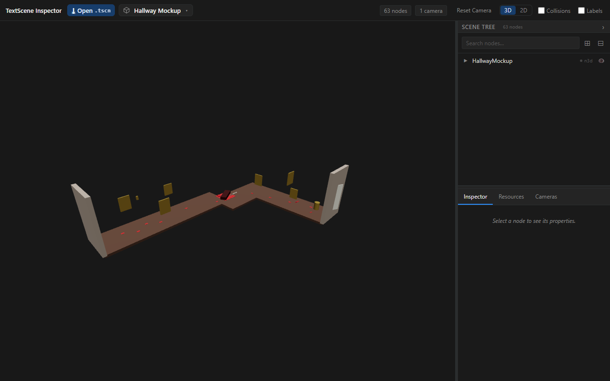

# Web previewer user guide

The web previewer renders a Godot `.tscn` scene in the browser.

- Public edition: [vortiago.github.io/textscene-inspector](https://vortiago.github.io/textscene-inspector/)
- Local: `pnpm dev:web`, then open `http://localhost:3000/`

## Open a scene

- Click **Open .tscn** and pick a file.
- Drag files onto the page. Drop a scene and its textures together. Add `project.godot` for the project's settings, such as `gui/theme/custom_font`, the default font of every Control, and a model's `.import` file for its import settings.
- Press <kbd>Ctrl/Cmd+K</kbd> to open the scene palette. The dev edition also lists the built-in scenes.

The app reopens your last scene on the next visit.
It does not watch files on disk. After you edit a file, open it again. This resets the camera.

In the dev edition, a link can open a scene:

| Query | Opens |
| --- | --- |
| `?fixture=<file>` | That built-in scene |
| `&camera=<node path>` | The view through that Camera3D, for example `Root/Camera3D` |

## Move the camera

The 3D viewport uses Godot's editor controls. Press <kbd>?</kbd> in the viewport for the full list, including trackpad and touch.
If zoom stops before you are close enough, select the node and press <kbd>F</kbd>, or fly there with freelook.

To fly, click **Freelook** over the viewport or press <kbd>Shift</kbd>+<kbd>F</kbd>.
The pointer hides, the mouse looks around, and <kbd>W</kbd> <kbd>A</kbd> <kbd>S</kbd> <kbd>D</kbd> or the arrow keys move.
<kbd>E</kbd> or <kbd>Space</kbd> goes up and <kbd>Q</kbd> goes down. <kbd>Shift</kbd> is faster, <kbd>Alt</kbd> is slower, and the wheel changes the speed.
<kbd>Esc</kbd> leaves freelook. A held right mouse button does the same without the toggle.

To look through a Camera3D, check **Preview** in its Inspector, or pick it in the **Cameras** tab.
As in Godot, the viewport ignores navigation while it previews a camera, so neither camera moves.
**Editor camera** in the **Cameras** tab, or **Reset Camera** over the viewport, ends the preview.

The **3D/2D** switch over the viewport changes the view. A scene with only Control or Node2D content shows a hint to switch.

## Inspect nodes

The right dock holds the scene tree above three tabs.

- **Scene tree:** click a node to select it. Search, expand and collapse, and hide nodes with the eye icon.
  A **Not Implemented** chip marks a type that the previewer parses but does not draw.
- **Inspector:** the type, path and properties of the selected node.
- **Resources:** the files the scene needs, and which are missing.
- **Cameras:** view the scene through one of its Camera3D nodes.

A click on a mesh in the viewport also selects it.
Lights, cameras and particle emitters have no geometry, so they show a wireframe gizmo. The **Gizmos** toggle in **Display** shows or hides every gizmo, and it is on by default. As in Godot, some gizmos draw for every node and fade when the node is not selected: an emitter box, a path curve, a spring arm, a vehicle wheel, a camera frustum, a decal box, a visibility notifier, a fog volume and a GPU particles collision or attractor volume. A marker, a 2D path and a light occluder draw at full colour. A gizmo of a node inside an instanced scene is grey, as in Godot, unless the scene file lists the instance with `[editable]`. Lights, audio players, reflection probes and VoxelGI draw their gizmo only for the selected node.

## Fix a missing file

A mesh whose texture is missing renders **magenta**. The Resources tab lists each missing `res://` path with ⚠.

1. Open the **Resources** tab.
2. Click the file input on the row for the missing path.
3. Pick the file.

The mesh updates at once, and the row shows ✓. Every mesh that uses the file updates. **Remove** makes the path missing again.
An uploaded file stays when you open another scene.

A `.tres` or a scene that reads a missing file in a `[sub_resource]` fails to load in Godot. Its row says **Fails to load** with the chain of files, and the upload replaces the file that is missing. When the scene you preview fails this way, the Resources tab says **The game would fail to load this scene**, with Godot's error and the chain. The preview still draws the scene.

## Edit the source

Click **Show Source** in the toolbar to open the Source pane. The scene renders again as you type.

- A dot in the gutter marks an error or a warning. Hover or tap it to read the message.
- The badge on **Show Source** counts the problems. A file-level section holds the problems that have no line.
- **Download .tscn** saves the text.

If the file cannot be parsed, a red banner shows the error. The app keeps working.

## Sky shaders

A WorldEnvironment whose Sky has a ShaderMaterial draws the shader as Godot does. The shader draws the background, and the previewer bakes it into the sky's radiance for the ambient light and the reflections. The previewer loads its shader translator only for a scene with a sky shader.

- If Godot does not compile the shader, the previewer draws Godot's default black sky. The Inspector of the WorldEnvironment shows Godot's error and its line under **Shader Error**.
- If the previewer does not translate a part of the shader yet, it also draws the default sky. The message under **Shader Error** names the part.
- An `#if` can call `decompress` in Zstandard or Brotli mode. The previewer loads its decoders only for a shader that names `decompress`.
- The shader reads the scene's suns through `LIGHT0_*` to `LIGHT3_*`, and draws its half and quarter resolution passes when it sets `use_half_res_pass` or `use_quarter_res_pass`.
- A pass can write `ALPHA`, and a later pass reads it as `HALF_RES_COLOR.a` or `QUARTER_RES_COLOR.a`, as in Godot. A sky can lay clouds over itself this way. `ALPHA` does not make the background see-through.
- The background and the half and quarter resolution passes read the sky's own radiance through `RADIANCE`, as in Godot. A bias picks the mip level. In the radiance bake `RADIANCE` reads black, so a shader draws the bake's colour under `AT_CUBEMAP_PASS`.
- A sky that reads `TIME` or `POSITION` bakes its radiance again when `TIME` moves forward or the camera moves, as Godot does. A stop or a seek bakes it again too. After `TIME` wraps, the radiance waits until `TIME` passes its last value again, as in Godot. The reflections and the ambient light then follow the background. The sky's process mode sets how: Real-Time and Quality bake every layer at once, and Incremental bakes one layer in each frame.
- A sky that reads the suns bakes its radiance again when a sun moves or changes, as Godot does. This holds for a ProceduralSkyMaterial and a PhysicalSkyMaterial too. The process mode sets how, as for `TIME`. Under Incremental, rough reflections follow a moving sun a few frames late, as in Godot.

`TIME` follows the **Timeline** while it shows an AnimationPlayer. Play advances `TIME`, pause holds it, a seek sets it to the playhead, and stop sets it to 0. With no AnimationPlayer, `TIME` advances every frame, as in a running game. `TIME` wraps at the project setting `rendering/limits/time/time_rollover_secs`, 3600 seconds by default. Drop `project.godot` with the scene to use another value.

## On a phone

The page fits a phone screen. The layout also applies to a narrow VS Code preview tab.

- The viewport is on top. A panel under it holds the scene tree or the node details.
- Tap **Scene** or **Details** to switch the panel.
- Drag the bar at the top of the panel to resize it. Tap **▾** to collapse the panel, and tap the **Scene** bar to open it again.
- The Source pane is closed on a first visit. Tap **Source** to open it over the preview.
- One finger orbits the 3D view, two fingers pan, and a pinch zooms. Tap a node to select it.

## Other tools

- **Timeline:** select an AnimationPlayer, AnimationTree or AnimatedSprite2D to play, pause and scrub it.
- **Display:** show or hide the viewport overlays, such as the gizmos, the collision shapes and the grid.
- **Screenshot:** save the rendered scene in the current view, 3D or 2D, as a PNG. The 2D frame, axes and size label are not part of it.
